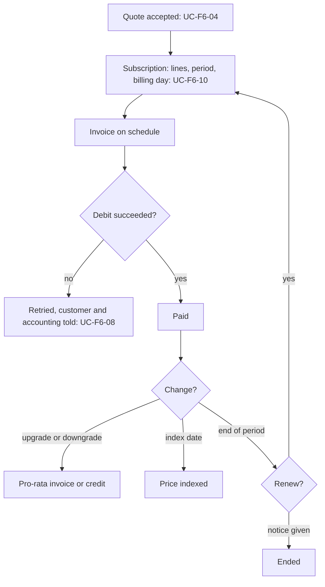

🏠 [Specs](../../../README.md) › 🧩 [Functional capabilities](../../README.md) ›
🛒 [F6 Customers and sales](../README.md) › 🔀 [Flows](README.md) › 🔀 FL-F6-04 Subscriptions

# 🔀 FL-F6-04 Subscriptions

**Status:** ✅ specified

## Summary

A recurring contract from signature to renewal: billed on schedule, collected by SEPA direct debit or card at the
provider, upgraded or downgraded with pro-rata, indexed on its date, renewed or ended within the notice, managed by the
customer in the portal.

## Personas

- [U03 Sales](../../../01-users/personas/u03-sales.md)
- [U05 Accounting](../../../01-users/personas/u05-accounting.md)
- [U09 Customer](../../../01-users/personas/u09-customer.md)

## Flowchart

## Sequence diagram

See each use case.

## Steps

| Step | Persona | Screen | Use case | What happens |
|---|---|---|---|---|
| 1 | [U03](../../../01-users/personas/u03-sales.md) | [S-F6-09](../screens/04-subscriptions/s-f06-09-subscriptions.md) | [UC-F6-10](../use-cases/04-subscriptions/uc-f06-10-manage-subscriptions.md) | Create the subscription from the accepted quote |
| 2 | [U05](../../../01-users/personas/u05-accounting.md) | [S-F6-06](../screens/03-invoice-and-get-paid/s-f06-06-invoice.md) | [UC-F6-10](../use-cases/04-subscriptions/uc-f06-10-manage-subscriptions.md) | Invoices issued and collected on schedule |
| 3 | [U09](../../../01-users/personas/u09-customer.md) | [S-F6-04](../screens/02-quote-to-order/s-f06-04-customer-portal.md) | [UC-F6-11](../use-cases/02-quote-to-order/uc-f06-11-use-the-customer-portal.md) | The customer upgrades or ends it in the portal |
| 4 | [U05](../../../01-users/personas/u05-accounting.md) | [S-F6-08](../screens/03-invoice-and-get-paid/s-f06-08-reminders.md) | [UC-F6-08](../use-cases/03-invoice-and-get-paid/uc-f06-08-remind-late-payers.md) | A failed debit is retried and reminded |
| 5 | [U05](../../../01-users/personas/u05-accounting.md) | [S-F6-09](../screens/04-subscriptions/s-f06-09-subscriptions.md) | [UC-F6-10](../use-cases/04-subscriptions/uc-f06-10-manage-subscriptions.md) | The price is indexed and the contract renewed |

### Entities and screens

| Entity | States in this flow | Shown at step and screen | Aggregated view |
|---|---|---|---|
| [E-F6-03 Quote](../data/e-f06-03-quote.md) | Draft, To approve, Sent, Accepted | 3 [S-F6-04](../screens/02-quote-to-order/s-f06-04-customer-portal.md) | Quotes |
| [E-F6-07 Subscription contract](../data/e-f06-07-subscription-contract.md) | Active | 1, 5 [S-F6-09](../screens/04-subscriptions/s-f06-09-subscriptions.md); 3 [S-F6-04](../screens/02-quote-to-order/s-f06-04-customer-portal.md) | Subscription contracts |
| [E-F6-05 Invoice](../data/e-f06-05-invoice.md) | Sent, Received, Paid, Draft, Issued | 2 [S-F6-06](../screens/03-invoice-and-get-paid/s-f06-06-invoice.md); 3 [S-F6-04](../screens/02-quote-to-order/s-f06-04-customer-portal.md); 4 [S-F6-08](../screens/03-invoice-and-get-paid/s-f06-08-reminders.md) | Invoices |
| [E-F6-06 Customer payment](../data/e-f06-06-customer-payment.md) | Matched, Refused | 2 [S-F6-06](../screens/03-invoice-and-get-paid/s-f06-06-invoice.md) | Customer payments |

## Errors

A failed debit, a cancellation after the notice period, an index not published on the date (BR-F6-05, BR-F6-08).

## Images

Every step and error, for each persona taking part, in light and dark mode (D120). Steps are numbered as in the Steps
table; E rows are the error cases.

| Step | Persona | Device | Light | Dark |
|---|---|---|---|---|
| 1 | U03 | desktop | [light](../images/04-subscriptions/u03-sales/1-subscriptions-desktop-light.png) | [dark](../images/04-subscriptions/u03-sales/1-subscriptions-desktop-dark.png) |
| 1 | U03 | phone | [light](../images/04-subscriptions/u03-sales/1-subscriptions-phone-light.png) | [dark](../images/04-subscriptions/u03-sales/1-subscriptions-phone-dark.png) |
| 1 | U03 | tablet | [light](../images/04-subscriptions/u03-sales/1-subscriptions-tablet-light.png) | [dark](../images/04-subscriptions/u03-sales/1-subscriptions-tablet-dark.png) |
| E1 | U05 | desktop | [light](../images/04-subscriptions/u05-accounting/e1-failed-debit-desktop-light.png) | [dark](../images/04-subscriptions/u05-accounting/e1-failed-debit-desktop-dark.png) |
| 2 | U05 | desktop | [light](../images/04-subscriptions/u05-accounting/2-invoice-desktop-light.png) | [dark](../images/04-subscriptions/u05-accounting/2-invoice-desktop-dark.png) |
| 3 | U09 | phone | [light](../images/04-subscriptions/u09-customer/3-customer-portal-phone-light.png) | [dark](../images/04-subscriptions/u09-customer/3-customer-portal-phone-dark.png) |
| 4 | U05 | desktop | [light](../images/04-subscriptions/u05-accounting/4-reminders-desktop-light.png) | [dark](../images/04-subscriptions/u05-accounting/4-reminders-desktop-dark.png) |
| 5 | U05 | desktop | [light](../images/04-subscriptions/u05-accounting/5-subscriptions-desktop-light.png) | [dark](../images/04-subscriptions/u05-accounting/5-subscriptions-desktop-dark.png) |

## Open questions

None.

---

⬅️ [FL-F6-03 Invoice and get paid](fl-f06-03-invoice-and-get-paid.md) · ⬆️ [Up](README.md) ·
➡️ [FL-F6-05 Benchmark additions](fl-f06-05-benchmark-additions.md)
