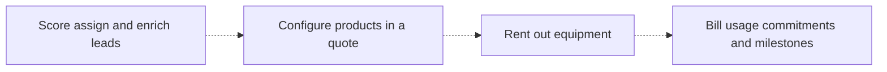

🏠 [Specs](../../../README.md) › 🧩 [Functional capabilities](../../README.md) ›
🛒 [F6 Customers and sales](../README.md) › 🔀 [Flows](README.md) › 🔀 FL-F6-05 Benchmark additions

# 🔀 FL-F6-05 Benchmark additions

**Status:** ✅ specified

## Summary

The benchmark additions of D304: UC-F6-13, UC-F6-14, UC-F6-15, UC-F6-16. Each step stands on its own.

## Personas

- [U02 Manager](../../../01-users/personas/u02-manager.md)
- [U03 Sales](../../../01-users/personas/u03-sales.md)
- [U05 Accounting](../../../01-users/personas/u05-accounting.md)
- [U09 Customer](../../../01-users/personas/u09-customer.md)
- [U15 Warehouse operator](../../../01-users/personas/u15-warehouse-operator.md)

## Flowchart

## Sequence diagram

See each use case.

## Steps

| Step | Persona | Screen | Use case | What happens |
|---|---|---|---|---|
| 1 | U03, U02 | [S-F6-11](../screens/05-benchmark-additions/s-f06-11-lead-scoring.md) | [UC-F6-13](../use-cases/05-benchmark-additions/uc-f06-13-score-assign-and-enrich-leads.md) | Score, assign and enrich leads |
| 2 | U03 | [S-F6-12](../screens/05-benchmark-additions/s-f06-12-product-configurator.md) | [UC-F6-14](../use-cases/05-benchmark-additions/uc-f06-14-configure-products-in-a-quote.md) | Configure products in a quote |
| 3 | U03, U15, U09 | [S-F6-13](../screens/05-benchmark-additions/s-f06-13-rentals.md) | [UC-F6-15](../use-cases/05-benchmark-additions/uc-f06-15-rent-out-equipment.md) | Rent out equipment |
| 4 | U05, U03 | [S-F6-14](../screens/05-benchmark-additions/s-f06-14-usage-billing.md) | [UC-F6-16](../use-cases/05-benchmark-additions/uc-f06-16-bill-usage-commitments-and-milestones.md) | Bill usage, commitments and milestones |

### Entities and screens

| Entity | States in this flow | Shown at step and screen | Aggregated view |
|---|---|---|---|
| [E-F6-20 Lead](../data/e-f06-20-lead.md) | Active | 1 [S-F6-11](../screens/05-benchmark-additions/s-f06-11-lead-scoring.md) | Leads |
| [E-F7-06 Item](../../f07-purchasing-and-stock/data/e-f07-06-item.md) | Active | Shown elsewhere: [S-F7-21 Stock levels](../../f07-purchasing-and-stock/screens/03-replenish/s-f07-21-stock-levels.md) | Items |
| [E-F6-03 Quote](../data/e-f06-03-quote.md) | Draft, To approve, Refused, Sent, Expired, Accepted | Shown elsewhere: [S-F6-03 Quote editor](../screens/01-lead-to-quote/s-f06-03-quote-editor.md) | Quotes |
| [E-F6-10 Rate plan and meter](../data/e-f06-10-rate-plan-and-meter.md) | Active | 4 [S-F6-14](../screens/05-benchmark-additions/s-f06-14-usage-billing.md) | Rate plan and meters |
| [E-SC03-08 Milestone](../../../08-sectors/sc03-services/data/e-sc03-08-milestone.md) | Planned, Accepted, Billed | Shown elsewhere: [S-SC03-07 Milestones](../../../08-sectors/sc03-services/screens/04-bill-and-recognise/s-sc03-07-milestones.md) | Milestones |

## Errors

As each use case; E1 shows one of them.

## Images

Every step and error, for each persona taking part, in light and dark mode (D120). Steps are numbered as in the Steps
table; E rows are the error cases.

| Step | Persona | Device | Light | Dark |
|---|---|---|---|---|
| 1 | U03 | desktop | [light](../images/05-benchmark-additions/u03-sales/1-lead-scoring-desktop-light.png) | [dark](../images/05-benchmark-additions/u03-sales/1-lead-scoring-desktop-dark.png) |
| 1 | U03 | phone | [light](../images/05-benchmark-additions/u03-sales/1-lead-scoring-phone-light.png) | [dark](../images/05-benchmark-additions/u03-sales/1-lead-scoring-phone-dark.png) |
| 1 | U03 | tablet | [light](../images/05-benchmark-additions/u03-sales/1-lead-scoring-tablet-light.png) | [dark](../images/05-benchmark-additions/u03-sales/1-lead-scoring-tablet-dark.png) |
| 1 | U02 | desktop | [light](../images/05-benchmark-additions/u02-manager/1-lead-scoring-desktop-light.png) | [dark](../images/05-benchmark-additions/u02-manager/1-lead-scoring-desktop-dark.png) |
| 1 | U02 | phone | [light](../images/05-benchmark-additions/u02-manager/1-lead-scoring-phone-light.png) | [dark](../images/05-benchmark-additions/u02-manager/1-lead-scoring-phone-dark.png) |
| 2 | U03 | desktop | [light](../images/05-benchmark-additions/u03-sales/2-configurator-desktop-light.png) | [dark](../images/05-benchmark-additions/u03-sales/2-configurator-desktop-dark.png) |
| 2 | U03 | phone | [light](../images/05-benchmark-additions/u03-sales/2-configurator-phone-light.png) | [dark](../images/05-benchmark-additions/u03-sales/2-configurator-phone-dark.png) |
| 2 | U03 | tablet | [light](../images/05-benchmark-additions/u03-sales/2-configurator-tablet-light.png) | [dark](../images/05-benchmark-additions/u03-sales/2-configurator-tablet-dark.png) |
| 3 | U03 | desktop | [light](../images/05-benchmark-additions/u03-sales/3-rental-desktop-light.png) | [dark](../images/05-benchmark-additions/u03-sales/3-rental-desktop-dark.png) |
| 3 | U03 | phone | [light](../images/05-benchmark-additions/u03-sales/3-rental-phone-light.png) | [dark](../images/05-benchmark-additions/u03-sales/3-rental-phone-dark.png) |
| 3 | U03 | tablet | [light](../images/05-benchmark-additions/u03-sales/3-rental-tablet-light.png) | [dark](../images/05-benchmark-additions/u03-sales/3-rental-tablet-dark.png) |
| 3 | U09 | phone | [light](../images/05-benchmark-additions/u09-customer/3-rental-phone-light.png) | [dark](../images/05-benchmark-additions/u09-customer/3-rental-phone-dark.png) |
| 3 | U15 | phone | [light](../images/05-benchmark-additions/u15-warehouse-operator/3-rental-phone-light.png) | [dark](../images/05-benchmark-additions/u15-warehouse-operator/3-rental-phone-dark.png) |
| 3 | U15 | tablet | [light](../images/05-benchmark-additions/u15-warehouse-operator/3-rental-tablet-light.png) | [dark](../images/05-benchmark-additions/u15-warehouse-operator/3-rental-tablet-dark.png) |
| 4 | U05 | desktop | [light](../images/05-benchmark-additions/u05-accounting/4-usage-billing-desktop-light.png) | [dark](../images/05-benchmark-additions/u05-accounting/4-usage-billing-desktop-dark.png) |
| 4 | U03 | desktop | [light](../images/05-benchmark-additions/u03-sales/4-usage-billing-desktop-light.png) | [dark](../images/05-benchmark-additions/u03-sales/4-usage-billing-desktop-dark.png) |
| 4 | U03 | phone | [light](../images/05-benchmark-additions/u03-sales/4-usage-billing-phone-light.png) | [dark](../images/05-benchmark-additions/u03-sales/4-usage-billing-phone-dark.png) |
| 4 | U03 | tablet | [light](../images/05-benchmark-additions/u03-sales/4-usage-billing-tablet-light.png) | [dark](../images/05-benchmark-additions/u03-sales/4-usage-billing-tablet-dark.png) |
| E1 | U03 | desktop | [light](../images/05-benchmark-additions/u03-sales/e1-double-booked-desktop-light.png) | [dark](../images/05-benchmark-additions/u03-sales/e1-double-booked-desktop-dark.png) |
| E1 | U03 | phone | [light](../images/05-benchmark-additions/u03-sales/e1-double-booked-phone-light.png) | [dark](../images/05-benchmark-additions/u03-sales/e1-double-booked-phone-dark.png) |
| E1 | U03 | tablet | [light](../images/05-benchmark-additions/u03-sales/e1-double-booked-tablet-light.png) | [dark](../images/05-benchmark-additions/u03-sales/e1-double-booked-tablet-dark.png) |

## Open questions

None.

---

⬅️ [FL-F6-04 Subscriptions](fl-f06-04-subscriptions.md) · ⬆️ [Up](README.md) ·
➡️ [FL-F6-06 Accounts and credit](fl-f06-06-accounts-and-credit.md)
