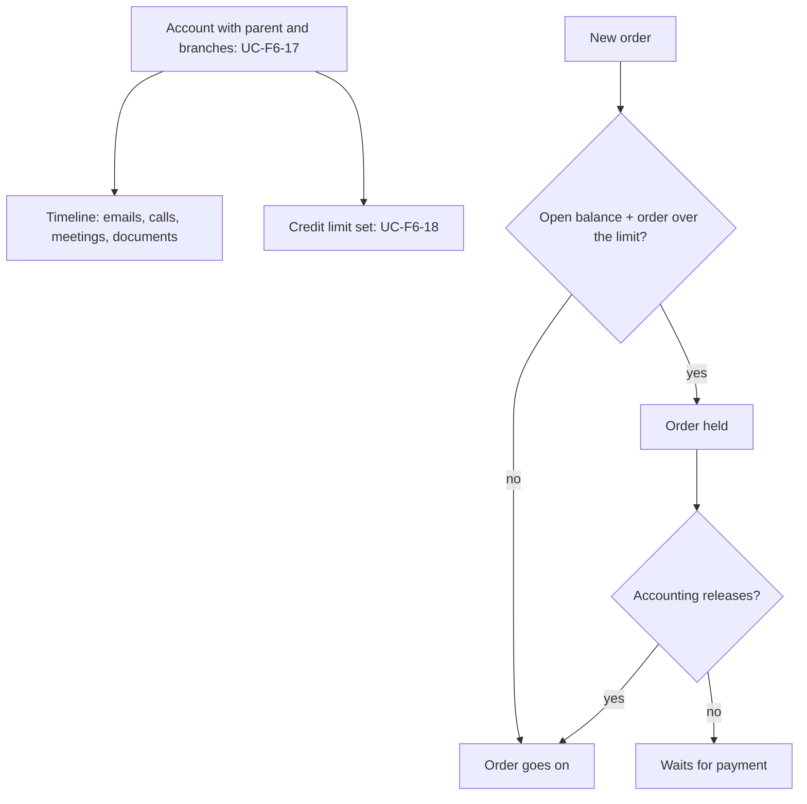

🏠 [Specs](../../../README.md) › 🧩 [Functional capabilities](../../README.md) ›
🛒 [F6 Customers and sales](../README.md) › 🔀 [Flows](README.md) › 🔀 FL-F6-06 Accounts and credit

# 🔀 FL-F6-06 Accounts and credit

**Status:** ✅ specified

## Summary

A customer seen as a group of accounts (head office, branches) with one timeline of emails, calls, meetings and
documents, and a credit limit that holds orders when it is passed.

## Personas

- [U03 Sales](../../../01-users/personas/u03-sales.md)
- [U05 Accounting](../../../01-users/personas/u05-accounting.md)

## Flowchart

## Sequence diagram

- [UC-F6-18 Set a credit limit and hold orders](../use-cases/06-accounts-and-credit/uc-f06-18-set-a-credit-limit-and-hold-orders.md#sequence-diagram)

## Steps

| Step | Persona | Screen | Use case | What happens |
|---|---|---|---|---|
| 1 | [U03](../../../01-users/personas/u03-sales.md) | [S-F6-15](../screens/06-accounts-and-credit/s-f06-15-account.md) | [UC-F6-17](../use-cases/06-accounts-and-credit/uc-f06-17-organise-accounts-with-their-timeline-and-emails.md) | Open an account with its branches and timeline |
| 2 | [U05](../../../01-users/personas/u05-accounting.md) | [S-F6-16](../screens/06-accounts-and-credit/s-f06-16-credit-control.md) | [UC-F6-18](../use-cases/06-accounts-and-credit/uc-f06-18-set-a-credit-limit-and-hold-orders.md) | Set the credit limit of a customer group |
| 3 | [U03](../../../01-users/personas/u03-sales.md) | [S-F6-05](../screens/02-quote-to-order/s-f06-05-order.md) | [UC-F6-18](../use-cases/06-accounts-and-credit/uc-f06-18-set-a-credit-limit-and-hold-orders.md) | An order over the limit is held |
| 4 | [U05](../../../01-users/personas/u05-accounting.md) | [S-F6-16](../screens/06-accounts-and-credit/s-f06-16-credit-control.md) | [UC-F6-18](../use-cases/06-accounts-and-credit/uc-f06-18-set-a-credit-limit-and-hold-orders.md) | Release or keep the hold |

### Entities and screens

| Entity | States in this flow | Shown at step and screen | Aggregated view |
|---|---|---|---|
| [E-F6-01 Customer record](../data/e-f06-01-customer-record.md) | Accepted, Active | 1 [S-F6-15](../screens/06-accounts-and-credit/s-f06-15-account.md) | Customer records |
| [E-F6-11 Timeline entry](../data/e-f06-11-timeline-entry.md) | Recorded | 1 [S-F6-15](../screens/06-accounts-and-credit/s-f06-15-account.md) | Timeline entries |
| [E-F4-01 Meeting](../../f04-meetings/data/e-f04-01-meeting.md) | Planned, Live, Ended, Waiting for review, Checked | Shown elsewhere: [S-F4-01 Meeting](../../f04-meetings/screens/01-record-an-online-meeting/s-f04-01-meeting.md) | Meetings |
| [E-F2-13 Document](../../f02-no-code-configuration/data/e-f02-13-document.md) | To sort, To validate, Done | Shown elsewhere: [S-F2-13 Documents workspace](../../f02-no-code-configuration/screens/07-benchmark-additions/s-f02-13-documents-workspace.md) | Documents |
| [E-F6-12 Credit limit](../data/e-f06-12-credit-limit.md) | Active | 2, 4 [S-F6-16](../screens/06-accounts-and-credit/s-f06-16-credit-control.md); 3 [S-F6-05](../screens/02-quote-to-order/s-f06-05-order.md) | Credit limits |
| [E-F6-04 Order](../data/e-f06-04-order.md) | Open | 2, 4 [S-F6-16](../screens/06-accounts-and-credit/s-f06-16-credit-control.md); 3 [S-F6-05](../screens/02-quote-to-order/s-f06-05-order.md) | Orders |
| [E-F6-06 Customer payment](../data/e-f06-06-customer-payment.md) | Matched | Shown elsewhere: [S-F6-07 Payments and reconciliation](../screens/03-invoice-and-get-paid/s-f06-07-payments-and-reconciliation.md) | Customer payments |

## Errors

A branch attached to two parents, an email not matched to an account, an order held while the customer has paid
(BR-F6-11).

## Images

Every step and error, for each persona taking part, in light and dark mode (D120). Steps are numbered as in the Steps
table; E rows are the error cases.

| Step | Persona | Device | Light | Dark |
|---|---|---|---|---|
| 1 | U03 | desktop | [light](../images/06-accounts-and-credit/u03-sales/1-account-desktop-light.png) | [dark](../images/06-accounts-and-credit/u03-sales/1-account-desktop-dark.png) |
| 1 | U03 | phone | [light](../images/06-accounts-and-credit/u03-sales/1-account-phone-light.png) | [dark](../images/06-accounts-and-credit/u03-sales/1-account-phone-dark.png) |
| 1 | U03 | tablet | [light](../images/06-accounts-and-credit/u03-sales/1-account-tablet-light.png) | [dark](../images/06-accounts-and-credit/u03-sales/1-account-tablet-dark.png) |
| 2 | U05 | desktop | [light](../images/06-accounts-and-credit/u05-accounting/2-credit-control-desktop-light.png) | [dark](../images/06-accounts-and-credit/u05-accounting/2-credit-control-desktop-dark.png) |
| 3 | U03 | desktop | [light](../images/06-accounts-and-credit/u03-sales/3-order-desktop-light.png) | [dark](../images/06-accounts-and-credit/u03-sales/3-order-desktop-dark.png) |
| 3 | U03 | phone | [light](../images/06-accounts-and-credit/u03-sales/3-order-phone-light.png) | [dark](../images/06-accounts-and-credit/u03-sales/3-order-phone-dark.png) |
| 3 | U03 | tablet | [light](../images/06-accounts-and-credit/u03-sales/3-order-tablet-light.png) | [dark](../images/06-accounts-and-credit/u03-sales/3-order-tablet-dark.png) |
| 4 | U05 | desktop | [light](../images/06-accounts-and-credit/u05-accounting/4-credit-control-desktop-light.png) | [dark](../images/06-accounts-and-credit/u05-accounting/4-credit-control-desktop-dark.png) |
| E1 | U03 | desktop | [light](../images/06-accounts-and-credit/u03-sales/e1-account-refused-desktop-light.png) | [dark](../images/06-accounts-and-credit/u03-sales/e1-account-refused-desktop-dark.png) |
| E1 | U03 | phone | [light](../images/06-accounts-and-credit/u03-sales/e1-account-refused-phone-light.png) | [dark](../images/06-accounts-and-credit/u03-sales/e1-account-refused-phone-dark.png) |
| E1 | U03 | tablet | [light](../images/06-accounts-and-credit/u03-sales/e1-account-refused-tablet-light.png) | [dark](../images/06-accounts-and-credit/u03-sales/e1-account-refused-tablet-dark.png) |

## Open questions

None.

---

⬅️ [FL-F6-05 Benchmark additions](fl-f06-05-benchmark-additions.md) · ⬆️ [Up](README.md) ·
➡️ [FL-F6-07 Special invoicing](fl-f06-07-special-invoicing.md)
