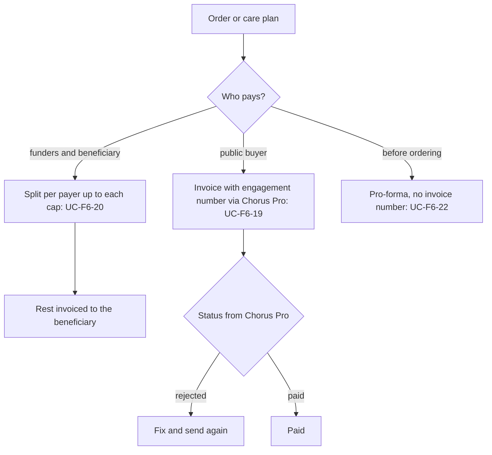

🏠 [Specs](../../../README.md) › 🧩 [Functional capabilities](../../README.md) ›
🛒 [F6 Customers and sales](../README.md) › 🔀 [Flows](README.md) › 🔀 FL-F6-07 Special invoicing

# 🔀 FL-F6-07 Special invoicing

**Status:** ✅ specified

## Summary

Invoices that are not one customer and one amount: public buyers through Chorus Pro, several payers (funders with caps
and the beneficiary), and pro-forma invoices before an order.

## Personas

- [U05 Accounting](../../../01-users/personas/u05-accounting.md)

## Flowchart

## Sequence diagram

- [UC-F6-20 Invoice several payers with funders and caps](../use-cases/07-special-invoicing/uc-f06-20-invoice-several-payers-with-funders-and-caps.md#sequence-diagram)

## Steps

| Step | Persona | Screen | Use case | What happens |
|---|---|---|---|---|
| 1 | [U05](../../../01-users/personas/u05-accounting.md) | [S-F6-06](../screens/03-invoice-and-get-paid/s-f06-06-invoice.md) | [UC-F6-19](../use-cases/07-special-invoicing/uc-f06-19-invoice-a-public-buyer-through-chorus-pro.md) | Invoice a town hall through Chorus Pro |
| 2 | [U05](../../../01-users/personas/u05-accounting.md) | [S-F6-17](../screens/07-special-invoicing/s-f06-17-funders-and-caps.md) | [UC-F6-20](../use-cases/07-special-invoicing/uc-f06-20-invoice-several-payers-with-funders-and-caps.md) | Split a care invoice between the département and the recipient |
| 3 | [U05](../../../01-users/personas/u05-accounting.md) | [S-F6-23](../screens/07-special-invoicing/s-f06-23-pro-forma-invoice.md) | [UC-F6-22](../use-cases/07-special-invoicing/uc-f06-22-issue-a-pro-forma-invoice-and-a-statement-of-account.md) | Send a pro-forma invoice |

### Entities and screens

| Entity | States in this flow | Shown at step and screen | Aggregated view |
|---|---|---|---|
| [E-F6-04 Order](../data/e-f06-04-order.md) | Open, In progress, Cancelled, Done | Shown elsewhere: [S-F6-05 Order](../screens/02-quote-to-order/s-f06-05-order.md) | Orders |
| [E-SC04-03 Care plan](../../../08-sectors/sc04-home-care/data/e-sc04-03-care-plan.md) | Active | Shown elsewhere: [S-SC04-02 Care plan](../../../08-sectors/sc04-home-care/screens/01-take-on-a-recipient/s-sc04-02-care-plan.md) | Care plans |
| [E-F6-05 Invoice](../data/e-f06-05-invoice.md) | Sent, Received, Paid | 1 [S-F6-06](../screens/03-invoice-and-get-paid/s-f06-06-invoice.md); 2 [S-F6-17](../screens/07-special-invoicing/s-f06-17-funders-and-caps.md); 3 [S-F6-23](../screens/07-special-invoicing/s-f06-23-pro-forma-invoice.md) | Invoices |
| [E-F6-14 Funder agreement](../data/e-f06-14-funder-agreement.md) | Active, Expired | 1 [S-F6-06](../screens/03-invoice-and-get-paid/s-f06-06-invoice.md); 2 [S-F6-17](../screens/07-special-invoicing/s-f06-17-funders-and-caps.md) | Funder agreements |
| [E-F6-15 Pro-forma invoice](../data/e-f06-15-pro-forma-invoice.md) | Issued, Superseded, Expired | 3 [S-F6-23](../screens/07-special-invoicing/s-f06-23-pro-forma-invoice.md) | Pro-forma invoices |
| [E-SC04-08 Care invoice](../../../08-sectors/sc04-home-care/data/e-sc04-08-care-invoice.md) | Sent, Issued | Shown elsewhere: [S-SC04-08 Billing](../../../08-sectors/sc04-home-care/screens/04-bill-and-fund/s-sc04-08-billing.md) | Care invoices |

## Errors

A missing engagement number, a cap reached mid-month, a pro-forma taken for an invoice (BR-F6-12, BR-F6-13, BR-F6-15).

## Images

Every step and error, for each persona taking part, in light and dark mode (D120). Steps are numbered as in the Steps
table; E rows are the error cases.

| Step | Persona | Device | Light | Dark |
|---|---|---|---|---|
| 1 | U05 | desktop | [light](../images/07-special-invoicing/u05-accounting/1-invoice-desktop-light.png) | [dark](../images/07-special-invoicing/u05-accounting/1-invoice-desktop-dark.png) |
| 2 | U05 | desktop | [light](../images/07-special-invoicing/u05-accounting/2-funders-and-caps-desktop-light.png) | [dark](../images/07-special-invoicing/u05-accounting/2-funders-and-caps-desktop-dark.png) |
| 3 | U05 | desktop | [light](../images/07-special-invoicing/u05-accounting/3-pro-forma-and-statements-desktop-light.png) | [dark](../images/07-special-invoicing/u05-accounting/3-pro-forma-and-statements-desktop-dark.png) |
| E1 | U05 | desktop | [light](../images/07-special-invoicing/u05-accounting/e1-invoice-refused-desktop-light.png) | [dark](../images/07-special-invoicing/u05-accounting/e1-invoice-refused-desktop-dark.png) |

## Open questions

None.

---

⬅️ [FL-F6-06 Accounts and credit](fl-f06-06-accounts-and-credit.md) · ⬆️ [Up](README.md) ·
➡️ [FL-F6-08 Collect and settle](fl-f06-08-collect-and-settle.md)
