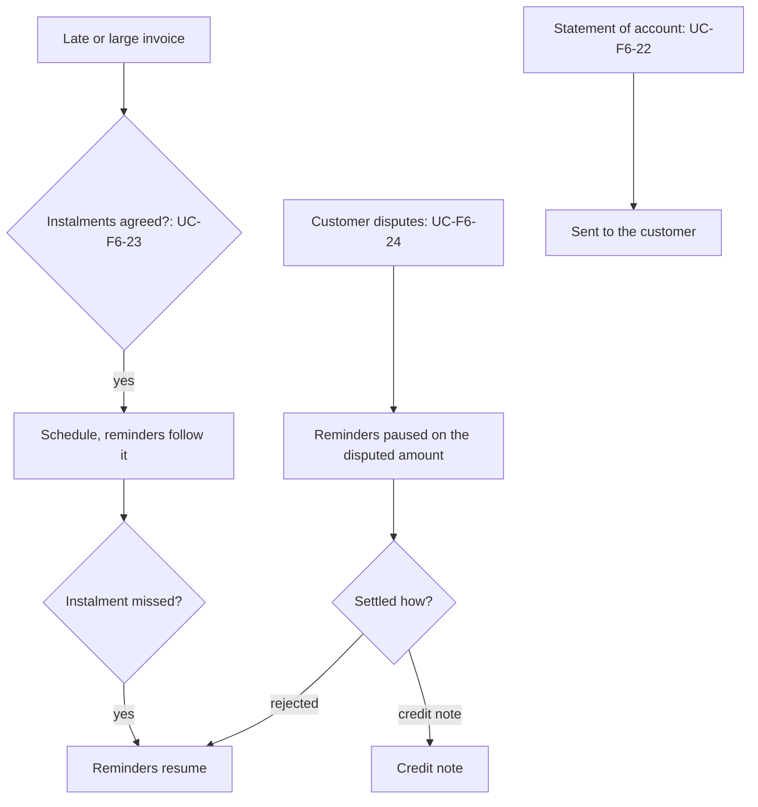

🏠 [Specs](../../../README.md) › 🧩 [Functional capabilities](../../README.md) ›
🛒 [F6 Customers and sales](../README.md) › 🔀 [Flows](README.md) › 🔀 FL-F6-08 Collect and settle

# 🔀 FL-F6-08 Collect and settle

**Status:** ✅ specified

## Summary

Customers pay in instalments when agreed, disputes pause reminders on what is disputed, and statements of account show
where each customer stands.

## Personas

- [U05 Accounting](../../../01-users/personas/u05-accounting.md)
- [U09 Customer](../../../01-users/personas/u09-customer.md)

## Flowchart

## Sequence diagram

- [UC-F6-24 Handle a disputed invoice](../use-cases/08-collect-and-settle/uc-f06-24-handle-a-disputed-invoice.md#sequence-diagram)

## Steps

| Step | Persona | Screen | Use case | What happens |
|---|---|---|---|---|
| 1 | [U05](../../../01-users/personas/u05-accounting.md) | [S-F6-20](../screens/08-collect-and-settle/s-f06-20-instalments-and-disputes.md) | [UC-F6-23](../use-cases/08-collect-and-settle/uc-f06-23-agree-an-instalment-plan.md) | Agree an instalment plan |
| 2 | [U09](../../../01-users/personas/u09-customer.md) | [S-F6-04](../screens/02-quote-to-order/s-f06-04-customer-portal.md) | [UC-F6-24](../use-cases/08-collect-and-settle/uc-f06-24-handle-a-disputed-invoice.md) | The customer disputes an invoice on the portal |
| 3 | [U05](../../../01-users/personas/u05-accounting.md) | [S-F6-20](../screens/08-collect-and-settle/s-f06-20-instalments-and-disputes.md) | [UC-F6-24](../use-cases/08-collect-and-settle/uc-f06-24-handle-a-disputed-invoice.md) | Settle the dispute |
| 4 | [U05](../../../01-users/personas/u05-accounting.md) | [S-F6-19](../screens/07-special-invoicing/s-f06-19-statement-of-account.md) | [UC-F6-22](../use-cases/07-special-invoicing/uc-f06-22-issue-a-pro-forma-invoice-and-a-statement-of-account.md) | Send the monthly statement of account |

### Entities and screens

| Entity | States in this flow | Shown at step and screen | Aggregated view |
|---|---|---|---|
| [E-F6-05 Invoice](../data/e-f06-05-invoice.md) | Sent, Received, Paid | 1, 3 [S-F6-20](../screens/08-collect-and-settle/s-f06-20-instalments-and-disputes.md); 2 [S-F6-04](../screens/02-quote-to-order/s-f06-04-customer-portal.md); 4 [S-F6-19](../screens/07-special-invoicing/s-f06-19-statement-of-account.md) | Invoices |
| [E-F6-16 Instalment plan](../data/e-f06-16-instalment-plan.md) | Proposed, Accepted, Done, Broken, Kept | 1, 3 [S-F6-20](../screens/08-collect-and-settle/s-f06-20-instalments-and-disputes.md) | Instalment plans |
| [E-F6-21 Payment reminder](../data/e-f06-21-payment-reminder.md) | Active | 1, 3 [S-F6-20](../screens/08-collect-and-settle/s-f06-20-instalments-and-disputes.md); 2 [S-F6-04](../screens/02-quote-to-order/s-f06-04-customer-portal.md) | Payment reminders |
| [E-F6-17 Invoice dispute](../data/e-f06-17-invoice-dispute.md) | Open, Settled | 1, 3 [S-F6-20](../screens/08-collect-and-settle/s-f06-20-instalments-and-disputes.md); 2 [S-F6-04](../screens/02-quote-to-order/s-f06-04-customer-portal.md) | Invoice disputes |

## Errors

Instalments not summing to the balance, a dispute on a paid invoice, a statement with unposted payments (BR-F6-16,
BR-F6-17).

## Images

Every step and error, for each persona taking part, in light and dark mode (D120). Steps are numbered as in the Steps
table; E rows are the error cases.

| Step | Persona | Device | Light | Dark |
|---|---|---|---|---|
| 1 | U05 | desktop | [light](../images/08-collect-and-settle/u05-accounting/1-instalments-and-disputes-desktop-light.png) | [dark](../images/08-collect-and-settle/u05-accounting/1-instalments-and-disputes-desktop-dark.png) |
| 2 | U09 | phone | [light](../images/08-collect-and-settle/u09-customer/2-customer-portal-phone-light.png) | [dark](../images/08-collect-and-settle/u09-customer/2-customer-portal-phone-dark.png) |
| 3 | U05 | desktop | [light](../images/08-collect-and-settle/u05-accounting/3-instalments-and-disputes-desktop-light.png) | [dark](../images/08-collect-and-settle/u05-accounting/3-instalments-and-disputes-desktop-dark.png) |
| 4 | U05 | desktop | [light](../images/08-collect-and-settle/u05-accounting/4-pro-forma-and-statements-desktop-light.png) | [dark](../images/08-collect-and-settle/u05-accounting/4-pro-forma-and-statements-desktop-dark.png) |
| E1 | U05 | desktop | [light](../images/08-collect-and-settle/u05-accounting/e1-instalments-and-disputes-refused-desktop-light.png) | [dark](../images/08-collect-and-settle/u05-accounting/e1-instalments-and-disputes-refused-desktop-dark.png) |

## Open questions

None.

---

⬅️ [FL-F6-07 Special invoicing](fl-f06-07-special-invoicing.md) · ⬆️ [Up](README.md) ·
➡️ [FL-F6-09 Sell on the road and steer sales](fl-f06-09-sell-on-the-road-and-steer-sales.md)
