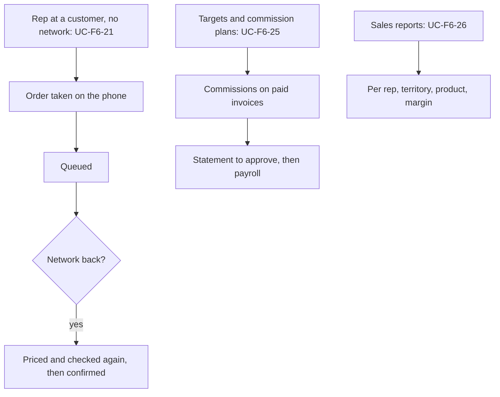

🏠 [Specs](../../../README.md) › 🧩 [Functional capabilities](../../README.md) ›
🛒 [F6 Customers and sales](../README.md) › 🔀 [Flows](README.md) › 🔀 FL-F6-09 Sell on the road and steer sales

# 🔀 FL-F6-09 Sell on the road and steer sales

**Status:** ✅ specified

## Summary

Sales representatives take orders offline at customers' premises; managers set targets and commissions, and read sales
and margin per rep, territory and product.

## Personas

- [U02 Manager](../../../01-users/personas/u02-manager.md)
- [U13 Owner](../../../01-users/personas/u13-owner.md)
- [U42 Sales representative](../../../01-users/personas/u42-sales-representative.md)

## Flowchart

## Sequence diagram

- [UC-F6-21 Take orders offline on the road](../use-cases/09-sell-on-the-road-and-steer-sales/uc-f06-21-take-orders-offline-on-the-road.md#sequence-diagram)

## Steps

| Step | Persona | Screen | Use case | What happens |
|---|---|---|---|---|
| 1 | [U42](../../../01-users/personas/u42-sales-representative.md) | [S-F6-18](../screens/09-sell-on-the-road-and-steer-sales/s-f06-18-phone-order.md) | [UC-F6-21](../use-cases/09-sell-on-the-road-and-steer-sales/uc-f06-21-take-orders-offline-on-the-road.md) | Take an order offline at a customer's |
| 2 | [U42](../../../01-users/personas/u42-sales-representative.md) | [S-F6-18](../screens/09-sell-on-the-road-and-steer-sales/s-f06-18-phone-order.md) | [UC-F6-21](../use-cases/09-sell-on-the-road-and-steer-sales/uc-f06-21-take-orders-offline-on-the-road.md) | The order syncs and is confirmed |
| 3 | [U02](../../../01-users/personas/u02-manager.md) | [S-F6-21](../screens/09-sell-on-the-road-and-steer-sales/s-f06-21-targets-and-commissions.md) | [UC-F6-25](../use-cases/09-sell-on-the-road-and-steer-sales/uc-f06-25-set-sales-targets-and-pay-commissions.md) | Set targets and the commission plan |
| 4 | [U13](../../../01-users/personas/u13-owner.md) | [S-F6-22](../screens/09-sell-on-the-road-and-steer-sales/s-f06-22-sales-reports.md) | [UC-F6-26](../use-cases/09-sell-on-the-road-and-steer-sales/uc-f06-26-read-sales-and-margin-reports.md) | Read sales and margin per rep and territory |

### Entities and screens

| Entity | States in this flow | Shown at step and screen | Aggregated view |
|---|---|---|---|
| [E-F6-04 Order](../data/e-f06-04-order.md) | Open, In progress, Cancelled, Done | 1, 2 [S-F6-18](../screens/09-sell-on-the-road-and-steer-sales/s-f06-18-phone-order.md) | Orders |
| [E-F6-18 Commission plan and target](../data/e-f06-18-commission-plan-and-target.md) | Draft, Active, Closed | 3 [S-F6-21](../screens/09-sell-on-the-road-and-steer-sales/s-f06-21-targets-and-commissions.md); 4 [S-F6-22](../screens/09-sell-on-the-road-and-steer-sales/s-f06-22-sales-reports.md) | Commission plan and targets |
| [E-F6-19 Commission line](../data/e-f06-19-commission-line.md) | Approved, Paid | 3 [S-F6-21](../screens/09-sell-on-the-road-and-steer-sales/s-f06-21-targets-and-commissions.md) | Commission lines |
| [E-F6-05 Invoice](../data/e-f06-05-invoice.md) | Sent, Received, Paid | 4 [S-F6-22](../screens/09-sell-on-the-road-and-steer-sales/s-f06-22-sales-reports.md) | Invoices |
| [E-F13-03 Pay input](../../f13-payroll/data/e-f13-03-pay-input.md) | Open, Complete, Late, Closed | Shown elsewhere: [S-F13-03 Pay inputs](../../f13-payroll/screens/02-monthly-pay-run/s-f13-03-pay-inputs.md) | Pay inputs |
| [E-F7-06 Item](../../f07-purchasing-and-stock/data/e-f07-06-item.md) | Active | Shown elsewhere: [S-F7-21 Stock levels](../../f07-purchasing-and-stock/screens/03-replenish/s-f07-21-stock-levels.md) | Items |

## Errors

A price changed while offline, a commission on an invoice later credited, a report on unposted invoices (BR-F6-14,
BR-F6-18).

## Images

Every step and error, for each persona taking part, in light and dark mode (D120). Steps are numbered as in the Steps
table; E rows are the error cases.

| Step | Persona | Device | Light | Dark |
|---|---|---|---|---|
| 1 | U42 | desktop | [light](../images/09-sell-on-the-road-and-steer-sales/u42-sales-representative/1-phone-order-desktop-light.png) | [dark](../images/09-sell-on-the-road-and-steer-sales/u42-sales-representative/1-phone-order-desktop-dark.png) |
| 1 | U42 | phone | [light](../images/09-sell-on-the-road-and-steer-sales/u42-sales-representative/1-phone-order-phone-light.png) | [dark](../images/09-sell-on-the-road-and-steer-sales/u42-sales-representative/1-phone-order-phone-dark.png) |
| 1 | U42 | tablet | [light](../images/09-sell-on-the-road-and-steer-sales/u42-sales-representative/1-phone-order-tablet-light.png) | [dark](../images/09-sell-on-the-road-and-steer-sales/u42-sales-representative/1-phone-order-tablet-dark.png) |
| 2 | U42 | desktop | [light](../images/09-sell-on-the-road-and-steer-sales/u42-sales-representative/2-phone-order-desktop-light.png) | [dark](../images/09-sell-on-the-road-and-steer-sales/u42-sales-representative/2-phone-order-desktop-dark.png) |
| 2 | U42 | phone | [light](../images/09-sell-on-the-road-and-steer-sales/u42-sales-representative/2-phone-order-phone-light.png) | [dark](../images/09-sell-on-the-road-and-steer-sales/u42-sales-representative/2-phone-order-phone-dark.png) |
| 2 | U42 | tablet | [light](../images/09-sell-on-the-road-and-steer-sales/u42-sales-representative/2-phone-order-tablet-light.png) | [dark](../images/09-sell-on-the-road-and-steer-sales/u42-sales-representative/2-phone-order-tablet-dark.png) |
| 3 | U02 | desktop | [light](../images/09-sell-on-the-road-and-steer-sales/u02-manager/3-targets-and-commissions-desktop-light.png) | [dark](../images/09-sell-on-the-road-and-steer-sales/u02-manager/3-targets-and-commissions-desktop-dark.png) |
| 3 | U02 | phone | [light](../images/09-sell-on-the-road-and-steer-sales/u02-manager/3-targets-and-commissions-phone-light.png) | [dark](../images/09-sell-on-the-road-and-steer-sales/u02-manager/3-targets-and-commissions-phone-dark.png) |
| 4 | U13 | desktop | [light](../images/09-sell-on-the-road-and-steer-sales/u13-owner/4-sales-reports-desktop-light.png) | [dark](../images/09-sell-on-the-road-and-steer-sales/u13-owner/4-sales-reports-desktop-dark.png) |
| 4 | U13 | phone | [light](../images/09-sell-on-the-road-and-steer-sales/u13-owner/4-sales-reports-phone-light.png) | [dark](../images/09-sell-on-the-road-and-steer-sales/u13-owner/4-sales-reports-phone-dark.png) |
| E1 | U42 | desktop | [light](../images/09-sell-on-the-road-and-steer-sales/u42-sales-representative/e1-phone-order-refused-desktop-light.png) | [dark](../images/09-sell-on-the-road-and-steer-sales/u42-sales-representative/e1-phone-order-refused-desktop-dark.png) |
| E1 | U42 | phone | [light](../images/09-sell-on-the-road-and-steer-sales/u42-sales-representative/e1-phone-order-refused-phone-light.png) | [dark](../images/09-sell-on-the-road-and-steer-sales/u42-sales-representative/e1-phone-order-refused-phone-dark.png) |
| E1 | U42 | tablet | [light](../images/09-sell-on-the-road-and-steer-sales/u42-sales-representative/e1-phone-order-refused-tablet-light.png) | [dark](../images/09-sell-on-the-road-and-steer-sales/u42-sales-representative/e1-phone-order-refused-tablet-dark.png) |

## Open questions

None.

---

⬅️ [FL-F6-08 Collect and settle](fl-f06-08-collect-and-settle.md) · ⬆️ [Up](README.md) ·
➡️ [FL-F6-10 Partners, frame contracts and warranties](fl-f06-10-partners-contracts-and-warranties.md)
