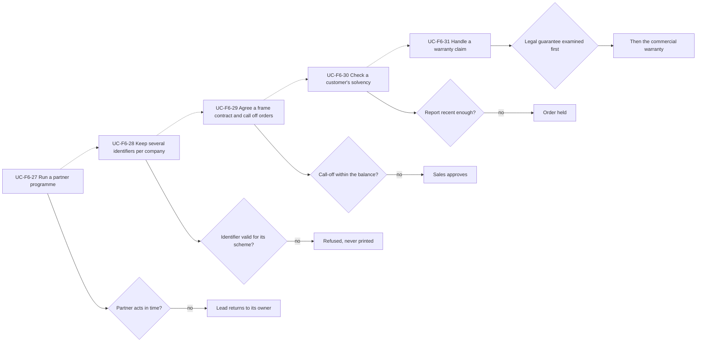
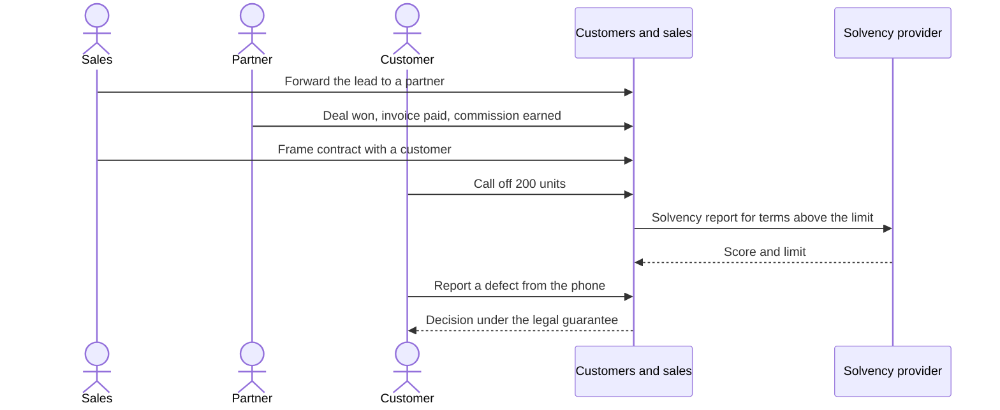

🏠 [Specs](../../../README.md) › 🧩 [Functional capabilities](../../README.md) ›
🛒 [F6 Customers and sales](../README.md) › 🔀 [Flows](README.md) › 🔀 FL-F6-10 Partners, frame contracts and warranties

# 🔀 FL-F6-10 Partners, frame contracts and warranties

**Status:** 🔄 waiting for the owner

## Summary

Sales runs a partner programme where each lead has one owner and commissions follow paid invoices, keeps several
identifiers per company checked by scheme, agrees frame contracts and takes call-offs within the balance, checks a
customer's solvency before giving terms above the limit, and handles warranty claims under the legal conformity
guarantee first. The customer's call-off and claim run on a phone
([D525](../../../06-decisions/f06-customers-and-sales/d525-benchmark-gaps-f06-customers-and-sales.md)).

## Personas

- [U03 Sales](../../../01-users/personas/u03-sales.md)
- [U51 Reseller partner](../../../01-users/personas/u51-reseller-partner.md), who works the forwarded leads in the
  partner portal
- [U05 Accounting](../../../01-users/personas/u05-accounting.md)
- [U09 Customer](../../../01-users/personas/u09-customer.md), who calls off orders and reports a defect from a phone
- [U16 Office worker](../../../01-users/personas/u16-office-worker.md)

## Flowchart

## Sequence diagram

## Steps

| Step | Persona | Screen | Use case | What happens |
|---|---|---|---|---|
| 1 | [U03](../../../01-users/personas/u03-sales.md) | [S-F6-24](../screens/10-partners-contracts-and-warranties/s-f06-24-partner-programme.md) | [UC-F6-27](../use-cases/10-partners-contracts-and-warranties/uc-f06-27-run-a-partner-programme.md) | Sales approves a partner and forwards a lead; the lead leaves its owner's pipeline and the partner works it in the portal |
| 2 | [U03](../../../01-users/personas/u03-sales.md) | [S-F6-25](../screens/10-partners-contracts-and-warranties/s-f06-25-company-identifiers.md) | [UC-F6-28](../use-cases/10-partners-contracts-and-warranties/uc-f06-28-keep-several-identifiers-per-company.md) | Sales and accounting add and check the identifiers of a company, each by the rule of its scheme |
| 3 | [U03](../../../01-users/personas/u03-sales.md) | [S-F6-26](../screens/10-partners-contracts-and-warranties/s-f06-26-frame-contracts.md) | [UC-F6-29](../use-cases/10-partners-contracts-and-warranties/uc-f06-29-agree-a-frame-contract-and-call-off-orders.md) | Sales agrees a frame contract; the customer calls off orders from it within the balance |
| 4 | [U03](../../../01-users/personas/u03-sales.md) | [S-F6-27](../screens/10-partners-contracts-and-warranties/s-f06-27-solvency-check.md) | [UC-F6-30](../use-cases/10-partners-contracts-and-warranties/uc-f06-30-check-a-customers-solvency.md) | Sales or accounting asks for a solvency report and sets the limit and the terms from it |
| 5 | [U09](../../../01-users/personas/u09-customer.md) | [S-F6-28](../screens/10-partners-contracts-and-warranties/s-f06-28-warranty-claims.md) | [UC-F6-31](../use-cases/10-partners-contracts-and-warranties/uc-f06-31-handle-a-warranty-claim.md) | A customer reports a defect from a phone; the office checks the legal guarantee first and decides the remedy |

### Entities and screens

| Entity | States in this flow | Shown at step and screen | Aggregated view |
|---|---|---|---|
| [E-F6-23 Partner](../data/e-f06-23-partner.md) | Applied, Active, Refused, Suspended, Ended | 1 [S-F6-24](../screens/10-partners-contracts-and-warranties/s-f06-24-partner-programme.md) | Partners |
| [E-F6-24 Company identifier](../data/e-f06-24-company-identifier.md) | Entered, Valid, Invalid, Retired | 2 [S-F6-25](../screens/10-partners-contracts-and-warranties/s-f06-25-company-identifiers.md) | Company identifiers |
| [E-F6-25 Frame contract](../data/e-f06-25-frame-contract.md) | Draft, Active, Exhausted, Expired, Closed | 3 [S-F6-26](../screens/10-partners-contracts-and-warranties/s-f06-26-frame-contracts.md) | Frame contracts |
| [E-F6-26 Solvency report](../data/e-f06-26-solvency-report.md) | Requested, Received, Failed, Expired | 4 [S-F6-27](../screens/10-partners-contracts-and-warranties/s-f06-27-solvency-check.md) | Solvency reports |
| [E-F6-27 Warranty](../data/e-f06-27-warranty.md) | Covered, Claimed, Accepted, Refused, Resolved, Expired | 5 [S-F6-28](../screens/10-partners-contracts-and-warranties/s-f06-28-warranty-claims.md) | Warranties |

## Errors

- **E1 A call-off is above the contract.** The call-off waits for sales' approval and is not an order until approved
  ([BR-F6-21](../business-rules/br-f06-21-call-offs-never-exceed-the-balance-without-approval.md), step 3).

## Images

Every step and error, for each persona taking part, in light and dark mode (D120). Steps are numbered as in the Steps
table; E rows are the error cases.

| Step | Persona | Device | Light | Dark |
|---|---|---|---|---|
| 1 | U03 | desktop | [light](../images/10-partners-contracts-and-warranties/u03-sales/1-partner-programme-desktop-light.png) | [dark](../images/10-partners-contracts-and-warranties/u03-sales/1-partner-programme-desktop-dark.png) |
| 1 | U51 | desktop | [light](../images/10-partners-contracts-and-warranties/u51-reseller-partner/1-partner-programme-desktop-light.png) | [dark](../images/10-partners-contracts-and-warranties/u51-reseller-partner/1-partner-programme-desktop-dark.png) |
| 1 | U03 | phone | [light](../images/10-partners-contracts-and-warranties/u03-sales/1-partner-programme-phone-light.png) | [dark](../images/10-partners-contracts-and-warranties/u03-sales/1-partner-programme-phone-dark.png) |
| 1 | U03 | tablet | [light](../images/10-partners-contracts-and-warranties/u03-sales/1-partner-programme-tablet-light.png) | [dark](../images/10-partners-contracts-and-warranties/u03-sales/1-partner-programme-tablet-dark.png) |
| 2 | U03 | desktop | [light](../images/10-partners-contracts-and-warranties/u03-sales/2-company-identifiers-desktop-light.png) | [dark](../images/10-partners-contracts-and-warranties/u03-sales/2-company-identifiers-desktop-dark.png) |
| 2 | U05 | desktop | [light](../images/10-partners-contracts-and-warranties/u05-accounting/2-company-identifiers-desktop-light.png) | [dark](../images/10-partners-contracts-and-warranties/u05-accounting/2-company-identifiers-desktop-dark.png) |
| 2 | U03 | phone | [light](../images/10-partners-contracts-and-warranties/u03-sales/2-company-identifiers-phone-light.png) | [dark](../images/10-partners-contracts-and-warranties/u03-sales/2-company-identifiers-phone-dark.png) |
| 2 | U03 | tablet | [light](../images/10-partners-contracts-and-warranties/u03-sales/2-company-identifiers-tablet-light.png) | [dark](../images/10-partners-contracts-and-warranties/u03-sales/2-company-identifiers-tablet-dark.png) |
| 3 | U03 | desktop | [light](../images/10-partners-contracts-and-warranties/u03-sales/3-frame-contracts-desktop-light.png) | [dark](../images/10-partners-contracts-and-warranties/u03-sales/3-frame-contracts-desktop-dark.png) |
| 3 | U09 | phone | [light](../images/10-partners-contracts-and-warranties/u09-customer/3-frame-contracts-phone-light.png) | [dark](../images/10-partners-contracts-and-warranties/u09-customer/3-frame-contracts-phone-dark.png) |
| 3 | U03 | phone | [light](../images/10-partners-contracts-and-warranties/u03-sales/3-frame-contracts-phone-light.png) | [dark](../images/10-partners-contracts-and-warranties/u03-sales/3-frame-contracts-phone-dark.png) |
| 3 | U03 | tablet | [light](../images/10-partners-contracts-and-warranties/u03-sales/3-frame-contracts-tablet-light.png) | [dark](../images/10-partners-contracts-and-warranties/u03-sales/3-frame-contracts-tablet-dark.png) |
| 4 | U03 | desktop | [light](../images/10-partners-contracts-and-warranties/u03-sales/4-solvency-check-desktop-light.png) | [dark](../images/10-partners-contracts-and-warranties/u03-sales/4-solvency-check-desktop-dark.png) |
| 4 | U05 | desktop | [light](../images/10-partners-contracts-and-warranties/u05-accounting/4-solvency-check-desktop-light.png) | [dark](../images/10-partners-contracts-and-warranties/u05-accounting/4-solvency-check-desktop-dark.png) |
| 4 | U03 | phone | [light](../images/10-partners-contracts-and-warranties/u03-sales/4-solvency-check-phone-light.png) | [dark](../images/10-partners-contracts-and-warranties/u03-sales/4-solvency-check-phone-dark.png) |
| 4 | U03 | tablet | [light](../images/10-partners-contracts-and-warranties/u03-sales/4-solvency-check-tablet-light.png) | [dark](../images/10-partners-contracts-and-warranties/u03-sales/4-solvency-check-tablet-dark.png) |
| 5 | U09 | phone | [light](../images/10-partners-contracts-and-warranties/u09-customer/5-warranty-claims-phone-light.png) | [dark](../images/10-partners-contracts-and-warranties/u09-customer/5-warranty-claims-phone-dark.png) |
| 5 | U16 | desktop | [light](../images/10-partners-contracts-and-warranties/u16-office-worker/5-warranty-claims-desktop-light.png) | [dark](../images/10-partners-contracts-and-warranties/u16-office-worker/5-warranty-claims-desktop-dark.png) |
| E1 | U03 | desktop | [light](../images/10-partners-contracts-and-warranties/u03-sales/e1-a-call-off-is-above-the-contract-desktop-light.png) | [dark](../images/10-partners-contracts-and-warranties/u03-sales/e1-a-call-off-is-above-the-contract-desktop-dark.png) |
| E1 | U03 | phone | [light](../images/10-partners-contracts-and-warranties/u03-sales/e1-a-call-off-is-above-the-contract-phone-light.png) | [dark](../images/10-partners-contracts-and-warranties/u03-sales/e1-a-call-off-is-above-the-contract-phone-dark.png) |
| E1 | U03 | tablet | [light](../images/10-partners-contracts-and-warranties/u03-sales/e1-a-call-off-is-above-the-contract-tablet-light.png) | [dark](../images/10-partners-contracts-and-warranties/u03-sales/e1-a-call-off-is-above-the-contract-tablet-dark.png) |

## Open questions

None.

---

⬅️ [FL-F6-09 Sell on the road and steer sales](fl-f06-09-sell-on-the-road-and-steer-sales.md) · ⬆️ [Up](README.md)
