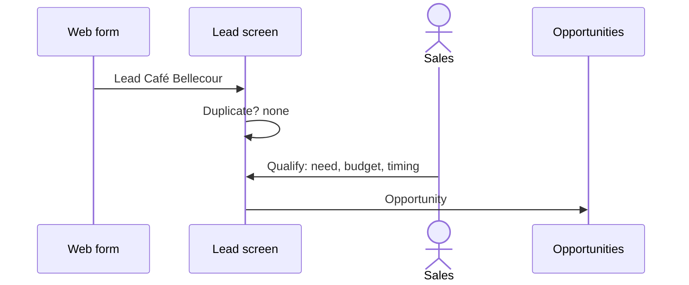

🏠 [Specs](../../../../README.md) › 🧩 [Functional capabilities](../../../README.md) ›
🛒 [F6 Customers and sales](../../README.md) › 📝 [Use cases](../README.md) ›
📝 [Use cases: FL-F6-01 Lead to quote](README.md) › 📝 UC-F6-01 Capture and qualify a lead

# 📝 UC-F6-01 Capture and qualify a lead

**Status:** ✅ specified

## Summary

A lead from a form, an email, a call, a social post or by hand is captured, deduplicated and qualified.

## Personas

- [U03 Sales](../../../../01-users/personas/u03-sales.md)

## Goal

No lead lost, none counted twice, each qualified and owned.

## Trigger

A lead arrives from a form, an email, a call, a social post, an import or by hand.

## Frequency

Daily.

## Preconditions

F6 set up for the company.

## Postconditions

- **Succeeded:** a qualified lead is assigned or turned into an opportunity.
- **Failed:** a disqualified lead keeps its reason.

## Main flow

1. A lead arrives from a web form,
   [UC-F5-19](../../../f05-social-media/use-cases/08-pages-forms-surveys-and-whatsapp/uc-f05-19-publish-a-landing-page-with-a-form.md),
   an email, a call (F4), a social post (F5), an import or by hand, and shows on the lead screen
   ([S-F6-02](../../screens/01-lead-to-quote/s-f06-02-lead.md)).
2. SimpleERP matches it against existing contacts and companies and proposes duplicates for merge.
3. The sales person qualifies it (need, budget, timing), or accepts the AI assistant's suggestion.
4. They assign it, or rules assign it by area or product
   ([UC-F6-13](../05-benchmark-additions/uc-f06-13-score-assign-and-enrich-leads.md)).
5. Qualified, it becomes an opportunity ([UC-F6-02](uc-f06-02-manage-the-pipeline-and-forecast.md)).

## Alternative flows

- 3a. Disqualified with a reason.
- 1a. A lead from a consented form keeps its consent,
  [UC-F5-15](../../../f05-social-media/use-cases/06-audiences-consent-and-journeys/uc-f05-15-record-and-prove-consent.md).

## Error flows

- 2e. A duplicate: merge proposed, never automatic.
- 1e. An import with a bad file: refused with the lines in error.

## Business rules

- See F6's rules.

## Entities

- [E-F6-01 Customer record](../../data/e-f06-01-customer-record.md)
- [E-F6-02 Opportunity](../../data/e-f06-02-opportunity.md)
- [E-F6-20 Lead](../../data/e-f06-20-lead.md)

## Permissions

Sales for their customers (record rules by area); managers; accounting for invoices.

## Notifications

The assigned sales person: new lead.

## Audit events

Lead created, merged, qualified, assigned, disqualified.

## AI involvement

The AI assistant prepares it for confirmation
([BR-F3-07](../../../f03-assistant/business-rules/br-f03-07-no-deletes-no-irreversible-acts.md)); figures come from
queries ([BR-F3-03](../../../f03-assistant/business-rules/br-f03-03-figures-come-from-queries.md)).

## API, MCP and A2A exposure

T5 operations of F6 with the caller's rights; the MCP tool of F6; no A2A skill.

## Screens

- [S-F6-02](../../screens/01-lead-to-quote/s-f06-02-lead.md)

## Flowchart

See [FL-F6-01 Lead to quote](../../flows/fl-f06-01-lead-to-quote.md#flowchart).

## Sequence diagram

## Acceptance criteria

1. **Given** a form lead from Café Bellecour for Distribution Lemoine **when** it arrives **then** it is created with
   its source form.
2. **Given** a lead with the email of an existing contact **when** it arrives **then** a merge is proposed, not done.
3. **Given** a lead disqualified as "no budget" **when** it is saved **then** the reason is kept and it leaves the list.
4. **Given** a qualified lead **when** it is converted **then** an opportunity exists with its amount.

## Non-functional notes

None.

## Regulatory references

[CR-FR-196](../../../../10-country-packs/france/data-protection/cr-fr-196-legitimate-interest-balancing.md);
[CR-FR-063](../../../../10-country-packs/france/consumer/cr-fr-063-electronic-marketing-consent.md).

## Related use cases

F8 (accounting), F16 (requests), F7 (stock), F9 (work).

- [UC-F5-19 Publish a landing page with a form](../../../f05-social-media/use-cases/08-pages-forms-surveys-and-whatsapp/uc-f05-19-publish-a-landing-page-with-a-form.md)

- [UC-F6-17 Organise accounts with their timeline and emails](../06-accounts-and-credit/uc-f06-17-organise-accounts-with-their-timeline-and-emails.md)

## Open questions

None.

---

⬆️ [Up](README.md) · ➡️ [UC-F6-02 Manage the pipeline and forecast](uc-f06-02-manage-the-pipeline-and-forecast.md)
