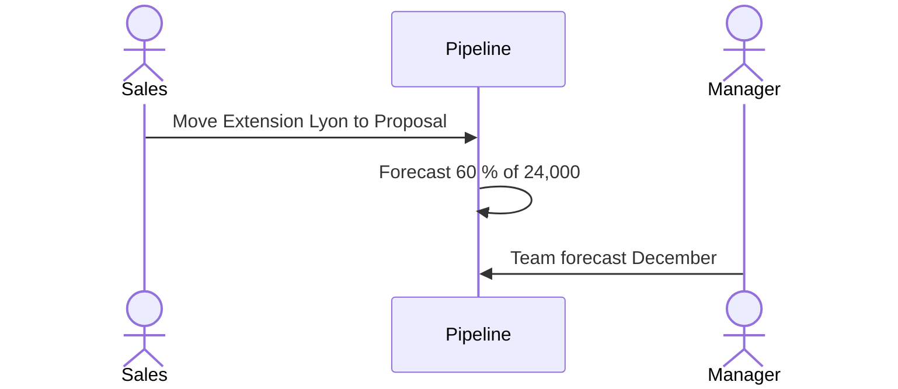

🏠 [Specs](../../../../README.md) › 🧩 [Functional capabilities](../../../README.md) ›
🛒 [F6 Customers and sales](../../README.md) › 📝 [Use cases](../README.md) ›
📝 [Use cases: FL-F6-01 Lead to quote](README.md) › 📝 UC-F6-02 Manage the pipeline and forecast

# 📝 UC-F6-02 Manage the pipeline and forecast

**Status:** ✅ specified

## Summary

Opportunities move through stages; activities are planned; the forecast is weighted by stage.

## Personas

- [U03 Sales](../../../../01-users/personas/u03-sales.md)
- [U02 Manager](../../../../01-users/personas/u02-manager.md)

## Goal

A pipeline that says what will be signed and when.

## Trigger

Daily pipeline work.

## Frequency

Daily.

## Preconditions

F6 set up for the company.

## Postconditions

- **Succeeded:** opportunities move by stage and the forecast is current.
- **Failed:** lost ones keep their reason.

## Main flow

1. The sales person opens the pipeline ([S-F6-01](../../screens/01-lead-to-quote/s-f06-01-pipeline.md)): opportunities
   by stage with amounts.
2. They move one to the next stage and plan the next activity.
3. The forecast sums amounts weighted by each stage's probability, per person and month.
4. The manager reviews the team's pipeline and forecast.

## Alternative flows

- 2a. Won: a quote or order follows ([UC-F6-03](uc-f06-03-create-and-send-a-quote.md)).
- 2b. Lost: a reason is required.

## Error flows

- 2e. No next activity for 14 days: flagged.
- 2e. Lost without a reason: refused.

## Business rules

- See F6's rules.

## Entities

- [E-F6-02 Opportunity](../../data/e-f06-02-opportunity.md)

## Permissions

Sales for their customers (record rules by area); managers; accounting for invoices.

## Notifications

Sales: opportunities without activity.

## Audit events

Stage changes, won, lost.

## AI involvement

The AI assistant prepares it for confirmation
([BR-F3-07](../../../f03-assistant/business-rules/br-f03-07-no-deletes-no-irreversible-acts.md)); figures come from
queries ([BR-F3-03](../../../f03-assistant/business-rules/br-f03-03-figures-come-from-queries.md)).

## API, MCP and A2A exposure

T5 operations of F6 with the caller's rights; the MCP tool of F6; no A2A skill.

## Screens

- [S-F6-01](../../screens/01-lead-to-quote/s-f06-01-pipeline.md)

## Flowchart

See [FL-F6-01 Lead to quote](../../flows/fl-f06-01-lead-to-quote.md#flowchart).

## Sequence diagram

## Acceptance criteria

1. **Given** an opportunity of 24,000 EUR at a stage of 60 % **when** the forecast is read **then** it counts 14,400
   EUR.
2. **Given** an opportunity without activity since 2026-10-28 **when** 2026-11-12 comes **then** it is flagged.
3. **Given** an opportunity marked lost **when** no reason is given **then** it is refused.

## Non-functional notes

None.

## Regulatory references

None.

## Related use cases

F8 (accounting), F16 (requests), F7 (stock), F9 (work).

- [UC-F6-26 Read sales and margin reports](../09-sell-on-the-road-and-steer-sales/uc-f06-26-read-sales-and-margin-reports.md)

## Open questions

None.

---

⬅️ [UC-F6-01 Capture and qualify a lead](uc-f06-01-capture-and-qualify-a-lead.md) · ⬆️ [Up](README.md) ·
➡️ [UC-F6-03 Create and send a quote](uc-f06-03-create-and-send-a-quote.md)
