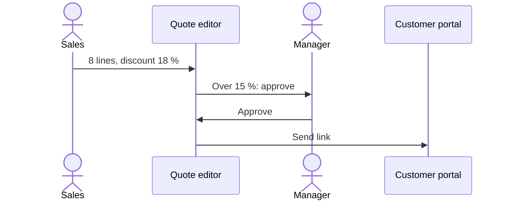

🏠 [Specs](../../../../README.md) › 🧩 [Functional capabilities](../../../README.md) ›
🛒 [F6 Customers and sales](../../README.md) › 📝 [Use cases](../README.md) ›
📝 [Use cases: FL-F6-01 Lead to quote](README.md) › 📝 UC-F6-03 Create and send a quote

# 📝 UC-F6-03 Create and send a quote

**Status:** 🔄 waiting for the owner

## Summary

A quote with products, services, options and discounts is built, approved if needed, and sent.

## Personas

- [U03 Sales](../../../../01-users/personas/u03-sales.md)

## Goal

A quote that is right, approved when needed, and sent fast.

## Trigger

A customer asks a price.

## Frequency

Daily.

## Preconditions

F6 set up for the company.

## Postconditions

- **Succeeded:** the quote is sent; versions are kept.
- **Failed:** a refused approval sends it back.

## Main flow

1. The sales person creates a quote ([S-F6-03](../../screens/01-lead-to-quote/s-f06-03-quote-editor.md)) from an
   opportunity or a customer, with lines from the catalogue, the customer's price list and options.
2. Margins and totals compute live, VAT shown
   ([BR-F6-08](../../business-rules/br-f06-08-vat-is-shown-wherever-it-matters.md)).
3. A discount above the threshold or a margin below the floor goes to a manager
   ([BR-F6-04](../../business-rules/br-f06-04-large-discounts-need-approval.md)).
4. Once approved, it is sent from simple-ERP or shared by a portal link; a new version keeps the previous ones.

## Alternative flows

- 1a. The AI assistant drafts the quote text
  ([UC-F3-04](../../../f03-assistant/use-cases/04-summarise-or-draft/uc-f03-04-summarise-and-draft.md)).
- 1b. On a phone at the customer's site, offline if needed
  ([UC-F6-21](../09-sell-on-the-road-and-steer-sales/uc-f06-21-take-orders-offline-on-the-road.md)).

## Error flows

- 3e. Approval refused: back with the reason.
- 4e. Customer without an email: sent by link only.

## Business rules

- [BR-F6-04](../../business-rules/br-f06-04-large-discounts-need-approval.md)
- [BR-F6-08 VAT is shown wherever it matters](../../business-rules/br-f06-08-vat-is-shown-wherever-it-matters.md)

## Entities

- [E-F6-03 Quote](../../data/e-f06-03-quote.md)
- [E-F6-08 Sales price list](../../data/e-f06-08-sales-price-list.md)

## Permissions

Sales for their customers (record rules by area); managers; accounting for invoices.

## Notifications

The manager: quote to approve; sales: decision.

## Audit events

Quote created, versioned, approved, sent.

## AI involvement

The AI assistant prepares it for confirmation
([BR-F3-07](../../../f03-assistant/business-rules/br-f03-07-no-deletes-no-irreversible-acts.md)); figures come from
queries ([BR-F3-03](../../../f03-assistant/business-rules/br-f03-03-figures-come-from-queries.md)).

## API, MCP and A2A exposure

T5 operations of F6 with the caller's rights; the MCP tool of F6; no A2A skill.

## Screens

- [S-F6-03](../../screens/01-lead-to-quote/s-f06-03-quote-editor.md)

## Flowchart

See [FL-F6-01 Lead to quote](../../flows/fl-f06-01-lead-to-quote.md#flowchart).

## Sequence diagram

## Acceptance criteria

1. **Given** a quote with an 18 % discount and a 15 % threshold **when** it is sent **then** it goes to the manager
   first.
2. **Given** the approval refused "margin too low" **when** the manager refuses **then** the sales person sees the
   reason.
3. **Given** version 2 sent **when** the customer opens the link **then** she sees version 2 and version 1 stays kept.

## Non-functional notes

Totals recompute within 300 ms (Proposed).

## Regulatory references

Invoice mentions ([CR-FR-015](../../../../10-country-packs/france/invoicing/cr-fr-015-invoice-mandatory-mentions.md));
payment terms and late penalties,
[CR-FR-018](../../../../10-country-packs/france/invoicing/cr-fr-018-payment-terms-cap.md),
[CR-FR-019](../../../../10-country-packs/france/invoicing/cr-fr-019-late-payment-penalties.md).

## Related use cases

F8 (accounting), F16 (requests), F7 (stock), F9 (work).

- [UC-F11-27 Request a quote or punch out from a buyer's system](../../../f11-online-shop/use-cases/09-pre-orders-and-b2b-buying/uc-f11-27-request-a-quote-or-punch-out-from-a-buyers-system.md)

## Open questions

None.

---

⬅️ [UC-F6-02 Manage the pipeline and forecast](uc-f06-02-manage-the-pipeline-and-forecast.md) · ⬆️ [Up](README.md) ·
➡️ [UC-F6-04 Accept or sign a quote](../02-quote-to-order/uc-f06-04-accept-or-sign-a-quote.md)
