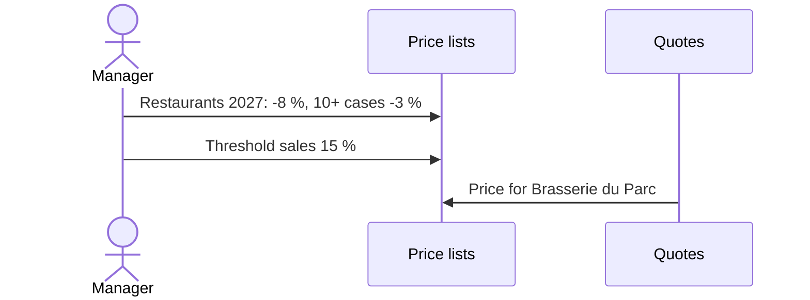

🏠 [Specs](../../../../README.md) › 🧩 [Functional capabilities](../../../README.md) ›
🛒 [F6 Customers and sales](../../README.md) › 📝 [Use cases](../README.md) ›
📝 [Use cases: FL-F6-01 Lead to quote](README.md) › 📝 UC-F6-12 Manage price lists and discounts

# 📝 UC-F6-12 Manage price lists and discounts

**Status:** ✅ specified

## Summary

Price lists per customer group, period or currency, and discount rules.

## Personas

- [U02 Manager](../../../../01-users/personas/u02-manager.md)
- [U13 Owner](../../../../01-users/personas/u13-owner.md)

## Goal

The right price for every customer, with discounts under control.

## Trigger

A new price list, a promotion, a supplier price change.

## Frequency

Monthly.

## Preconditions

F6 set up for the company.

## Postconditions

- **Succeeded:** quotes and orders apply the lists and rules.
- **Failed:** an overlap is shown and resolved.

## Main flow

1. The manager opens price lists ([S-F6-10](../../screens/01-lead-to-quote/s-f06-10-price-lists.md)) and creates one per
   customer group, currency or period.
2. They add discount rules (quantity, promotion).
3. They set the discount approval thresholds per role
   ([BR-F6-04](../../business-rules/br-f06-04-large-discounts-need-approval.md)).
4. Quotes and orders apply them ([UC-F6-03](uc-f06-03-create-and-send-a-quote.md)).

## Alternative flows

- 1a. Import a supplier's price update and recompute margins.

## Error flows

- 1e. Two lists overlapping for a customer: the more specific wins, shown.

## Business rules

- [BR-F6-04](../../business-rules/br-f06-04-large-discounts-need-approval.md)

## Entities

- [E-F6-08 Sales price list](../../data/e-f06-08-sales-price-list.md)

## Permissions

Managers and the owner.

## Notifications

Sales: a new price list.

## Audit events

Lists and rules changed.

## AI involvement

The AI assistant prepares it for confirmation
([BR-F3-07](../../../f03-assistant/business-rules/br-f03-07-no-deletes-no-irreversible-acts.md)); figures come from
queries ([BR-F3-03](../../../f03-assistant/business-rules/br-f03-03-figures-come-from-queries.md)).

## API, MCP and A2A exposure

T5 operations of F6 with the caller's rights; the MCP tool of F6; no A2A skill.

## Screens

- [S-F6-10](../../screens/01-lead-to-quote/s-f06-10-price-lists.md)

## Flowchart

See [FL-F6-01 Lead to quote](../../flows/fl-f06-01-lead-to-quote.md#flowchart).

## Sequence diagram

## Acceptance criteria

1. **Given** the list Restaurants 2027 at -8 % **when** a quote for a restaurant is made **then** prices are 8 % below
   the base.
2. **Given** a group list and a customer list **when** both apply **then** the customer list wins and it is shown.
3. **Given** a threshold of 15 % for sales **when** a seller gives 18 % **then** approval is asked.

## Non-functional notes

None.

## Regulatory references

[CR-FR-174](../../../../10-country-packs/france/invoicing/cr-fr-174-discounts-on-invoices.md).

## Related use cases

F8 (accounting), F16 (requests), F7 (stock), F9 (work).

## Open questions

None.

---

⬅️ [UC-F6-11 Use the customer portal](../02-quote-to-order/uc-f06-11-use-the-customer-portal.md) · ⬆️ [Up](README.md) ·
➡️ [UC-F6-13 Score, assign and enrich leads](../05-benchmark-additions/uc-f06-13-score-assign-and-enrich-leads.md)
