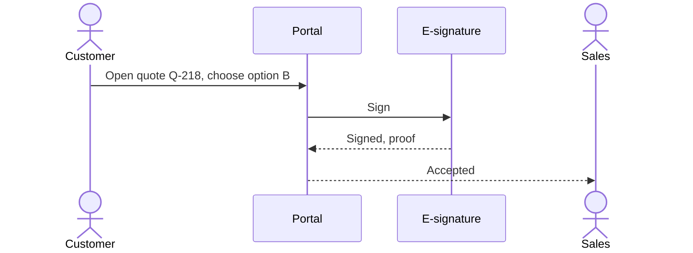

🏠 [Specs](../../../../README.md) › 🧩 [Functional capabilities](../../../README.md) ›
🛒 [F6 Customers and sales](../../README.md) › 📝 [Use cases](../README.md) ›
📝 [Use cases: FL-F6-02 Quote to order](README.md) › 📝 UC-F6-04 Accept or sign a quote

# 📝 UC-F6-04 Accept or sign a quote

**Status:** ✅ specified

## Summary

The customer accepts a quote by click, or signs it electronically when its type requires.

## Personas

- [U09 Customer](../../../../01-users/personas/u09-customer.md)

## Goal

Accept or sign in a few clicks, with proof.

## Trigger

The customer receives a quote.

## Frequency

Per quote.

## Preconditions

F6 set up for the company.

## Postconditions

- **Succeeded:** the quote is accepted with its proof.
- **Failed:** refused with a reason, or expired.

## Main flow

1. The customer opens the quote from its link or account,
   [S-F6-04](../../screens/02-quote-to-order/s-f06-04-customer-portal.md),
   [BR-F6-03](../../business-rules/br-f06-03-portal-shows-only-the-customer-s-own.md).
2. They choose the options.
3. They accept with a click, or sign through the e-signature provider when the type requires
   ([BR-F6-01](../../business-rules/br-f06-01-acceptance-is-proven.md)).
4. A deposit is requested if the quote says so
   ([UC-F6-07](../03-invoice-and-get-paid/uc-f06-07-get-paid-online-and-reconcile.md)); the sales person is told.

## Alternative flows

- 2a. Ask a question or a change: a request to the sales person.
- 3a. Refuse with a reason.

## Error flows

- 1e. The quote expired: "This quote ended on 2026-11-30; ask for a new one" with a button.

## Business rules

- [BR-F6-01](../../business-rules/br-f06-01-acceptance-is-proven.md)
- [BR-F6-03](../../business-rules/br-f06-03-portal-shows-only-the-customer-s-own.md)
- [BR-F6-08 VAT is shown wherever it matters](../../business-rules/br-f06-08-vat-is-shown-wherever-it-matters.md)

## Entities

- [E-F6-03 Quote](../../data/e-f06-03-quote.md)

## Permissions

The customer's portal contacts ([BR-F6-03](../../business-rules/br-f06-03-portal-shows-only-the-customer-s-own.md)).

## Notifications

Sales: accepted, signed, refused.

## Audit events

Opened, accepted or signed (with proof), refused.

## AI involvement

None on the customer's side.

## API, MCP and A2A exposure

T5 acceptance operation for portal integrations.

## Screens

- [S-F6-04](../../screens/02-quote-to-order/s-f06-04-customer-portal.md)

## Flowchart

See [FL-F6-02 Quote to order](../../flows/fl-f06-02-quote-to-order.md#flowchart).

## Sequence diagram

## Acceptance criteria

1. **Given** quote Q-218 valid until 2026-11-30 **when** Claire Durand signs on 2026-11-20 **then** it is accepted with
   the signature proof.
2. **Given** the same **when** she opens it on 2026-12-02 **then** she sees it ended and can ask a new one.
3. **Given** a quote with a 30 % deposit **when** she accepts **then** the deposit payment opens.

## Non-functional notes

Works on a phone.

## Regulatory references

[CR-FR-020](../../../../10-country-packs/france/invoicing/cr-fr-020-electronic-acceptance-and-signature.md).

## Related use cases

F8 (accounting), F16 (requests), F7 (stock), F9 (work).

## Open questions

None.

---

⬅️ [UC-F6-03 Create and send a quote](../01-lead-to-quote/uc-f06-03-create-and-send-a-quote.md) · ⬆️ [Up](README.md) ·
➡️ [UC-F6-05 Turn a quote into an order and follow it](uc-f06-05-turn-a-quote-into-an-order-and-follow-it.md)
