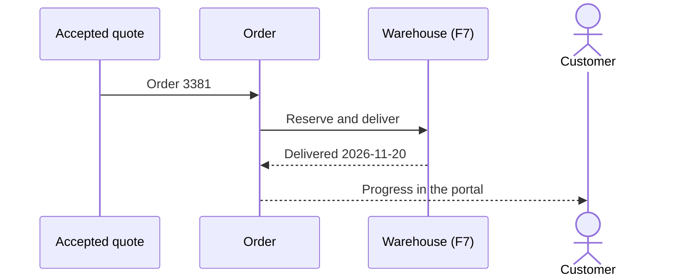

🏠 [Specs](../../../../README.md) › 🧩 [Functional capabilities](../../../README.md) ›
🛒 [F6 Customers and sales](../../README.md) › 📝 [Use cases](../README.md) ›
📝 [Use cases: FL-F6-02 Quote to order](README.md) › 📝 UC-F6-05 Turn a quote into an order and follow it

# 📝 UC-F6-05 Turn a quote into an order and follow it

**Status:** ✅ specified

## Summary

An accepted quote becomes an order, followed through delivery or work.

## Personas

- [U03 Sales](../../../../01-users/personas/u03-sales.md)
- [U16 Office worker](../../../../01-users/personas/u16-office-worker.md)

## Goal

Deliver what was sold, and know where each order stands.

## Trigger

A quote is accepted.

## Frequency

Daily.

## Preconditions

F6 set up for the company.

## Postconditions

- **Succeeded:** the order is done and ready to invoice.
- **Failed:** the order waits with its reason.

## Main flow

1. The accepted quote becomes an order ([S-F6-05](../../screens/02-quote-to-order/s-f06-05-order.md)); the credit limit
   is checked ([UC-F6-18](../06-accounts-and-credit/uc-f06-18-set-a-credit-limit-and-hold-orders.md)).
2. The order plans delivery (F7 stock) or work (F9 projects, field visits).
3. Its progress shows to the customer in the portal ([UC-F6-11](uc-f06-11-use-the-customer-portal.md)).
4. Done, it is ready to invoice
   ([UC-F6-06](../03-invoice-and-get-paid/uc-f06-06-invoice-deposits-progress-and-final.md)).

## Alternative flows

- 2a. Partial deliveries.
- 2b. A change order: a new quote version accepted.

## Error flows

- 2e. Not enough stock: the order waits with the expected date (F7).
- 1e. Over the credit limit: held.

## Business rules

- See F6's rules.

## Entities

- [E-F6-04 Order](../../data/e-f06-04-order.md)

## Permissions

Sales for their customers (record rules by area); managers; accounting for invoices. Office workers follow orders.

## Notifications

The customer: order confirmed and delivered.

## Audit events

Order created, held, released, delivered, done.

## AI involvement

The AI assistant prepares it for confirmation
([BR-F3-07](../../../f03-assistant/business-rules/br-f03-07-no-deletes-no-irreversible-acts.md)); figures come from
queries ([BR-F3-03](../../../f03-assistant/business-rules/br-f03-03-figures-come-from-queries.md)).

## API, MCP and A2A exposure

T5 operations of F6 with the caller's rights; the MCP tool of F6; no A2A skill.

## Screens

- [S-F6-05](../../screens/02-quote-to-order/s-f06-05-order.md)

## Flowchart

See [FL-F6-02 Quote to order](../../flows/fl-f06-02-quote-to-order.md#flowchart).

## Sequence diagram

## Acceptance criteria

1. **Given** quote Q-218 accepted **when** it is converted **then** order 3381 exists with the same lines.
2. **Given** stock short by 4 units **when** the order is planned **then** it waits with the expected date.
3. **Given** a partial delivery of 8 of 12 **when** it is shipped **then** the portal shows 8 delivered.

## Non-functional notes

None.

## Regulatory references

None.

## Related use cases

F8 (accounting), F16 (requests), F7 (stock), F9 (work).

- [UC-F6-18 Set a credit limit and hold orders](../06-accounts-and-credit/uc-f06-18-set-a-credit-limit-and-hold-orders.md)

- [UC-F6-21 Take orders offline on the road](../09-sell-on-the-road-and-steer-sales/uc-f06-21-take-orders-offline-on-the-road.md)

## Open questions

None.

---

⬅️ [UC-F6-04 Accept or sign a quote](uc-f06-04-accept-or-sign-a-quote.md) · ⬆️ [Up](README.md) ·
➡️ [UC-F6-06](../03-invoice-and-get-paid/uc-f06-06-invoice-deposits-progress-and-final.md)
