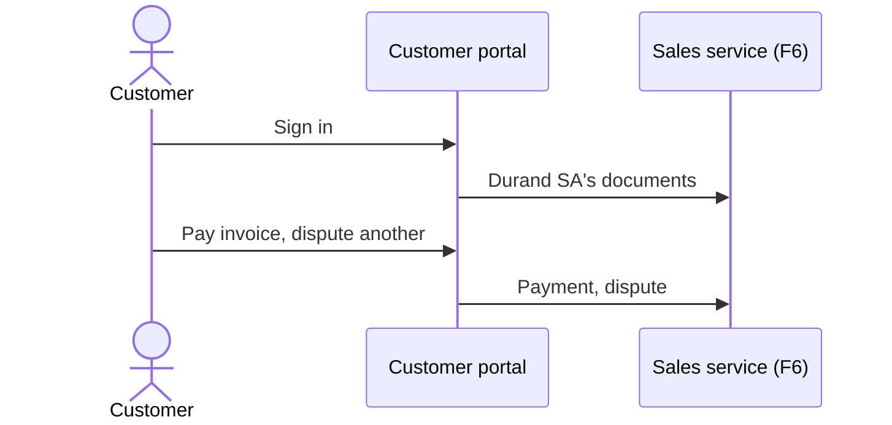

🏠 [Specs](../../../../README.md) › 🧩 [Functional capabilities](../../../README.md) ›
🛒 [F6 Customers and sales](../../README.md) › 📝 [Use cases](../README.md) ›
📝 [Use cases: FL-F6-02 Quote to order](README.md) › 📝 UC-F6-11 Use the customer portal

# 📝 UC-F6-11 Use the customer portal

**Status:** ✅ specified

## Summary

Customers accept, sign, pay, download, follow orders and send requests in one place.

## Personas

- [U09 Customer](../../../../01-users/personas/u09-customer.md)

## Goal

Customers do everything about their account themselves.

## Trigger

A customer opens the portal.

## Frequency

Weekly per active customer.

## Preconditions

F6 set up for the company.

## Postconditions

- **Succeeded:** the customer accepted, paid, downloaded or sent a request.
- **Failed:** a link expired; a new one is sent.

## Main flow

1. The customer opens a link or signs in on the portal
   ([S-F6-04](../../screens/02-quote-to-order/s-f06-04-customer-portal.md)); their account comes from
   [UC-F1-19](../../../f01-administration/use-cases/12-portal-accounts-and-integrations/uc-f01-19-manage-portal-accounts.md)
   and shows only their own records
   ([BR-F6-03](../../business-rules/br-f06-03-portal-shows-only-the-customer-s-own.md)).
2. They see their quotes, orders, invoices, statements, subscriptions and requests.
3. They accept a quote, pay an invoice, dispute one
   ([UC-F6-24](../08-collect-and-settle/uc-f06-24-handle-a-disputed-invoice.md)) or download a document.
4. They update their details; a change of billing details is confirmed by email.
5. They send a request, handled by F16 or a person.

## Alternative flows

- 3a. A branch contact sees only their branch; the group's contact sees all.

## Error flows

- 1e. A link expired: a new one is sent to the address on file.
- 4e. A change of billing details not confirmed: not applied.

## Business rules

- [BR-F6-03](../../business-rules/br-f06-03-portal-shows-only-the-customer-s-own.md)
- [BR-F6-08 VAT is shown wherever it matters](../../business-rules/br-f06-08-vat-is-shown-wherever-it-matters.md)

## Entities

- [E-F6-01 Customer record](../../data/e-f06-01-customer-record.md)
- [E-F6-03 Quote](../../data/e-f06-03-quote.md)
- [E-F6-05 Invoice](../../data/e-f06-05-invoice.md)
- [E-F6-07 Subscription contract](../../data/e-f06-07-subscription-contract.md)

## Permissions

The customer's portal accounts,
[BR-F1-26](../../../f01-administration/business-rules/br-f01-26-portal-accounts-see-only-their-own-records.md).

## Notifications

The sales person: requests and changes.

## Audit events

Sign-ins, acceptances, payments, disputes, changes.

## AI involvement

None on the portal ([D460](../../../../06-decisions/f03-assistant/d460-f03-gaps-and-improvements.md)).

## API, MCP and A2A exposure

The portal uses the T5 operations of its customer.

## Screens

- [S-F6-04](../../screens/02-quote-to-order/s-f06-04-customer-portal.md)

## Flowchart

See [FL-F6-02 Quote to order](../../flows/fl-f06-02-quote-to-order.md#flowchart).

## Sequence diagram

## Acceptance criteria

1. **Given** Claire Durand's portal account **when** she signs in **then** she sees Durand SA's 3 open invoices.
2. **Given** a branch contact **when** she signs in **then** she sees only her branch.
3. **Given** a new IBAN entered **when** it is not confirmed by email **then** it is not applied.

## Non-functional notes

Works on a phone.

## Regulatory references

[CR-FR-052](../../../../10-country-packs/france/data-protection/cr-fr-052-storage-limitation.md).

## Related use cases

F8 (accounting), F16 (requests), F7 (stock), F9 (work).

- [UC-F1-19 Manage portal accounts](../../../f01-administration/use-cases/12-portal-accounts-and-integrations/uc-f01-19-manage-portal-accounts.md)

- [UC-F2-20 Expose a record type on a portal](../../../f02-no-code-configuration/use-cases/09-portals-and-offline-forms/uc-f02-20-expose-a-record-type-on-a-portal.md)

- [UC-F4-26 Receive and confirm the agreed actions](../../../f04-meetings/use-cases/13-outside-people-and-follow-up/uc-f04-26-receive-and-confirm-the-agreed-actions.md)

## Open questions

None.

---

⬅️ [UC-F6-10 Manage subscriptions](../04-subscriptions/uc-f06-10-manage-subscriptions.md) · ⬆️ [Up](README.md) ·
➡️ [UC-F6-12 Manage price lists and discounts](../01-lead-to-quote/uc-f06-12-manage-price-lists-and-discounts.md)
