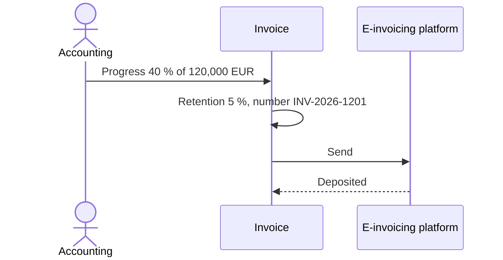

🏠 [Specs](../../../../README.md) › 🧩 [Functional capabilities](../../../README.md) ›
🛒 [F6 Customers and sales](../../README.md) › 📝 [Use cases](../README.md) ›
📝 [Use cases: FL-F6-03 Invoice and get paid](README.md) › 📝 UC-F6-06 Invoice: deposits, progress and final

# 📝 UC-F6-06 Invoice: deposits, progress and final

**Status:** ✅ specified

## Summary

Deposit, progress and final invoices, with the retention guarantee, in e-invoicing formats.

## Personas

- [U05 Accounting](../../../../01-users/personas/u05-accounting.md)
- [U16 Office worker](../../../../01-users/personas/u16-office-worker.md)

## Goal

Invoices that are right, legal and in the e-invoicing format.

## Trigger

An order done, a deposit due, a progress step.

## Frequency

Daily.

## Preconditions

F6 set up for the company.

## Postconditions

- **Succeeded:** the invoice is numbered, sent and receivable.
- **Failed:** refused by the platform, not sent.

## Main flow

1. From an order or contract, accounting invoices a deposit, a progress step or the final amount,
   [S-F6-06](../../screens/03-invoice-and-get-paid/s-f06-06-invoice.md),
   [BR-F6-06](../../business-rules/br-f06-06-progress-invoices-and-retention.md).
2. A retention guarantee of 5 % is deducted when the contract says so,
   [CR-FR-021](../../../../10-country-packs/france/invoicing/cr-fr-021-construction-retention-guarantee.md).
3. The final invoice deducts deposits, progress invoices and the retention.
4. The invoice is numbered without gaps ([BR-F6-07](../../business-rules/br-f06-07-invoice-numbers-never-break.md)),
   generated with its PDF and e-invoicing formats and sent through the platform
   ([CR-FR-016](../../../../10-country-packs/france/invoicing/cr-fr-016-electronic-invoicing.md)).
5. A public buyer's invoice goes through Chorus Pro
   ([UC-F6-19](../07-special-invoicing/uc-f06-19-invoice-a-public-buyer-through-chorus-pro.md)); a funded one is split
   per payer ([UC-F6-20](../07-special-invoicing/uc-f06-20-invoice-several-payers-with-funders-and-caps.md)).

## Alternative flows

- 2a. The retention is released after the guarantee period or against a bank guarantee.

## Error flows

- 4e. The e-invoicing platform refuses: its reason shown, the invoice not sent.

## Business rules

- [BR-F6-06](../../business-rules/br-f06-06-progress-invoices-and-retention.md)
- [BR-F6-07](../../business-rules/br-f06-07-invoice-numbers-never-break.md)
- [BR-F6-08 VAT is shown wherever it matters](../../business-rules/br-f06-08-vat-is-shown-wherever-it-matters.md)

## Entities

- [E-F6-05 Invoice](../../data/e-f06-05-invoice.md)

## Permissions

Accounting; sales read their customers' invoices; the owner reads.

## Notifications

The customer: invoice.

## Audit events

Invoice issued, sent, refused.

## AI involvement

The AI assistant prepares it for confirmation
([BR-F3-07](../../../f03-assistant/business-rules/br-f03-07-no-deletes-no-irreversible-acts.md)); figures come from
queries ([BR-F3-03](../../../f03-assistant/business-rules/br-f03-03-figures-come-from-queries.md)).

## API, MCP and A2A exposure

T5 operations of F6 with the caller's rights; the MCP tool of F6; no A2A skill.

## Screens

- [S-F6-06](../../screens/03-invoice-and-get-paid/s-f06-06-invoice.md)

## Flowchart

See [FL-F6-03 Invoice and get paid](../../flows/fl-f06-03-invoice-and-get-paid.md#flowchart).

## Sequence diagram

## Acceptance criteria

1. **Given** Acme Bâtiment's contract of 120,000 EUR excl. VAT with a 5 % retention **when** a 40 % progress invoice is
   issued **then** it bills 48,000 EUR less 2,400 EUR retention.
2. **Given** invoice INV-2026-1200 issued **when** the next is issued **then** it is numbered INV-2026-1201.
3. **Given** the platform refuses "missing SIREN" **when** it is sent **then** the reason shows and it is not sent.

## Non-functional notes

None.

## Regulatory references

Invoice mentions ([CR-FR-015](../../../../10-country-packs/france/invoicing/cr-fr-015-invoice-mandatory-mentions.md));
payment terms and late penalties,
[CR-FR-018](../../../../10-country-packs/france/invoicing/cr-fr-018-payment-terms-cap.md),
[CR-FR-019](../../../../10-country-packs/france/invoicing/cr-fr-019-late-payment-penalties.md).
[CR-FR-016](../../../../10-country-packs/france/invoicing/cr-fr-016-electronic-invoicing.md);
[CR-FR-021](../../../../10-country-packs/france/invoicing/cr-fr-021-construction-retention-guarantee.md).

## Related use cases

F8 (accounting), F16 (requests), F7 (stock), F9 (work).

- [UC-F6-19 Invoice a public buyer through Chorus Pro](../07-special-invoicing/uc-f06-19-invoice-a-public-buyer-through-chorus-pro.md)

- [UC-F6-20 Invoice several payers with funders and caps](../07-special-invoicing/uc-f06-20-invoice-several-payers-with-funders-and-caps.md)

- [UC-F6-22 Issue a pro-forma invoice and a statement of account](../07-special-invoicing/uc-f06-22-issue-a-pro-forma-invoice-and-a-statement-of-account.md)

- [UC-F7-22 Charge and declare packaging eco-contributions](../../../f07-purchasing-and-stock/use-cases/09-compliance-and-carbon/uc-f07-22-charge-and-declare-packaging-eco-contributions.md)

## Open questions

None.

---

⬅️ [UC-F6-05](../02-quote-to-order/uc-f06-05-turn-a-quote-into-an-order-and-follow-it.md) · ⬆️ [Up](README.md) ·
➡️ [UC-F6-07 Get paid online and reconcile](uc-f06-07-get-paid-online-and-reconcile.md)
