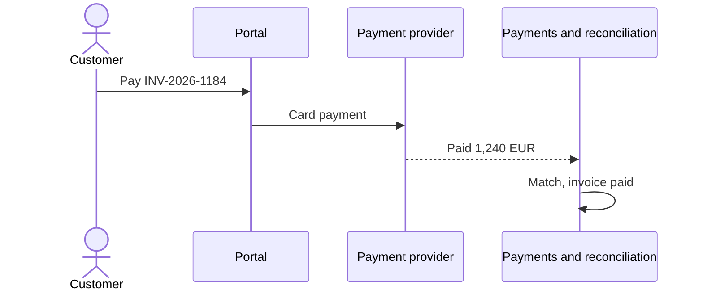

🏠 [Specs](../../../../README.md) › 🧩 [Functional capabilities](../../../README.md) ›
🛒 [F6 Customers and sales](../../README.md) › 📝 [Use cases](../README.md) ›
📝 [Use cases: FL-F6-03 Invoice and get paid](README.md) › 📝 UC-F6-07 Get paid online and reconcile

# 📝 UC-F6-07 Get paid online and reconcile

**Status:** ✅ specified

## Summary

Customers pay online through the company's providers; payments are matched to invoices.

## Personas

- [U09 Customer](../../../../01-users/personas/u09-customer.md)
- [U05 Accounting](../../../../01-users/personas/u05-accounting.md)

## Goal

Get paid easily and see invoices paid without matching by hand.

## Trigger

A customer pays.

## Frequency

Daily.

## Preconditions

F6 set up for the company.

## Postconditions

- **Succeeded:** the invoice is paid and F8 has the payment.
- **Failed:** an unmatched payment waits for a person.

## Main flow

1. The customer pays from the portal by card, wallet or SEPA direct debit
   ([BR-F6-02](../../business-rules/br-f06-02-no-card-number-in-simple-erp.md)), or by transfer with the reference.
2. The provider's status or the bank line (F8) is matched to the invoice on the payments screen
   ([S-F6-07](../../screens/03-invoice-and-get-paid/s-f06-07-payments-and-reconciliation.md)).
3. The invoice is paid; F8 gets the payment.
4. An instalment is matched to its plan ([UC-F6-23](../08-collect-and-settle/uc-f06-23-agree-an-instalment-plan.md)).

## Alternative flows

- 1a. Partial payment: the invoice stays partly paid.

## Error flows

- 2e. An unmatched payment: listed for a person to match.
- 1e. Card refused: the customer sees it.

## Business rules

- [BR-F6-02](../../business-rules/br-f06-02-no-card-number-in-simple-erp.md)
- [BR-F6-08 VAT is shown wherever it matters](../../business-rules/br-f06-08-vat-is-shown-wherever-it-matters.md)

## Entities

- [E-F6-06 Customer payment](../../data/e-f06-06-customer-payment.md)

## Permissions

Customers pay; accounting matches.

## Notifications

Accounting: unmatched payments.

## Audit events

Paid, matched.

## AI involvement

The AI assistant proposes matches; a person confirms unclear ones.

## API, MCP and A2A exposure

T5 operations of F6 with the caller's rights; the MCP tool of F6; no A2A skill.

## Screens

- [S-F6-07](../../screens/03-invoice-and-get-paid/s-f06-07-payments-and-reconciliation.md)

## Flowchart

See [FL-F6-03 Invoice and get paid](../../flows/fl-f06-03-invoice-and-get-paid.md#flowchart).

## Sequence diagram

## Acceptance criteria

1. **Given** invoice INV-2026-1184 of 1,240 EUR **when** the customer pays by card **then** it is paid and F8 has the
   payment.
2. **Given** a transfer of 1,240 EUR with the reference **when** the bank line arrives **then** it is matched.
3. **Given** a transfer of 999 EUR with no reference **when** it arrives **then** it is listed for a person.

## Non-functional notes

None.

## Regulatory references

[CR-FR-023](../../../../10-country-packs/france/payments/cr-fr-023-sepa-formats.md).

## Related use cases

F8 (accounting), F16 (requests), F7 (stock), F9 (work).

## Open questions

None.

---

⬅️ [UC-F6-06 Invoice: deposits, progress and final](uc-f06-06-invoice-deposits-progress-and-final.md) ·
⬆️ [Up](README.md) · ➡️ [UC-F6-08 Remind late payers](uc-f06-08-remind-late-payers.md)
