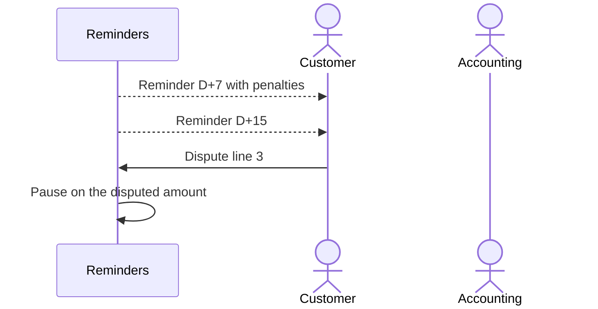

🏠 [Specs](../../../../README.md) › 🧩 [Functional capabilities](../../../README.md) ›
🛒 [F6 Customers and sales](../../README.md) › 📝 [Use cases](../README.md) ›
📝 [Use cases: FL-F6-03 Invoice and get paid](README.md) › 📝 UC-F6-08 Remind late payers

# 📝 UC-F6-08 Remind late payers

**Status:** ✅ specified

## Summary

Reminders, penalties and the formal notice go out automatically on schedule.

## Personas

- [U05 Accounting](../../../../01-users/personas/u05-accounting.md)

## Goal

Get paid on time without chasing by hand.

## Trigger

An invoice nears or passes its due date.

## Frequency

Daily run.

## Preconditions

F6 set up for the company.

## Postconditions

- **Succeeded:** reminders and the formal notice went out; payment stops them.
- **Failed:** a bounce goes to a person.

## Main flow

1. Each customer profile has a reminder sequence: before the due date, then after 7, 15 and 30 days
   ([BR-F6-05](../../business-rules/br-f06-05-reminders-run-on-their-own.md)), on the reminders screen
   ([S-F6-08](../../screens/03-invoice-and-get-paid/s-f06-08-reminders.md)).
2. Each reminder goes out automatically, with the legal late penalties and the 40 EUR fixed recovery fee
   ([CR-FR-019](../../../../10-country-packs/france/invoicing/cr-fr-019-late-payment-penalties.md)).
3. At the last step, the formal notice goes out.
4. A payment, an instalment plan ([UC-F6-23](../08-collect-and-settle/uc-f06-23-agree-an-instalment-plan.md)) or a
   dispute ([UC-F6-24](../08-collect-and-settle/uc-f06-24-handle-a-disputed-invoice.md)) stops or pauses the sequence.

## Alternative flows

- 3a. Hand over to a collection agency or court procedure: a person's decision.

## Error flows

- 2e. An email bounce: the reminder goes by post or a person is told.

## Business rules

- [BR-F6-05](../../business-rules/br-f06-05-reminders-run-on-their-own.md)

## Entities

- [E-F6-05 Invoice](../../data/e-f06-05-invoice.md)
- [E-F6-21 Payment reminder](../../data/e-f06-21-payment-reminder.md)
- [E-F6-22 Formal notice](../../data/e-f06-22-formal-notice.md)

## Permissions

Accounting; sales read their customers' invoices; the owner reads.

## Notifications

Customers: reminders; accounting: bounces.

## Audit events

Each reminder sent.

## AI involvement

The AI assistant prepares it for confirmation
([BR-F3-07](../../../f03-assistant/business-rules/br-f03-07-no-deletes-no-irreversible-acts.md)); figures come from
queries ([BR-F3-03](../../../f03-assistant/business-rules/br-f03-03-figures-come-from-queries.md)).

## API, MCP and A2A exposure

T5 operations of F6 with the caller's rights; the MCP tool of F6; no A2A skill.

## Screens

- [S-F6-08](../../screens/03-invoice-and-get-paid/s-f06-08-reminders.md)

## Flowchart

See [FL-F6-03 Invoice and get paid](../../flows/fl-f06-03-invoice-and-get-paid.md#flowchart).

## Sequence diagram

## Acceptance criteria

1. **Given** invoice due 2026-11-01 unpaid **when** 2026-11-08 comes **then** the first reminder goes with the 40 EUR
   fee.
2. **Given** a payment on 2026-11-12 **when** it is matched **then** the sequence stops.
3. **Given** a dispute on 86 EUR **when** it is recorded **then** reminders pause on 86 EUR only.

## Non-functional notes

None.

## Regulatory references

Invoice mentions ([CR-FR-015](../../../../10-country-packs/france/invoicing/cr-fr-015-invoice-mandatory-mentions.md));
payment terms and late penalties,
[CR-FR-018](../../../../10-country-packs/france/invoicing/cr-fr-018-payment-terms-cap.md),
[CR-FR-019](../../../../10-country-packs/france/invoicing/cr-fr-019-late-payment-penalties.md).

## Related use cases

F8 (accounting), F16 (requests), F7 (stock), F9 (work).

- [UC-F6-18 Set a credit limit and hold orders](../06-accounts-and-credit/uc-f06-18-set-a-credit-limit-and-hold-orders.md)

- [UC-F6-22 Issue a pro-forma invoice and a statement of account](../07-special-invoicing/uc-f06-22-issue-a-pro-forma-invoice-and-a-statement-of-account.md)

- [UC-F6-23 Agree an instalment plan](../08-collect-and-settle/uc-f06-23-agree-an-instalment-plan.md)

- [UC-F6-24 Handle a disputed invoice](../08-collect-and-settle/uc-f06-24-handle-a-disputed-invoice.md)

- [UC-F8-26 Provision doubtful debts](../../../f08-accounting/use-cases/08-year-end-duties/uc-f08-26-provision-doubtful-debts.md)

## Open questions

None.

---

⬅️ [UC-F6-07 Get paid online and reconcile](uc-f06-07-get-paid-online-and-reconcile.md) · ⬆️ [Up](README.md) ·
➡️ [UC-F6-09 Credit note and refund](uc-f06-09-credit-note-and-refund.md)
