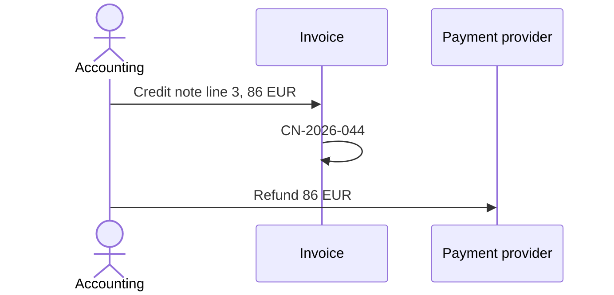

🏠 [Specs](../../../../README.md) › 🧩 [Functional capabilities](../../../README.md) ›
🛒 [F6 Customers and sales](../../README.md) › 📝 [Use cases](../README.md) ›
📝 [Use cases: FL-F6-03 Invoice and get paid](README.md) › 📝 UC-F6-09 Credit note and refund

# 📝 UC-F6-09 Credit note and refund

**Status:** ✅ specified

## Summary

A credit note cancels or reduces an invoice; a refund is paid back.

## Personas

- [U05 Accounting](../../../../01-users/personas/u05-accounting.md)

## Goal

Correct an invoice legally and refund what is owed.

## Trigger

An error, a return, a settled dispute.

## Frequency

Weekly.

## Preconditions

F6 set up for the company.

## Postconditions

- **Succeeded:** the credit note is numbered and sent; refund paid or kept as credit.
- **Failed:** a refund above the payment is refused.

## Main flow

1. Accounting creates a credit note from an invoice
   ([S-F6-06](../../screens/03-invoice-and-get-paid/s-f06-06-invoice.md)), in full or for some lines.
2. It is numbered ([BR-F6-07](../../business-rules/br-f06-07-invoice-numbers-never-break.md)) and sent like an invoice
   ([CR-FR-200](../../../../10-country-packs/france/invoicing/cr-fr-200-credit-notes.md)).
3. A refund is paid through the provider or by transfer, or the credit is kept for the next invoice.
4. Commissions on the credited amount are reversed
   ([UC-F6-25](../09-sell-on-the-road-and-steer-sales/uc-f06-25-set-sales-targets-and-pay-commissions.md)).

## Alternative flows

- 1a. From F16, an agent prepares a refund within its intent's rules, for confirmation.

## Error flows

- 3e. A refund above the original payment: refused.

## Business rules

- [BR-F6-07](../../business-rules/br-f06-07-invoice-numbers-never-break.md)
- [BR-F6-08 VAT is shown wherever it matters](../../business-rules/br-f06-08-vat-is-shown-wherever-it-matters.md)

## Entities

- [E-F6-05 Invoice](../../data/e-f06-05-invoice.md)
- [E-F6-06 Customer payment](../../data/e-f06-06-customer-payment.md)

## Permissions

Accounting; sales read their customers' invoices; the owner reads.

## Notifications

The customer: credit note and refund.

## Audit events

Credit note, refund.

## AI involvement

The AI assistant prepares it for confirmation
([BR-F3-07](../../../f03-assistant/business-rules/br-f03-07-no-deletes-no-irreversible-acts.md)); figures come from
queries ([BR-F3-03](../../../f03-assistant/business-rules/br-f03-03-figures-come-from-queries.md)).

## API, MCP and A2A exposure

T5 operations of F6 with the caller's rights; the MCP tool of F6; no A2A skill.

## Screens

- [S-F6-06](../../screens/03-invoice-and-get-paid/s-f06-06-invoice.md)

## Flowchart

See [FL-F6-03 Invoice and get paid](../../flows/fl-f06-03-invoice-and-get-paid.md#flowchart).

## Sequence diagram

## Acceptance criteria

1. **Given** invoice INV-2026-1184 **when** a credit note for line 3 of 86 EUR is made **then** CN-2026-044 is issued
   and sent.
2. **Given** a payment of 1,240 EUR **when** a refund of 1,300 EUR is asked **then** it is refused.
3. **Given** a commission on that invoice **when** the credit note is posted **then** the commission on 86 EUR is
   reversed.

## Non-functional notes

None.

## Regulatory references

[CR-FR-200](../../../../10-country-packs/france/invoicing/cr-fr-200-credit-notes.md).

## Related use cases

F8 (accounting), F16 (requests), F7 (stock), F9 (work).

- [UC-F6-24 Handle a disputed invoice](../08-collect-and-settle/uc-f06-24-handle-a-disputed-invoice.md)

## Open questions

None.

---

⬅️ [UC-F6-08 Remind late payers](uc-f06-08-remind-late-payers.md) · ⬆️ [Up](README.md) ·
➡️ [UC-F6-10 Manage subscriptions](../04-subscriptions/uc-f06-10-manage-subscriptions.md)
