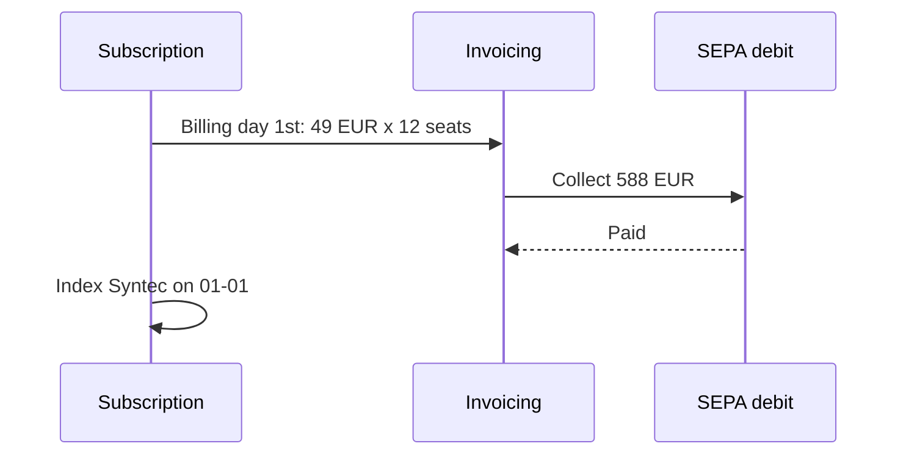

🏠 [Specs](../../../../README.md) › 🧩 [Functional capabilities](../../../README.md) ›
🛒 [F6 Customers and sales](../../README.md) › 📝 [Use cases](../README.md) ›
📝 [Use cases: FL-F6-04 Subscriptions](README.md) › 📝 UC-F6-10 Manage subscriptions

# 📝 UC-F6-10 Manage subscriptions

**Status:** ✅ specified

## Summary

Recurring contracts are billed on schedule, renewed and indexed.

## Personas

- [U03 Sales](../../../../01-users/personas/u03-sales.md)
- [U05 Accounting](../../../../01-users/personas/u05-accounting.md)

## Goal

Recurring revenue billed and collected without work.

## Trigger

A subscription is created or its date comes.

## Frequency

Monthly runs.

## Preconditions

F6 set up for the company.

## Postconditions

- **Succeeded:** invoices issued and collected; renewals and indexation applied.
- **Failed:** a failed debit is retried and reminded.

## Main flow

1. Sales create a subscription ([S-F6-09](../../screens/04-subscriptions/s-f06-09-subscriptions.md)) with its lines,
   period, billing day and payment method.
2. Invoices are issued on schedule and collected (SEPA direct debit or card at the provider).
3. Renewal is automatic or with notice; prices are indexed by their index (Syntec, INSEE) on the date.
4. The customer manages it in the portal ([UC-F6-11](../02-quote-to-order/uc-f06-11-use-the-customer-portal.md)).

## Alternative flows

- 3a. Upgrade or downgrade with pro-rata.
- 3b. Pause, or cancel within the notice.

## Error flows

- 2e. A failed debit: retried, then the customer and accounting told.

## Business rules

- [BR-F6-08 VAT is shown wherever it matters](../../business-rules/br-f06-08-vat-is-shown-wherever-it-matters.md)

## Entities

- [E-F6-07 Subscription contract](../../data/e-f06-07-subscription-contract.md)

## Permissions

Sales for their customers (record rules by area); managers; accounting for invoices.

## Notifications

The customer: invoices and renewal notice.

## Audit events

Created, invoiced, indexed, renewed, ended.

## AI involvement

The AI assistant prepares it for confirmation
([BR-F3-07](../../../f03-assistant/business-rules/br-f03-07-no-deletes-no-irreversible-acts.md)); figures come from
queries ([BR-F3-03](../../../f03-assistant/business-rules/br-f03-03-figures-come-from-queries.md)).

## API, MCP and A2A exposure

T5 operations of F6 with the caller's rights; the MCP tool of F6; no A2A skill.

## Screens

- [S-F6-09](../../screens/04-subscriptions/s-f06-09-subscriptions.md)

## Flowchart

See [FL-F6-04 Subscriptions](../../flows/fl-f06-04-subscriptions.md#flowchart).

## Sequence diagram

## Acceptance criteria

1. **Given** Nuvola Logiciels' customer with 12 seats at 49 EUR monthly **when** the 1st comes **then** an invoice of
   588 EUR excl. VAT is issued and debited.
2. **Given** an upgrade to 15 seats on the 16th **when** it is saved **then** a pro-rata invoice for 3 seats over half a
   month is issued.
3. **Given** a Syntec index up 2 % **when** the indexation date comes **then** the price becomes 49.98 EUR.

## Non-functional notes

None.

## Regulatory references

Invoice mentions ([CR-FR-015](../../../../10-country-packs/france/invoicing/cr-fr-015-invoice-mandatory-mentions.md));
payment terms and late penalties,
[CR-FR-018](../../../../10-country-packs/france/invoicing/cr-fr-018-payment-terms-cap.md),
[CR-FR-019](../../../../10-country-packs/france/invoicing/cr-fr-019-late-payment-penalties.md).

## Related use cases

F8 (accounting), F16 (requests), F7 (stock), F9 (work).

## Open questions

None.

---

⬅️ [UC-F6-09 Credit note and refund](../03-invoice-and-get-paid/uc-f06-09-credit-note-and-refund.md) ·
⬆️ [Up](README.md) · ➡️ [UC-F6-11 Use the customer portal](../02-quote-to-order/uc-f06-11-use-the-customer-portal.md)
