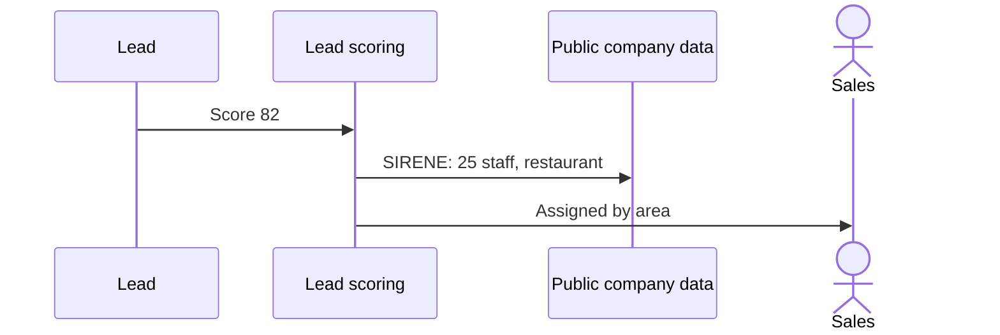

🏠 [Specs](../../../../README.md) › 🧩 [Functional capabilities](../../../README.md) ›
🛒 [F6 Customers and sales](../../README.md) › 📝 [Use cases](../README.md) ›
📝 [Use cases: FL-F6-05 Benchmark additions](README.md) › 📝 UC-F6-13 Score, assign and enrich leads

# 📝 UC-F6-13 Score, assign and enrich leads

**Status:** ✅ specified

## Summary

Leads are scored from past wins, assigned by rules and quotas, enriched from public company data and deduplicated.

## Personas

- [U03 Sales](../../../../01-users/personas/u03-sales.md)
- [U02 Manager](../../../../01-users/personas/u02-manager.md)

## Goal

Sales call the best leads first.

## Trigger

A lead arrives.

## Frequency

Continuous.

## Preconditions

F6 set up for the company.

## Postconditions

- **Succeeded:** the lead is scored, enriched and assigned.
- **Failed:** the lead is kept unenriched and retried.

## Main flow

1. A lead arrives ([UC-F6-01](../01-lead-to-quote/uc-f06-01-capture-and-qualify-a-lead.md)).
2. It is scored from what past won leads had in common, on the lead scoring screen
   ([S-F6-11](../../screens/05-benchmark-additions/s-f06-11-lead-scoring.md)).
3. It is enriched from public company data (SIRENE: size, activity) and checked for duplicates.
4. It is assigned to a sales person by rules (area, product) and quotas.

## Alternative flows

- 2a. Lead mining: a search by sector and region proposes companies to contact.

## Error flows

- 3e. The enrichment source is down: the lead is kept and enrichment retried.

## Business rules

- See F6's rules.

## Entities

- Existing entities of the capability.
- [E-F6-20 Lead](../../data/e-f06-20-lead.md)

## Permissions

Sales for their customers (record rules by area); managers; accounting for invoices.

## Notifications

The sales person: lead assigned.

## Audit events

Score, enrichment, assignment.

## AI involvement

The scoring model explains its score; a person can change it.

## API, MCP and A2A exposure

T5 operations of F6 with the caller's rights; the MCP tool of F6; no A2A skill.

## Screens

- [S-F6-11](../../screens/05-benchmark-additions/s-f06-11-lead-scoring.md)

## Flowchart

See [FL-F6-05 Benchmark additions](../../flows/fl-f06-05-benchmark-additions.md#flowchart).

## Sequence diagram

## Acceptance criteria

1. **Given** a lead similar to past wins **when** it is scored **then** it gets a high score with the reasons.
2. **Given** a SIRET on the lead **when** it is enriched **then** size and activity are filled.
3. **Given** an area rule Lyon -> Lea **when** a Lyon lead arrives **then** it is assigned to Lea.

## Non-functional notes

None.

## Regulatory references

[CR-FR-196](../../../../10-country-packs/france/data-protection/cr-fr-196-legitimate-interest-balancing.md).

## Related use cases

See [FL-F6-05](../../flows/fl-f06-05-benchmark-additions.md).

## Open questions

None.

---

⬅️ [UC-F6-12 Manage price lists and discounts](../01-lead-to-quote/uc-f06-12-manage-price-lists-and-discounts.md) ·
⬆️ [Up](README.md) · ➡️ [UC-F6-14 Configure products in a quote](uc-f06-14-configure-products-in-a-quote.md)
