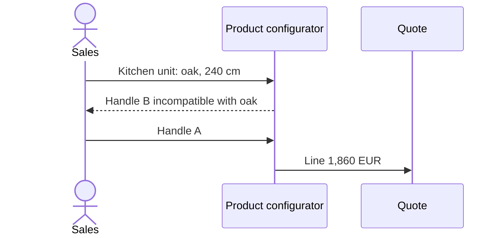

🏠 [Specs](../../../../README.md) › 🧩 [Functional capabilities](../../../README.md) ›
🛒 [F6 Customers and sales](../../README.md) › 📝 [Use cases](../README.md) ›
📝 [Use cases: FL-F6-05 Benchmark additions](README.md) › 📝 UC-F6-14 Configure products in a quote

# 📝 UC-F6-14 Configure products in a quote

**Status:** ✅ specified

## Summary

A configurator in the quote chooses options and variants, a grid enters quantities per variant, and optional products
are offered.

## Personas

- [U03 Sales](../../../../01-users/personas/u03-sales.md)

## Goal

Sell configurable products without errors.

## Trigger

A configurable product added to a quote.

## Frequency

Daily for configurable products.

## Preconditions

F6 set up for the company.

## Postconditions

- **Succeeded:** valid lines with their price.
- **Failed:** incompatible options are refused.

## Main flow

1. The sales person adds a configurable product to the quote and opens the configurator
   ([S-F6-12](../../screens/05-benchmark-additions/s-f06-12-product-configurator.md)).
2. They pick options and variants; incompatible ones are greyed with the reason.
3. For sizes and colours, a grid takes quantities per variant.
4. The price updates in the quote; optional products are offered.

## Alternative flows

- 3a. Optional products accepted by the customer in the portal.

## Error flows

- 2e. Incompatible options: explained and refused.

## Business rules

- See F6's rules.

## Entities

- Existing entities of the capability.

## Permissions

Sales for their customers (record rules by area); managers; accounting for invoices.

## Notifications

None.

## Audit events

Configuration chosen.

## AI involvement

The AI assistant prepares it for confirmation
([BR-F3-07](../../../f03-assistant/business-rules/br-f03-07-no-deletes-no-irreversible-acts.md)); figures come from
queries ([BR-F3-03](../../../f03-assistant/business-rules/br-f03-03-figures-come-from-queries.md)).

## API, MCP and A2A exposure

T5 operations of F6 with the caller's rights; the MCP tool of F6; no A2A skill.

## Screens

- [S-F6-12](../../screens/05-benchmark-additions/s-f06-12-product-configurator.md)

## Flowchart

See [FL-F6-05 Benchmark additions](../../flows/fl-f06-05-benchmark-additions.md#flowchart).

## Sequence diagram

## Acceptance criteria

1. **Given** a kitchen unit in oak **when** handle B is chosen **then** it is refused as incompatible with oak.
2. **Given** a T-shirt in 3 sizes and 2 colours **when** the grid is filled **then** 6 lines with their quantities are
   added.
3. **Given** options chosen **when** the configuration is saved **then** the price is updated in the quote.

## Non-functional notes

None.

## Regulatory references

None.

## Related use cases

See [FL-F6-05](../../flows/fl-f06-05-benchmark-additions.md).

## Open questions

None.

---

⬅️ [UC-F6-13 Score, assign and enrich leads](uc-f06-13-score-assign-and-enrich-leads.md) · ⬆️ [Up](README.md) ·
➡️ [UC-F6-15 Rent out equipment](uc-f06-15-rent-out-equipment.md)
