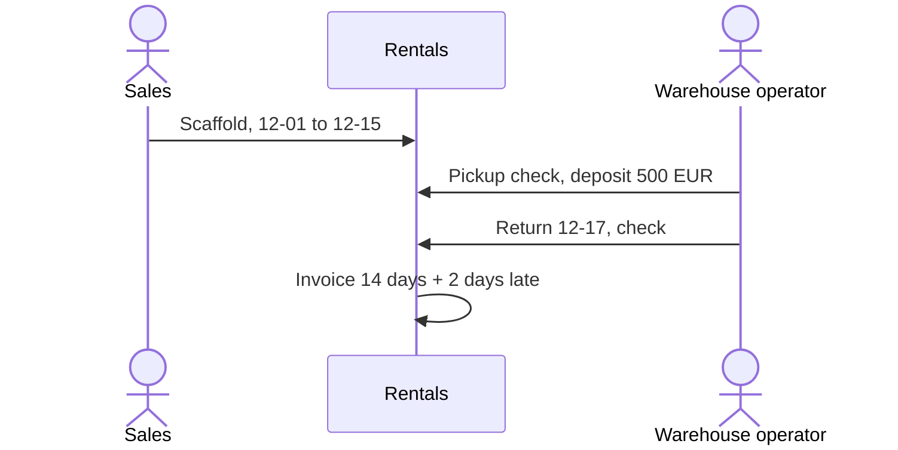

🏠 [Specs](../../../../README.md) › 🧩 [Functional capabilities](../../../README.md) ›
🛒 [F6 Customers and sales](../../README.md) › 📝 [Use cases](../README.md) ›
📝 [Use cases: FL-F6-05 Benchmark additions](README.md) › 📝 UC-F6-15 Rent out equipment

# 📝 UC-F6-15 Rent out equipment

**Status:** ✅ specified

## Summary

Rentals with time-based prices, pickup and return checks, padding between rentals, overdue charges and deposits.

## Personas

- [U03 Sales](../../../../01-users/personas/u03-sales.md)
- [U15 Warehouse operator](../../../../01-users/personas/u15-warehouse-operator.md)
- [U09 Customer](../../../../01-users/personas/u09-customer.md)

## Goal

Rent out equipment without double booking or losses.

## Trigger

A customer asks to rent.

## Frequency

Daily for rental companies.

## Preconditions

F6 set up for the company.

## Postconditions

- **Succeeded:** the rental is returned, checked and invoiced.
- **Failed:** a late return is charged.

## Main flow

1. The sales person quotes a rental ([S-F6-13](../../screens/05-benchmark-additions/s-f06-13-rentals.md)) with dates;
   availability is checked, [BR-F6-09](../../business-rules/br-f06-09-rentals-are-never-double-booked.md),
   [UC-F2-19](../../../f02-no-code-configuration/use-cases/08-views-and-bookings/uc-f02-19-book-a-resource.md).
2. At pickup, the warehouse operator checks the equipment and records the deposit.
3. At return, they check it again and record damage.
4. The rental is invoiced: time-based price, overdue charges, damage; the deposit is released or kept.

## Alternative flows

- 1a. The customer rents from the portal.

## Error flows

- 4e. Late return: overdue charges apply
  ([BR-F6-09](../../business-rules/br-f06-09-rentals-are-never-double-booked.md)).
- 1e. Equipment not free: other dates offered.

## Business rules

- [BR-F6-09 Rentals are never double-booked](../../business-rules/br-f06-09-rentals-are-never-double-booked.md)

## Entities

- [E-F6-09 Rental](../../data/e-f06-09-rental.md)

## Permissions

Sales for their customers (record rules by area); managers; accounting for invoices. Warehouse operators for pickups and
returns.

## Notifications

The customer: pickup and return dates.

## Audit events

Rented, picked up, returned, invoiced.

## AI involvement

The AI assistant prepares it for confirmation
([BR-F3-07](../../../f03-assistant/business-rules/br-f03-07-no-deletes-no-irreversible-acts.md)); figures come from
queries ([BR-F3-03](../../../f03-assistant/business-rules/br-f03-03-figures-come-from-queries.md)).

## API, MCP and A2A exposure

T5 operations of F6 with the caller's rights; the MCP tool of F6; no A2A skill.

## Screens

- [S-F6-13](../../screens/05-benchmark-additions/s-f06-13-rentals.md)

## Flowchart

See [FL-F6-05 Benchmark additions](../../flows/fl-f06-05-benchmark-additions.md#flowchart).

## Sequence diagram

## Acceptance criteria

1. **Given** a scaffold rented 12-01 to 12-15 at 20 EUR a day **when** it returns on 12-17 **then** 2 overdue days are
   charged.
2. **Given** the scaffold rented 12-01 to 12-15 **when** another rental 12-10 is tried **then** it is refused.
3. **Given** no damage at return **when** it is checked **then** the 500 EUR deposit is released.

## Non-functional notes

None.

## Regulatory references

None.

## Related use cases

See [FL-F6-05](../../flows/fl-f06-05-benchmark-additions.md).

- [UC-F2-18 Make a record type bookable](../../../f02-no-code-configuration/use-cases/08-views-and-bookings/uc-f02-18-make-a-record-type-bookable.md)

## Open questions

None.

---

⬅️ [UC-F6-14 Configure products in a quote](uc-f06-14-configure-products-in-a-quote.md) · ⬆️ [Up](README.md) ·
➡️ [UC-F6-16 Bill usage, commitments and milestones](uc-f06-16-bill-usage-commitments-and-milestones.md)
