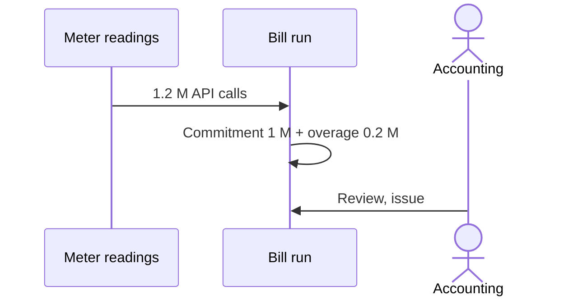

🏠 [Specs](../../../../README.md) › 🧩 [Functional capabilities](../../../README.md) ›
🛒 [F6 Customers and sales](../../README.md) › 📝 [Use cases](../README.md) ›
📝 [Use cases: FL-F6-05 Benchmark additions](README.md) › 📝 UC-F6-16 Bill usage, commitments and milestones

# 📝 UC-F6-16 Bill usage, commitments and milestones

**Status:** 🔄 waiting for the owner

## Summary

Metered usage, commitments with overage, prepaid credits and milestones are billed from contracts and readings.

## Personas

- [U05 Accounting](../../../../01-users/personas/u05-accounting.md)
- [U03 Sales](../../../../01-users/personas/u03-sales.md)

## Goal

Bill exactly what was used or reached.

## Trigger

Readings arrive; the bill run date; a milestone.

## Frequency

Monthly bill runs.

## Preconditions

F6 set up for the company.

## Postconditions

- **Succeeded:** invoices computed from readings and contracts.
- **Failed:** the run waits for missing readings.

## Main flow

1. Readings arrive through T12 or an import
   ([BR-F6-10](../../business-rules/br-f06-10-usage-is-billed-from-metered-data.md)) on usage billing
   ([S-F6-14](../../screens/05-benchmark-additions/s-f06-14-usage-billing.md)).
2. The bill run computes each invoice: commitment, overage, prepaid credits used.
3. Accounting reviews the run and issues the invoices
   ([UC-F6-06](../03-invoice-and-get-paid/uc-f06-06-invoice-deposits-progress-and-final.md)).
4. Revenue is recognised,
   [UC-F8-16](../../../f08-accounting/use-cases/06-benchmark-additions/uc-f08-16-recognise-revenue-under-ifrs-15.md).

## Alternative flows

- 2a. A milestone reached: its invoice is issued.

## Error flows

- 1e. Missing readings: the run waits and lists them.

## Business rules

- [BR-F6-10 Usage is billed from metered data](../../business-rules/br-f06-10-usage-is-billed-from-metered-data.md)

## Entities

- [E-F6-10 Rate plan and meter](../../data/e-f06-10-rate-plan-and-meter.md)

## Permissions

Accounting; sales read their customers' invoices; the owner reads.

## Notifications

Accounting: run ready; missing readings.

## Audit events

Readings, runs, invoices.

## AI involvement

The AI assistant prepares it for confirmation
([BR-F3-07](../../../f03-assistant/business-rules/br-f03-07-no-deletes-no-irreversible-acts.md)); figures come from
queries ([BR-F3-03](../../../f03-assistant/business-rules/br-f03-03-figures-come-from-queries.md)).

## API, MCP and A2A exposure

T5 operations of F6 with the caller's rights; the MCP tool of F6; no A2A skill.

## Screens

- [S-F6-14](../../screens/05-benchmark-additions/s-f06-14-usage-billing.md)

## Flowchart

See [FL-F6-05 Benchmark additions](../../flows/fl-f06-05-benchmark-additions.md#flowchart).

## Sequence diagram

## Acceptance criteria

1. **Given** a commitment of 1 M calls at 400 EUR and 0.40 EUR per 1,000 above **when** 1.2 M calls are read **then**
   the invoice is 400 + 80 = 480 EUR.
2. **Given** readings missing for 3 customers **when** the run starts **then** it waits and lists them.
3. **Given** a milestone "go-live" reached **when** it is marked **then** its invoice is issued.

## Non-functional notes

A run of 2,500 customers within 10 minutes (Proposed).

## Regulatory references

None.

## Related use cases

See [FL-F6-05](../../flows/fl-f06-05-benchmark-additions.md).

- [UC-F9-31 Follow a project as a customer](../../../f09-hr-and-projects/use-cases/11-capacity-rounds-and-partners/uc-f09-31-follow-a-project-as-a-customer.md)

## Open questions

None.

---

⬅️ [UC-F6-15 Rent out equipment](uc-f06-15-rent-out-equipment.md) · ⬆️ [Up](README.md) ·
➡️ [UC-F6-17](../06-accounts-and-credit/uc-f06-17-organise-accounts-with-their-timeline-and-emails.md)
