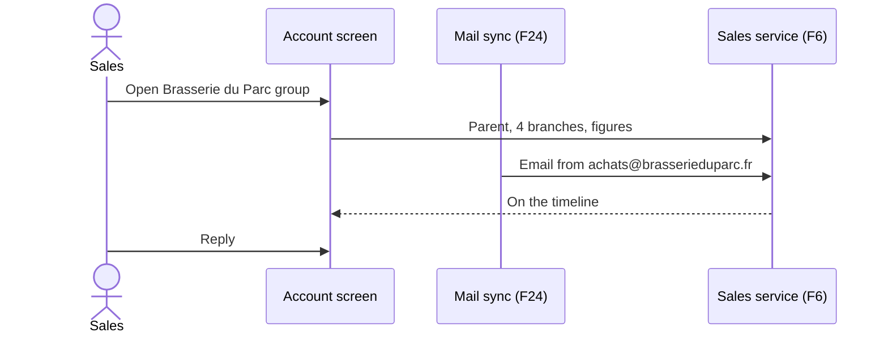

🏠 [Specs](../../../../README.md) › 🧩 [Functional capabilities](../../../README.md) ›
🛒 [F6 Customers and sales](../../README.md) › 📝 [Use cases](../README.md) ›
📝 [Use cases: FL-F6-06 Accounts and credit](README.md) › 📝 UC-F6-17 Organise accounts with their timeline and emails

# 📝 UC-F6-17 Organise accounts with their timeline and emails

**Status:** 🔄 waiting for the owner

## Summary

A sales person sees a customer as a group (parent and branches) and, on each account, one timeline of emails, calls,
meetings, quotes, orders, invoices and requests.

## Personas

- [U03 Sales](../../../../01-users/personas/u03-sales.md)
- [U41 Customer success manager](../../../../01-users/personas/u41-customer-success-manager.md)
- [U02 Manager](../../../../01-users/personas/u02-manager.md)

## Goal

Know everything that happened with a customer, and how its branches belong together.

## Trigger

Opening a customer, or an email arriving.

## Frequency

Daily for sales.

## Preconditions

- Mailboxes connected,
  [UC-F24-05](../../../f24-integrations-hub/use-cases/02-office-suites/uc-f24-05-sync-mail-calendars-and-contacts.md),
  for emails to appear.

## Postconditions

- **Succeeded:** the account shows its parent, branches and timeline.
- **Failed:** an email not matched waits in the inbox to be linked.

## Main flow

1. The sales person opens a customer ([S-F6-15](../../screens/06-accounts-and-credit/s-f06-15-account.md)): its parent,
   its branches and their key figures.
2. The timeline lists, newest first, emails, calls (F4), meetings, quotes, orders, invoices, payments and requests
   (F16).
3. Emails from the customer's domains and contacts are matched to the account; the sales person replies from the
   timeline.
4. They attach a branch to its parent; reports and the credit limit can then roll up to the group
   ([UC-F6-18](uc-f06-18-set-a-credit-limit-and-hold-orders.md)).

## Alternative flows

- 3a. An email matching two accounts: the sales person chooses.
- 1a. The AI assistant summarises the last three months of the timeline.

## Error flows

- 4e. A branch attached under its own branch: refused as a loop.
- 3e. A private email (personal label): never matched.

## Business rules

- [BR-F6-11 Over the credit limit, orders are held](../../business-rules/br-f06-11-over-the-credit-limit-orders-are-held.md)
- [BR-F6-03 The portal shows only the customer's own](../../business-rules/br-f06-03-portal-shows-only-the-customer-s-own.md)

## Entities

- [E-F6-11 Timeline entry](../../data/e-f06-11-timeline-entry.md)
- [E-F6-01 Customer record](../../data/e-f06-01-customer-record.md)

## Permissions

Sales for their customers (record rules by area or team); managers for their team; accounting for invoices.

## Notifications

The account owner: a new email from the customer.

## Audit events

Parent changed; emails linked.

## AI involvement

The AI assistant prepares it for confirmation
([BR-F3-07](../../../f03-assistant/business-rules/br-f03-07-no-deletes-no-irreversible-acts.md)); figures come from
queries ([BR-F3-03](../../../f03-assistant/business-rules/br-f03-03-figures-come-from-queries.md)).

## API, MCP and A2A exposure

T5 operations of F6 with the caller's rights; the MCP tool of F6; no A2A skill.

## Screens

- [S-F6-15 Account](../../screens/06-accounts-and-credit/s-f06-15-account.md)

## Flowchart

See [FL-F6-06 Accounts and credit](../../flows/fl-f06-06-accounts-and-credit.md#flowchart).

## Sequence diagram

## Acceptance criteria

1. **Given** Distribution Lemoine's customer group Brasserie du Parc with 4 branches **when** the sales person opens it
   **then** the group shows the 4 branches and their sales this year.
2. **Given** an email from achats@brasserieduparc.fr **when** it arrives **then** it shows on the group's timeline.
3. **Given** branch Lyon Part-Dieu attached to Brasserie du Parc **when** the parent is set to Lyon Part-Dieu itself
   **then** it is refused as a loop.

## Non-functional notes

The timeline of 5 years opens within 2 seconds (Proposed).

## Regulatory references

GDPR: work emails only
([CR-FR-052](../../../../10-country-packs/france/data-protection/cr-fr-052-storage-limitation.md)).

## Related use cases

- [UC-F6-01 Capture and qualify a lead](../01-lead-to-quote/uc-f06-01-capture-and-qualify-a-lead.md)
- [UC-F24-05 Sync mail, calendars and contacts](../../../f24-integrations-hub/use-cases/02-office-suites/uc-f24-05-sync-mail-calendars-and-contacts.md)

## Open questions

None.

---

⬅️ [UC-F6-16](../05-benchmark-additions/uc-f06-16-bill-usage-commitments-and-milestones.md) · ⬆️ [Up](README.md) ·
➡️ [UC-F6-18 Set a credit limit and hold orders](uc-f06-18-set-a-credit-limit-and-hold-orders.md)
