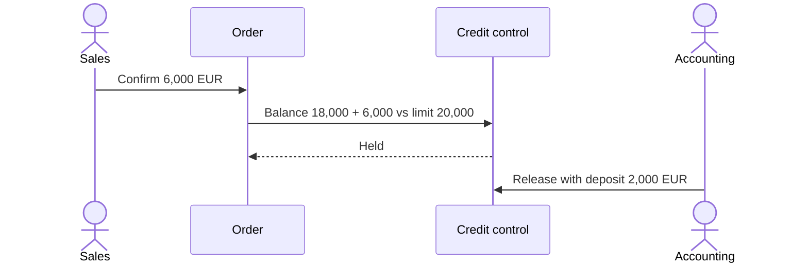

🏠 [Specs](../../../../README.md) › 🧩 [Functional capabilities](../../../README.md) ›
🛒 [F6 Customers and sales](../../README.md) › 📝 [Use cases](../README.md) ›
📝 [Use cases: FL-F6-06 Accounts and credit](README.md) › 📝 UC-F6-18 Set a credit limit and hold orders

# 📝 UC-F6-18 Set a credit limit and hold orders

**Status:** 🔄 waiting for the owner

## Summary

Accounting sets a credit limit per customer or group; an order that would pass it is held until accounting releases it
or the customer pays.

## Personas

- [U05 Accounting](../../../../01-users/personas/u05-accounting.md)
- [U03 Sales](../../../../01-users/personas/u03-sales.md)
- [U13 Owner](../../../../01-users/personas/u13-owner.md)

## Goal

Sell without letting unpaid balances grow beyond what the company accepts.

## Trigger

A new customer, a review of risk, or an order over the limit.

## Frequency

Daily checks; limits reviewed yearly.

## Preconditions

- The customer's open balance is known (F6 and F8).

## Postconditions

- **Succeeded:** orders within the limit go on; those over it are held
  ([BR-F6-11](../../business-rules/br-f06-11-over-the-credit-limit-orders-are-held.md)).
- **Failed:** the order stays held.

## Main flow

1. Accounting opens Credit control ([S-F6-16](../../screens/06-accounts-and-credit/s-f06-16-credit-control.md)) and sets
   the limit of a customer or group, with its review date.
2. A sales person confirms an order; SimpleERP adds it to the open balance and overdue invoices.
3. Over the limit, or with an invoice overdue by more than 30 days (Proposed), the order is held and the sales person
   sees why.
4. Accounting releases the order, asks a deposit, or keeps it held until payment.
5. A payment that brings the balance under the limit releases held orders automatically.

## Alternative flows

- 1a. A group limit: branches share it.
- 4a. The owner releases above accounting's own limit.

## Error flows

- 3e. The balance cannot be computed (F8 unavailable): the order is held with that reason.
- 4e. A release without a reason: refused.

## Business rules

- [BR-F6-11 Over the credit limit, orders are held](../../business-rules/br-f06-11-over-the-credit-limit-orders-are-held.md)

## Entities

- [E-F6-12 Credit limit](../../data/e-f06-12-credit-limit.md)
- [E-F6-04 Order](../../data/e-f06-04-order.md)

## Permissions

Accounting sets and releases; the owner above accounting's release limit; sales see the status.

## Notifications

- Sales: order held, released.
- Accounting: an order held.

## Audit events

Limit changed; order held and released, with reason.

## AI involvement

The AI assistant prepares it for confirmation
([BR-F3-07](../../../f03-assistant/business-rules/br-f03-07-no-deletes-no-irreversible-acts.md)); figures come from
queries ([BR-F3-03](../../../f03-assistant/business-rules/br-f03-03-figures-come-from-queries.md)).

## API, MCP and A2A exposure

T5 operations of F6 with the caller's rights; the MCP tool of F6; no A2A skill.

## Screens

- [S-F6-16 Credit control](../../screens/06-accounts-and-credit/s-f06-16-credit-control.md)
- [S-F6-05 Order](../../screens/02-quote-to-order/s-f06-05-order.md)

## Flowchart

See [FL-F6-06 Accounts and credit](../../flows/fl-f06-06-accounts-and-credit.md#flowchart).

## Sequence diagram

## Acceptance criteria

1. **Given** Brasserie du Parc with a limit of 20,000 EUR and 18,000 EUR open **when** an order of 6,000 EUR is
   confirmed **then** the order is held and the sales person sees "credit limit".
2. **Given** the held order **when** accounting releases it with the reason "deposit asked" **then** it goes on and the
   reason is logged.
3. **Given** a payment of 10,000 EUR **when** it is posted **then** the held order is released.
4. **Given** an invoice overdue by 45 days **when** a small order is confirmed **then** it is held.

## Non-functional notes

The check adds under 300 ms to confirming an order (Proposed).

## Regulatory references

None.

## Related use cases

- [UC-F6-05 Turn a quote into an order and follow it](../02-quote-to-order/uc-f06-05-turn-a-quote-into-an-order-and-follow-it.md)
- [UC-F6-08 Remind late payers](../03-invoice-and-get-paid/uc-f06-08-remind-late-payers.md)

## Open questions

None.

---

⬅️ [UC-F6-17](uc-f06-17-organise-accounts-with-their-timeline-and-emails.md) · ⬆️ [Up](README.md) ·
➡️ [UC-F6-19](../07-special-invoicing/uc-f06-19-invoice-a-public-buyer-through-chorus-pro.md)
