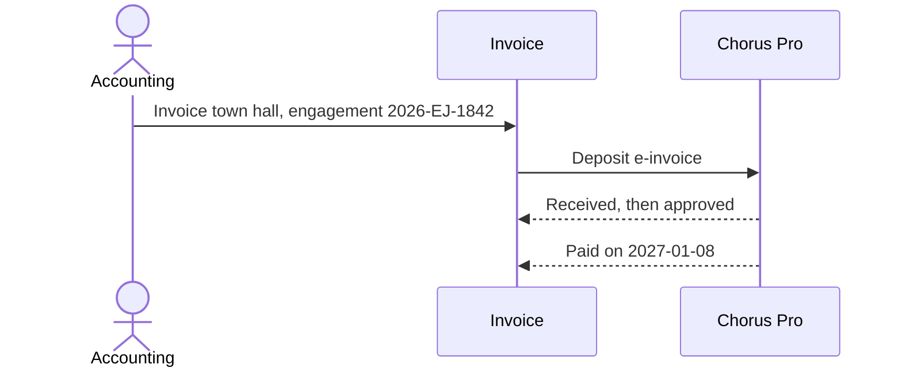

🏠 [Specs](../../../../README.md) › 🧩 [Functional capabilities](../../../README.md) ›
🛒 [F6 Customers and sales](../../README.md) › 📝 [Use cases](../README.md) ›
📝 [Use cases: FL-F6-07 Special invoicing](README.md) › 📝 UC-F6-19 Invoice a public buyer through Chorus Pro

# 📝 UC-F6-19 Invoice a public buyer through Chorus Pro

**Status:** 🔄 waiting for the owner

## Summary

Accounting invoices a public body (a town hall, a hospital, a ministry) through Chorus Pro, with its SIRET, service code
and engagement number, and follows the invoice's status there.

## Personas

- [U05 Accounting](../../../../01-users/personas/u05-accounting.md)
- [U16 Office worker](../../../../01-users/personas/u16-office-worker.md)

## Goal

Public invoices accepted first time and paid within the legal period.

## Trigger

An order or a progress step for a public customer.

## Frequency

Monthly for companies working for public buyers.

## Preconditions

- The customer is marked public buyer with its Chorus Pro details
  ([E-F6-13](../../data/e-f06-13-public-buyer-setting.md)).

## Postconditions

- **Succeeded:** the invoice is deposited on Chorus Pro and its status followed to payment.
- **Failed:** the invoice is rejected and back to accounting.

## Main flow

1. Accounting invoices the order
   ([UC-F6-06](../03-invoice-and-get-paid/uc-f06-06-invoice-deposits-progress-and-final.md)) on the invoice screen
   ([S-F6-06](../../screens/03-invoice-and-get-paid/s-f06-06-invoice.md)); simple-ERP asks the engagement number and
   service code if the buyer requires them,
   [BR-F6-12](../../business-rules/br-f06-12-public-invoices-go-through-chorus-pro-with-their-references.md).
2. The invoice is deposited on Chorus Pro in the e-invoicing format
   ([CR-FR-016](../../../../10-country-packs/france/invoicing/cr-fr-016-electronic-invoicing.md)).
3. The status comes back: deposited, received, rejected, approved, paid.
4. A rejection shows the buyer's reason; accounting fixes it with a credit note and a new invoice.
5. The legal payment period is followed and late interest computed when passed,
   [CR-FR-091](../../../../10-country-packs/france/invoicing/cr-fr-091-public-contracts-payment-and-chorus-pro.md).

## Alternative flows

- 1a. Progress invoices on public works: retention and progress statements as
  [BR-F6-06](../../business-rules/br-f06-06-progress-invoices-and-retention.md).

## Error flows

- 1e. No engagement number when the buyer requires one: the invoice cannot be validated.
- 2e. Chorus Pro unreachable: retried, then accounting told.

## Business rules

- [BR-F6-12 Public invoices go through Chorus Pro with their references](../../business-rules/br-f06-12-public-invoices-go-through-chorus-pro-with-their-references.md)
- [BR-F6-07 Invoice numbers never break](../../business-rules/br-f06-07-invoice-numbers-never-break.md)
- [BR-F6-06 Progress invoices and retention](../../business-rules/br-f06-06-progress-invoices-and-retention.md)

## Entities

- [E-F6-13 Public buyer setting](../../data/e-f06-13-public-buyer-setting.md)
- [E-F6-05 Invoice](../../data/e-f06-05-invoice.md)

## Permissions

Accounting; sales read their customers' invoices; the owner reads.

## Notifications

Accounting: rejected, approved and paid statuses.

## Audit events

Deposited, each status.

## AI involvement

The AI assistant prepares it for confirmation
([BR-F3-07](../../../f03-assistant/business-rules/br-f03-07-no-deletes-no-irreversible-acts.md)); figures come from
queries ([BR-F3-03](../../../f03-assistant/business-rules/br-f03-03-figures-come-from-queries.md)).

## API, MCP and A2A exposure

T5 operations of F6 with the caller's rights; the MCP tool of F6; no A2A skill.

## Screens

- [S-F6-06 Invoice](../../screens/03-invoice-and-get-paid/s-f06-06-invoice.md)

## Flowchart

See [FL-F6-07 Special invoicing](../../flows/fl-f06-07-special-invoicing.md#flowchart).

## Sequence diagram

## Acceptance criteria

1. **Given** Acme Bâtiment's progress invoice to the town hall of Villeurbanne with engagement 2026-EJ-1842 **when** it
   is validated **then** it is deposited on Chorus Pro.
2. **Given** a buyer requiring an engagement number **when** the invoice has none **then** it cannot be validated.
3. **Given** Chorus Pro rejects with "wrong service code" **when** the status arrives **then** accounting sees the
   reason and fixes by credit note.
4. **Given** approved on 2026-12-01 and unpaid after 30 days **when** the period passes **then** late interest is
   computed.

## Non-functional notes

Statuses refreshed at least daily (Proposed).

## Regulatory references

[CR-FR-091](../../../../10-country-packs/france/invoicing/cr-fr-091-public-contracts-payment-and-chorus-pro.md);
[CR-FR-016](../../../../10-country-packs/france/invoicing/cr-fr-016-electronic-invoicing.md);
[CR-FR-200](../../../../10-country-packs/france/invoicing/cr-fr-200-credit-notes.md).

## Related use cases

- [UC-F6-06 Invoice: deposits, progress and final](../03-invoice-and-get-paid/uc-f06-06-invoice-deposits-progress-and-final.md)
- [UC-F24-01 Browse the connector catalogue](../../../f24-integrations-hub/use-cases/01-find-and-connect/uc-f24-01-browse-the-connector-catalogue.md)

## Open questions

None.

---

⬅️ [UC-F6-18](../06-accounts-and-credit/uc-f06-18-set-a-credit-limit-and-hold-orders.md) · ⬆️ [Up](README.md) ·
➡️ [UC-F6-20 Invoice several payers with funders and caps](uc-f06-20-invoice-several-payers-with-funders-and-caps.md)
