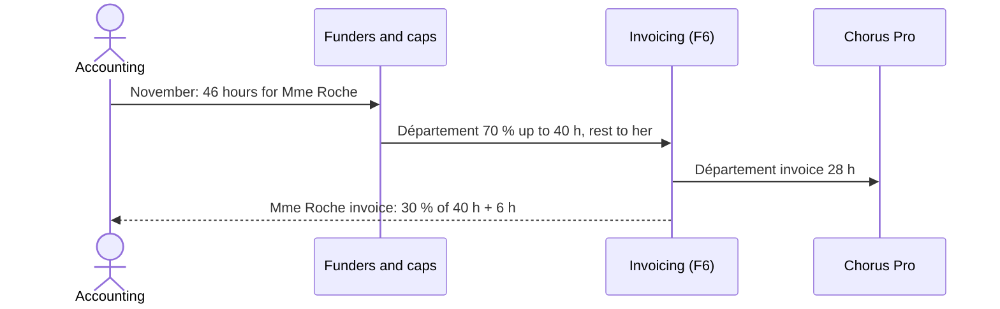

🏠 [Specs](../../../../README.md) › 🧩 [Functional capabilities](../../../README.md) ›
🛒 [F6 Customers and sales](../../README.md) › 📝 [Use cases](../README.md) ›
📝 [Use cases: FL-F6-07 Special invoicing](README.md) › 📝 UC-F6-20 Invoice several payers with funders and caps

# 📝 UC-F6-20 Invoice several payers with funders and caps

**Status:** 🔄 waiting for the owner

## Summary

An invoice is split between payers: funders (a département, a health insurer, an OPCO, a grant-giver) each up to its
cap, and the beneficiary for the rest; the shared multi-payer capability of D457.

## Personas

- [U05 Accounting](../../../../01-users/personas/u05-accounting.md)
- [U25 Care coordinator](../../../../01-users/personas/u25-care-coordinator.md)
- [U38 Training coordinator](../../../../01-users/personas/u38-training-coordinator.md)

## Goal

Each payer receives exactly its share, and caps are never passed.

## Trigger

Invoicing a service funded by one or more third parties.

## Frequency

Monthly in home care, training and health.

## Preconditions

- The funder agreements are set on the customer or beneficiary: funder, share, cap, period
  ([E-F6-14](../../data/e-f06-14-funder-agreement.md)).

## Postconditions

- **Succeeded:** one invoice per payer, each with its share, the beneficiary billed the rest
  ([BR-F6-13](../../business-rules/br-f06-13-each-payer-pays-its-share-up-to-its-cap.md)).
- **Failed:** nothing is invoiced; the gap is shown.

## Main flow

1. Accounting opens Funders and caps ([S-F6-17](../../screens/07-special-invoicing/s-f06-17-funders-and-caps.md)) and
   checks the beneficiary's agreements: the département pays 70 % up to 40 hours a month, the beneficiary the rest.
2. The month's services are invoiced; simple-ERP splits each line per payer by share and cap.
3. Once a cap is reached, the rest of the month goes to the next payer or the beneficiary.
4. One invoice per payer is issued, each in its format (Chorus Pro for public funders, the funder's file, or a normal
   invoice) ([UC-F6-19](uc-f06-19-invoice-a-public-buyer-through-chorus-pro.md)).
5. Each payer's payments are matched to its invoice; the beneficiary sees only their share.

## Alternative flows

- 1a. Third-party payment in health
  ([CR-FR-133](../../../../10-country-packs/france/health-practice/cr-fr-133-third-party-payment.md)): the insurer's
  share is billed to the insurer.
- 1b. A training funded by an OPCO and the employer,
  [UC-SC12-04](../../../../08-sectors/sc12-education-and-training/use-cases/02-enrol-and-fund/uc-sc12-04-get-funding.md).

## Error flows

- 2e. An agreement expired: its share goes to the beneficiary and accounting is warned before issuing.
- 4e. A funder rejects its invoice: accounting fixes it; the beneficiary's invoice is not changed.

## Business rules

- [BR-F6-13 Each payer pays its share up to its cap](../../business-rules/br-f06-13-each-payer-pays-its-share-up-to-its-cap.md)
- [BR-F6-07 Invoice numbers never break](../../business-rules/br-f06-07-invoice-numbers-never-break.md)

## Entities

- [E-F6-14 Funder agreement](../../data/e-f06-14-funder-agreement.md)
- [E-F6-05 Invoice](../../data/e-f06-05-invoice.md)

## Permissions

Accounting; sales read their customers' invoices; the owner reads. Care and training coordinators read agreements.

## Notifications

Accounting: an agreement ending within 30 days (Proposed).

## Audit events

Agreements changed; splits per invoice.

## AI involvement

The AI assistant prepares it for confirmation
([BR-F3-07](../../../f03-assistant/business-rules/br-f03-07-no-deletes-no-irreversible-acts.md)); figures come from
queries ([BR-F3-03](../../../f03-assistant/business-rules/br-f03-03-figures-come-from-queries.md)).

## API, MCP and A2A exposure

T5 operations of F6 with the caller's rights; the MCP tool of F6; no A2A skill.

## Screens

- [S-F6-17 Funders and caps](../../screens/07-special-invoicing/s-f06-17-funders-and-caps.md)
- [S-F6-06 Invoice](../../screens/03-invoice-and-get-paid/s-f06-06-invoice.md)

## Flowchart

See [FL-F6-07 Special invoicing](../../flows/fl-f06-07-special-invoicing.md#flowchart).

## Sequence diagram

## Acceptance criteria

1. **Given** the example home-care service's recipient Mme Roche with 46 hours in November at 25 EUR, the département
   paying 70 % up to 40 hours **when** November is invoiced **then** the département is billed 700 EUR and Mme Roche 450
   EUR.
2. **Given** the département's agreement ending on 2026-11-15 **when** November is invoiced **then** hours after the
   15th go to Mme Roche and accounting is warned.
3. **Given** an OPCO funding 1,200 EUR of a 2,000 EUR course at Atelier Compétences **when** the course is invoiced
   **then** the OPCO is billed 1,200 EUR and the employer 800 EUR.

## Non-functional notes

None.

## Regulatory references

[CR-FR-105](../../../../10-country-packs/france/home-care/cr-fr-105-departmental-allowances-billing.md);
[CR-FR-133](../../../../10-country-packs/france/health-practice/cr-fr-133-third-party-payment.md);
[CR-FR-091](../../../../10-country-packs/france/invoicing/cr-fr-091-public-contracts-payment-and-chorus-pro.md).

## Related use cases

- [UC-F6-06 Invoice: deposits, progress and final](../03-invoice-and-get-paid/uc-f06-06-invoice-deposits-progress-and-final.md)
- [UC-SC04-08 Bill recipients and funders](../../../../08-sectors/sc04-home-care/use-cases/04-bill-and-fund/uc-sc04-08-bill-recipients-and-funders.md)

## Open questions

None.

---

⬅️ [UC-F6-19 Invoice a public buyer through Chorus Pro](uc-f06-19-invoice-a-public-buyer-through-chorus-pro.md) ·
⬆️ [Up](README.md) ·
➡️ [UC-F6-21](../09-sell-on-the-road-and-steer-sales/uc-f06-21-take-orders-offline-on-the-road.md)
