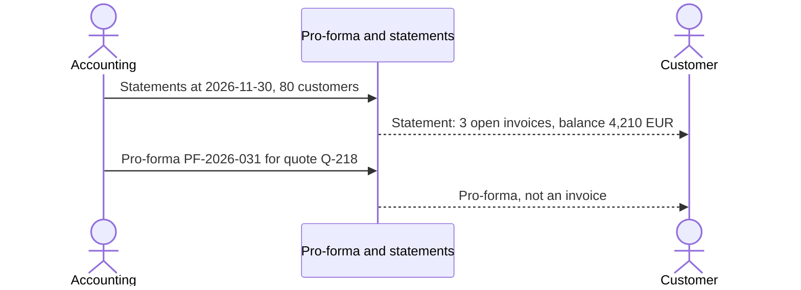

🏠 [Specs](../../../../README.md) › 🧩 [Functional capabilities](../../../README.md) ›
🛒 [F6 Customers and sales](../../README.md) › 📝 [Use cases](../README.md) ›
📝 [Use cases: FL-F6-07 Special invoicing](README.md) › 📝 UC-F6-22 Issue a pro-forma invoice and a statement of account

# 📝 UC-F6-22 Issue a pro-forma invoice and a statement of account

**Status:** 🔄 waiting for the owner

## Summary

Accounting sends a pro-forma invoice before an order (for a deposit or an import), and a statement of account listing a
customer's invoices, payments and balance.

## Personas

- [U05 Accounting](../../../../01-users/personas/u05-accounting.md)
- [U09 Customer](../../../../01-users/personas/u09-customer.md)

## Goal

Customers know what they will pay and what they owe.

## Trigger

A customer asks a pro-forma; the monthly statements.

## Frequency

Weekly pro-formas; monthly statements.

## Preconditions

- A quote or order for a pro-forma; posted invoices and payments for a statement.

## Postconditions

- **Succeeded:** the pro-forma or statement is sent; neither is an invoice
  ([BR-F6-15](../../business-rules/br-f06-15-a-pro-forma-is-not-an-invoice.md)).
- **Failed:** nothing is sent.

## Main flow

1. Accounting opens Pro-forma invoice ([S-F6-23](../../screens/07-special-invoicing/s-f06-23-pro-forma-invoice.md)) or
   Statement of account ([S-F6-19](../../screens/07-special-invoicing/s-f06-19-statement-of-account.md)).
2. For a pro-forma, they pick the quote or order; it is numbered in its own range and marked "pro-forma, not an
   invoice".
3. For statements, they choose the customers and the date; each statement lists open invoices, payments, credits and the
   balance by age.
4. They send them by email or to the portal; the customer pays from it
   ([UC-F6-07](../03-invoice-and-get-paid/uc-f06-07-get-paid-online-and-reconcile.md)).

## Alternative flows

- 3a. Statements sent automatically on the 1st of each month (Proposed).

## Error flows

- 3e. Payments not yet posted: the statement says "as of" with the date.
- 2e. A pro-forma asked on a quote with no price: refused.

## Business rules

- [BR-F6-15 A pro-forma is not an invoice](../../business-rules/br-f06-15-a-pro-forma-is-not-an-invoice.md)
- [BR-F6-08 VAT is shown wherever it matters](../../business-rules/br-f06-08-vat-is-shown-wherever-it-matters.md)

## Entities

- [E-F6-15 Pro-forma invoice](../../data/e-f06-15-pro-forma-invoice.md)
- [E-F6-05 Invoice](../../data/e-f06-05-invoice.md)

## Permissions

Accounting; sales read their customers' invoices; the owner reads.

## Notifications

The customer receives them.

## Audit events

Pro-forma issued; statements sent.

## AI involvement

The AI assistant prepares it for confirmation
([BR-F3-07](../../../f03-assistant/business-rules/br-f03-07-no-deletes-no-irreversible-acts.md)); figures come from
queries ([BR-F3-03](../../../f03-assistant/business-rules/br-f03-03-figures-come-from-queries.md)).

## API, MCP and A2A exposure

T5 operations of F6 with the caller's rights; the MCP tool of F6; no A2A skill.

## Screens

- [S-F6-19 Statement of account](../../screens/07-special-invoicing/s-f06-19-statement-of-account.md)
- [S-F6-23 Pro-forma invoice](../../screens/07-special-invoicing/s-f06-23-pro-forma-invoice.md)

## Flowchart

See [FL-F6-07 Special invoicing](../../flows/fl-f06-07-special-invoicing.md#flowchart).

## Sequence diagram

## Acceptance criteria

1. **Given** Brasserie du Parc with 3 open invoices of 4,210 EUR in total **when** the statement of 2026-11-30 is sent
   **then** it lists the 3 invoices by age and the balance.
2. **Given** quote Q-218 of 8,400 EUR **when** a pro-forma is issued **then** it is numbered PF-2026-031, marked not an
   invoice, with no accounting entry.
3. **Given** a payment received but not posted **when** the statement is sent **then** it says "as of 2026-11-30".

## Non-functional notes

None.

## Regulatory references

[CR-FR-014](../../../../10-country-packs/france/invoicing/cr-fr-014-invoice-numbering.md);
[CR-FR-015](../../../../10-country-packs/france/invoicing/cr-fr-015-invoice-mandatory-mentions.md).

## Related use cases

- [UC-F6-06 Invoice: deposits, progress and final](../03-invoice-and-get-paid/uc-f06-06-invoice-deposits-progress-and-final.md)
- [UC-F6-08 Remind late payers](../03-invoice-and-get-paid/uc-f06-08-remind-late-payers.md)

## Open questions

None.

---

⬅️ [UC-F6-21](../09-sell-on-the-road-and-steer-sales/uc-f06-21-take-orders-offline-on-the-road.md) ·
⬆️ [Up](README.md) ·
➡️ [UC-F6-23 Agree an instalment plan](../08-collect-and-settle/uc-f06-23-agree-an-instalment-plan.md)
