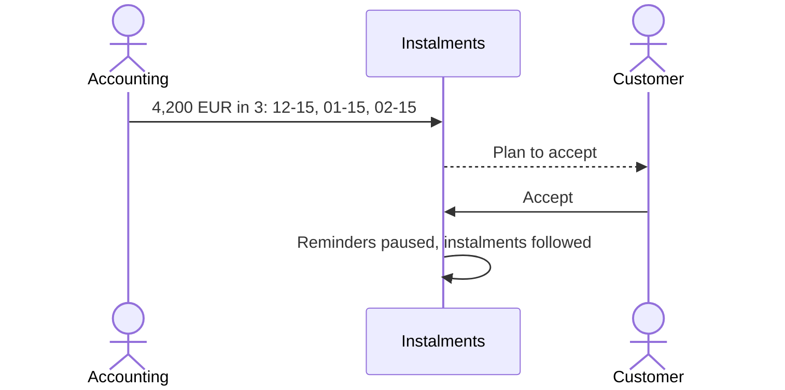

🏠 [Specs](../../../../README.md) › 🧩 [Functional capabilities](../../../README.md) ›
🛒 [F6 Customers and sales](../../README.md) › 📝 [Use cases](../README.md) ›
📝 [Use cases: FL-F6-08 Collect and settle](README.md) › 📝 UC-F6-23 Agree an instalment plan

# 📝 UC-F6-23 Agree an instalment plan

**Status:** ✅ specified

## Summary

Accounting agrees with a customer to pay an invoice or a balance in instalments; reminders follow the schedule instead
of the due date.

## Personas

- [U05 Accounting](../../../../01-users/personas/u05-accounting.md)
- [U09 Customer](../../../../01-users/personas/u09-customer.md)

## Goal

Get paid by a customer who cannot pay at once, without losing track.

## Trigger

A customer asks, or a late balance.

## Frequency

A few a month.

## Preconditions

- Open invoices for the customer.

## Postconditions

- **Succeeded:** the plan is in force; each instalment is due and reminded on its date
  ([BR-F6-16](../../business-rules/br-f06-16-an-instalment-plan-replaces-the-due-date.md)).
- **Failed:** no plan; reminders go on.

## Main flow

1. Accounting opens Instalments and disputes
   ([S-F6-20](../../screens/08-collect-and-settle/s-f06-20-instalments-and-disputes.md)) and creates a plan on the open
   invoices: number of instalments, dates, amounts.
2. The schedule must sum to the balance; late penalties are waived or kept as agreed.
3. The customer accepts the plan (portal or signed letter); reminders of
   [UC-F6-08](../03-invoice-and-get-paid/uc-f06-08-remind-late-payers.md) pause.
4. Each instalment is reminded before its date and matched when paid.
5. A missed instalment resumes the reminders on the whole balance after the grace days (default: 7).

## Alternative flows

- 3a. By SEPA direct debit: each instalment is collected on its date
  ([UC-F6-07](../03-invoice-and-get-paid/uc-f06-07-get-paid-online-and-reconcile.md)).

## Error flows

- 2e. The schedule does not sum to the balance: refused with the gap.

## Business rules

- [BR-F6-16 An instalment plan replaces the due date](../../business-rules/br-f06-16-an-instalment-plan-replaces-the-due-date.md)
- [BR-F6-05 Reminders run on their own](../../business-rules/br-f06-05-reminders-run-on-their-own.md)

## Entities

- [E-F6-16 Instalment plan](../../data/e-f06-16-instalment-plan.md)
- [E-F6-05 Invoice](../../data/e-f06-05-invoice.md)

## Permissions

Accounting; sales read their customers' invoices; the owner reads.

## Notifications

The customer: schedule and reminders; accounting: missed instalment.

## Audit events

Plan created, accepted, instalments paid or missed.

## AI involvement

The AI assistant prepares it for confirmation
([BR-F3-07](../../../f03-assistant/business-rules/br-f03-07-no-deletes-no-irreversible-acts.md)); figures come from
queries ([BR-F3-03](../../../f03-assistant/business-rules/br-f03-03-figures-come-from-queries.md)).

## API, MCP and A2A exposure

T5 operations of F6 with the caller's rights; the MCP tool of F6; no A2A skill.

## Screens

- [S-F6-20 Instalments and disputes](../../screens/08-collect-and-settle/s-f06-20-instalments-and-disputes.md)

## Flowchart

See [FL-F6-08 Collect and settle](../../flows/fl-f06-08-collect-and-settle.md#flowchart).

## Sequence diagram

## Acceptance criteria

1. **Given** a balance of 4,200 EUR **when** a plan of 3 instalments of 1,400 EUR is accepted **then** reminders pause
   and each instalment is reminded before its date.
2. **Given** the instalment of 2027-01-15 unpaid on 2027-01-22 **when** the grace days pass **then** reminders resume on
   the remaining 2,800 EUR.
3. **Given** instalments summing to 4,000 EUR for 4,200 EUR **when** the plan is saved **then** it is refused with the
   gap of 200 EUR.

## Non-functional notes

None.

## Regulatory references

Invoice mentions ([CR-FR-015](../../../../10-country-packs/france/invoicing/cr-fr-015-invoice-mandatory-mentions.md));
payment terms and late penalties,
[CR-FR-018](../../../../10-country-packs/france/invoicing/cr-fr-018-payment-terms-cap.md),
[CR-FR-019](../../../../10-country-packs/france/invoicing/cr-fr-019-late-payment-penalties.md).

## Related use cases

- [UC-F6-08 Remind late payers](../03-invoice-and-get-paid/uc-f06-08-remind-late-payers.md)
- [UC-F6-24 Handle a disputed invoice](uc-f06-24-handle-a-disputed-invoice.md)

## Open questions

None.

---

⬅️ [UC-F6-22](../07-special-invoicing/uc-f06-22-issue-a-pro-forma-invoice-and-a-statement-of-account.md) ·
⬆️ [Up](README.md) · ➡️ [UC-F6-24 Handle a disputed invoice](uc-f06-24-handle-a-disputed-invoice.md)
