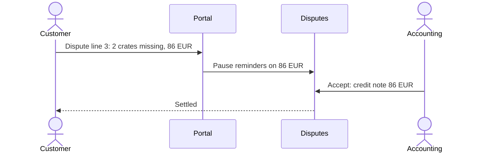

🏠 [Specs](../../../../README.md) › 🧩 [Functional capabilities](../../../README.md) ›
🛒 [F6 Customers and sales](../../README.md) › 📝 [Use cases](../README.md) ›
📝 [Use cases: FL-F6-08 Collect and settle](README.md) › 📝 UC-F6-24 Handle a disputed invoice

# 📝 UC-F6-24 Handle a disputed invoice

**Status:** ✅ specified

## Summary

A customer disputes an invoice or some of its lines; reminders pause on the disputed amount until the dispute is settled
by a credit note or rejected.

## Personas

- [U05 Accounting](../../../../01-users/personas/u05-accounting.md)
- [U03 Sales](../../../../01-users/personas/u03-sales.md)
- [U09 Customer](../../../../01-users/personas/u09-customer.md)

## Goal

Settle disagreements without reminding a customer who is right.

## Trigger

The customer disputes on the portal, by email or by phone.

## Frequency

A few a month.

## Preconditions

- A sent invoice.

## Postconditions

- **Succeeded:** settled: credit note or rejection with reason; reminders resume on what is due.
- **Failed:** the dispute stays open.

## Main flow

1. The customer disputes from the portal ([S-F6-04](../../screens/02-quote-to-order/s-f06-04-customer-portal.md)) with
   the lines and a reason, or accounting records it.
2. The disputed amount is marked; reminders pause on it
   ([BR-F6-17](../../business-rules/br-f06-17-a-dispute-pauses-reminders-on-what-is-disputed.md)); the rest is reminded.
3. Accounting and the sales person check (delivery, quality, price) on Instalments and disputes
   ([S-F6-20](../../screens/08-collect-and-settle/s-f06-20-instalments-and-disputes.md)).
4. They settle: a credit note for the accepted part
   ([UC-F6-09](../03-invoice-and-get-paid/uc-f06-09-credit-note-and-refund.md)), a rejection with the reason, or both.
5. The customer is told; reminders resume on what remains due.

## Alternative flows

- 1a. From a support request (F16).

## Error flows

- 2e. A dispute on a paid invoice: handled as a refund request.
- 4e. Open more than 60 days: escalated to the manager.

## Business rules

- [BR-F6-17 A dispute pauses reminders on what is disputed](../../business-rules/br-f06-17-a-dispute-pauses-reminders-on-what-is-disputed.md)
- [BR-F6-05 Reminders run on their own](../../business-rules/br-f06-05-reminders-run-on-their-own.md)

## Entities

- [E-F6-17 Invoice dispute](../../data/e-f06-17-invoice-dispute.md)
- [E-F6-05 Invoice](../../data/e-f06-05-invoice.md)
- [E-F6-21 Payment reminder](../../data/e-f06-21-payment-reminder.md)

## Permissions

Accounting; sales read their customers' invoices; the owner reads. Sales check their customers' disputes.

## Notifications

The customer: dispute received and settled; sales: a dispute on their customer.

## Audit events

Dispute opened, paused amount, settled, how.

## AI involvement

The AI assistant prepares it for confirmation
([BR-F3-07](../../../f03-assistant/business-rules/br-f03-07-no-deletes-no-irreversible-acts.md)); figures come from
queries ([BR-F3-03](../../../f03-assistant/business-rules/br-f03-03-figures-come-from-queries.md)).

## API, MCP and A2A exposure

T5 operations of F6 with the caller's rights; the MCP tool of F6; no A2A skill.

## Screens

- [S-F6-20 Instalments and disputes](../../screens/08-collect-and-settle/s-f06-20-instalments-and-disputes.md)
- [S-F6-04 Customer portal](../../screens/02-quote-to-order/s-f06-04-customer-portal.md)

## Flowchart

See [FL-F6-08 Collect and settle](../../flows/fl-f06-08-collect-and-settle.md#flowchart).

## Sequence diagram

## Acceptance criteria

1. **Given** an invoice of 1,240 EUR with line 3 of 86 EUR disputed **when** the dispute is recorded **then** reminders
   pause on 86 EUR and go on for 1,154 EUR.
2. **Given** the dispute accepted **when** accounting settles it **then** a credit note of 86 EUR is issued and the
   customer told.
3. **Given** a dispute rejected with the delivery note signed **when** it is settled **then** reminders resume on 86
   EUR.

## Non-functional notes

None.

## Regulatory references

Invoice mentions ([CR-FR-015](../../../../10-country-packs/france/invoicing/cr-fr-015-invoice-mandatory-mentions.md));
payment terms and late penalties,
[CR-FR-018](../../../../10-country-packs/france/invoicing/cr-fr-018-payment-terms-cap.md),
[CR-FR-019](../../../../10-country-packs/france/invoicing/cr-fr-019-late-payment-penalties.md). Credit notes
([CR-FR-200](../../../../10-country-packs/france/invoicing/cr-fr-200-credit-notes.md)).

## Related use cases

- [UC-F6-08 Remind late payers](../03-invoice-and-get-paid/uc-f06-08-remind-late-payers.md)
- [UC-F6-09 Credit note and refund](../03-invoice-and-get-paid/uc-f06-09-credit-note-and-refund.md)

## Open questions

None.

---

⬅️ [UC-F6-23 Agree an instalment plan](uc-f06-23-agree-an-instalment-plan.md) · ⬆️ [Up](README.md) ·
➡️ [UC-F6-25](../09-sell-on-the-road-and-steer-sales/uc-f06-25-set-sales-targets-and-pay-commissions.md)
