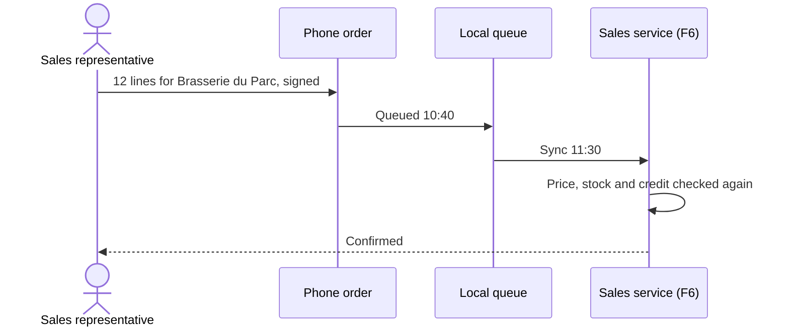

🏠 [Specs](../../../../README.md) › 🧩 [Functional capabilities](../../../README.md) ›
🛒 [F6 Customers and sales](../../README.md) › 📝 [Use cases](../README.md) ›
📝 [Use cases: FL-F6-09 Sell on the road and steer sales](README.md) › 📝 UC-F6-21 Take orders offline on the road

# 📝 UC-F6-21 Take orders offline on the road

**Status:** 🔄 waiting for the owner

## Summary

A sales representative takes orders and quotes on the phone at a customer's premises with no network; they sync and are
priced and checked again when the network is back.

## Personas

- [U42 Sales representative](../../../../01-users/personas/u42-sales-representative.md)
- [U03 Sales](../../../../01-users/personas/u03-sales.md)

## Goal

Never lose an order because of the network.

## Trigger

A visit to a customer.

## Frequency

Daily for representatives.

## Preconditions

- The rep's phone synced its customers, price lists and stock before leaving,
  [UC-F2-21](../../../f02-no-code-configuration/use-cases/09-portals-and-offline-forms/uc-f02-21-make-a-phone-form-work-offline.md).

## Postconditions

- **Succeeded:** the order is confirmed in SimpleERP with its offline time.
- **Failed:** the order stays queued and the rep sees why.

## Main flow

1. The representative opens the customer on the phone
   ([S-F6-18](../../screens/09-sell-on-the-road-and-steer-sales/s-f06-18-phone-order.md)); the banner says Offline.
2. They add lines from the catalogue with the customer's prices and the stock as loaded.
3. The customer signs on the phone; the order is saved in the queue.
4. When the network is back, the order syncs, is priced and checked again (stock, credit limit)
   ([BR-F6-14](../../business-rules/br-f06-14-offline-orders-are-checked-again-on-sync.md)).
5. If nothing changed, it is confirmed and the customer gets the confirmation; otherwise the rep sees the differences to
   accept.

## Alternative flows

- 2a. A quote instead of an order: it is sent on sync.

## Error flows

- 4e. A price changed meanwhile: the rep and the customer accept the new price or the line is removed.
- 4e. Over the credit limit: the order is held
  ([UC-F6-18](../06-accounts-and-credit/uc-f06-18-set-a-credit-limit-and-hold-orders.md)).

## Business rules

- [BR-F6-14 Offline orders are checked again on sync](../../business-rules/br-f06-14-offline-orders-are-checked-again-on-sync.md)
- [BR-F6-11 Over the credit limit, orders are held](../../business-rules/br-f06-11-over-the-credit-limit-orders-are-held.md)
- [BR-F2-21 Offline forms keep only what is needed and sync in order](../../../f02-no-code-configuration/business-rules/br-f02-21-offline-forms-keep-only-what-is-needed-and-sync-in-order.md)

## Entities

- [E-F6-04 Order](../../data/e-f06-04-order.md)
- [E-F2-20 Offline form setting](../../../f02-no-code-configuration/data/e-f02-20-offline-form-setting.md)

## Permissions

Representatives for their customers.

## Notifications

The customer: order confirmed; the rep: differences.

## Audit events

Order taken offline (time), synced, confirmed or changed.

## AI involvement

None offline.

## API, MCP and A2A exposure

T5 sync operations of the phone app.

## Screens

- [S-F6-18 Phone order](../../screens/09-sell-on-the-road-and-steer-sales/s-f06-18-phone-order.md)

## Flowchart

See [FL-F6-09 Sell on the road and steer sales](../../flows/fl-f06-09-sell-on-the-road-and-steer-sales.md#flowchart).

## Sequence diagram

## Acceptance criteria

1. **Given** Distribution Lemoine's rep with no network at Brasserie du Parc **when** she saves a 12-line order at 10:40
   **then** it is queued with its signature.
2. **Given** the network back at 11:30 and nothing changed **when** it syncs **then** the order is confirmed and the
   customer gets it.
3. **Given** a price changed from 12.40 to 12.90 EUR meanwhile **when** it syncs **then** the rep sees the difference to
   accept.
4. **Given** the order passing the credit limit **when** it syncs **then** it is held.

## Non-functional notes

Saving offline within 300 ms (Proposed).

## Regulatory references

[CR-FR-020](../../../../10-country-packs/france/invoicing/cr-fr-020-electronic-acceptance-and-signature.md) for the
signature.

## Related use cases

- [UC-F6-05 Turn a quote into an order and follow it](../02-quote-to-order/uc-f06-05-turn-a-quote-into-an-order-and-follow-it.md)
- [UC-F2-22 Fill a form offline on the phone](../../../f02-no-code-configuration/use-cases/09-portals-and-offline-forms/uc-f02-22-fill-a-form-offline-on-the-phone.md)
- [UC-SC15-05 Take orders on the road, offline](../../../../08-sectors/sc15-wholesale-and-distribution/use-cases/02-orders/uc-sc15-05-take-orders-on-the-road-offline.md)

## Open questions

None.

---

⬅️ [UC-F6-20](../07-special-invoicing/uc-f06-20-invoice-several-payers-with-funders-and-caps.md) · ⬆️ [Up](README.md) ·
➡️ [UC-F6-22](../07-special-invoicing/uc-f06-22-issue-a-pro-forma-invoice-and-a-statement-of-account.md)
