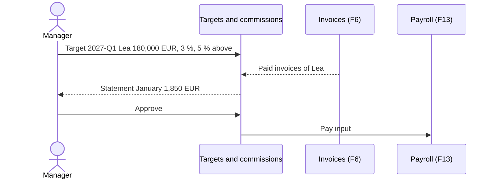

🏠 [Specs](../../../../README.md) › 🧩 [Functional capabilities](../../../README.md) ›
🛒 [F6 Customers and sales](../../README.md) › 📝 [Use cases](../README.md) ›
📝 [Use cases: FL-F6-09 Sell on the road and steer sales](README.md) › 📝 UC-F6-25 Set sales targets and pay commissions

# 📝 UC-F6-25 Set sales targets and pay commissions

**Status:** 🔄 waiting for the owner

## Summary

Managers set targets per rep, team or territory and commission plans; commissions are computed on paid invoices,
approved, and sent to payroll; the shared commissions and targets capability of D457.

## Personas

- [U02 Manager](../../../../01-users/personas/u02-manager.md)
- [U13 Owner](../../../../01-users/personas/u13-owner.md)
- [U42 Sales representative](../../../../01-users/personas/u42-sales-representative.md)
- [U23 Store manager](../../../../01-users/personas/u23-store-manager.md)

## Goal

Reps know their targets and are paid the right commission.

## Trigger

The start of a period; each paid invoice; the period's end.

## Frequency

Plans yearly; statements monthly.

## Preconditions

- Invoices carry their sales person
  ([UC-F6-06](../03-invoice-and-get-paid/uc-f06-06-invoice-deposits-progress-and-final.md)).

## Postconditions

- **Succeeded:** each rep has a target and an approved commission statement sent to payroll (F13).
- **Failed:** the statement waits for approval.

## Main flow

1. The manager opens Targets and commissions
   ([S-F6-21](../../screens/09-sell-on-the-road-and-steer-sales/s-f06-21-targets-and-commissions.md)) and sets targets
   per rep, team or territory for the period.
2. They set the commission plan: rate by product or margin, tiers above the target, split between reps.
3. Commissions are computed on paid invoices
   ([BR-F6-18](../../business-rules/br-f06-18-commissions-follow-paid-invoices.md)); credit notes reverse them.
4. Each rep follows their progress and expected commission on the phone.
5. At the period's end, the manager approves the statements; they go to payroll as pay inputs (F13).

## Alternative flows

- 2a. Resellers' commissions are paid by invoice instead of payroll.
- 2b. Store staff targets (shop sales per seller from F10).

## Error flows

- 3e. A credit note after payment: the commission is reversed on the next statement.
- 5e. A statement disputed by a rep: it waits, with the comment.

## Business rules

- [BR-F6-18 Commissions follow paid invoices](../../business-rules/br-f06-18-commissions-follow-paid-invoices.md)

## Entities

- [E-F6-18 Commission plan and target](../../data/e-f06-18-commission-plan-and-target.md)
- [E-F6-19 Commission line](../../data/e-f06-19-commission-line.md)

## Permissions

Managers for their team; the owner; reps see their own.

## Notifications

Reps: statement ready; payroll: approved statements.

## Audit events

Plans and targets changed; statements approved.

## AI involvement

The AI assistant prepares it for confirmation
([BR-F3-07](../../../f03-assistant/business-rules/br-f03-07-no-deletes-no-irreversible-acts.md)); figures come from
queries ([BR-F3-03](../../../f03-assistant/business-rules/br-f03-03-figures-come-from-queries.md)).

## API, MCP and A2A exposure

T5 operations of F6 with the caller's rights; the MCP tool of F6; no A2A skill.

## Screens

- [S-F6-21 Targets and commissions](../../screens/09-sell-on-the-road-and-steer-sales/s-f06-21-targets-and-commissions.md)

## Flowchart

See [FL-F6-09 Sell on the road and steer sales](../../flows/fl-f06-09-sell-on-the-road-and-steer-sales.md#flowchart).

## Sequence diagram

## Acceptance criteria

1. **Given** Lea with 3 % up to 180,000 EUR and 5 % above in Q1 2027 **when** she reaches 200,000 EUR paid **then** her
   commission is 5,400 + 1,000 = 6,400 EUR.
2. **Given** a credit note of 2,000 EUR on a paid invoice **when** it is posted **then** 60 EUR is reversed on the next
   statement.
3. **Given** an approved January statement **when** it is approved **then** a pay input goes to payroll.
4. **Given** Lea **when** she opens her progress **then** she sees 112 % of the target and her expected commission.

## Non-functional notes

None.

## Regulatory references

(Proposed) to read: rules on variable pay in the employment contract.

## Related use cases

- [UC-F6-26 Read sales and margin reports](uc-f06-26-read-sales-and-margin-reports.md)
- [UC-F13-03 Collect pay inputs from F9](../../../f13-payroll/use-cases/02-monthly-pay-run/uc-f13-03-collect-pay-inputs-from-f9.md)

## Open questions

None.

---

⬅️ [UC-F6-24 Handle a disputed invoice](../08-collect-and-settle/uc-f06-24-handle-a-disputed-invoice.md) ·
⬆️ [Up](README.md) · ➡️ [UC-F6-26 Read sales and margin reports](uc-f06-26-read-sales-and-margin-reports.md)
