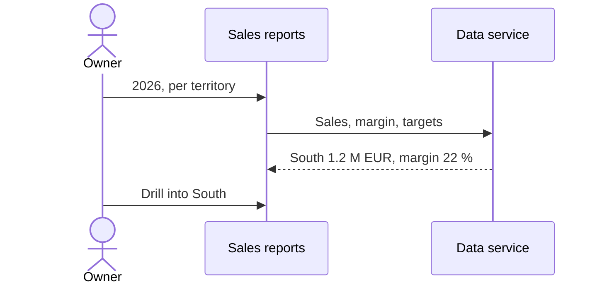

🏠 [Specs](../../../../README.md) › 🧩 [Functional capabilities](../../../README.md) ›
🛒 [F6 Customers and sales](../../README.md) › 📝 [Use cases](../README.md) ›
📝 [Use cases: FL-F6-09 Sell on the road and steer sales](README.md) › 📝 UC-F6-26 Read sales and margin reports

# 📝 UC-F6-26 Read sales and margin reports

**Status:** ✅ specified

## Summary

Managers and the owner read sales and margin per rep, territory, customer and product, against targets and last year.

## Personas

- [U02 Manager](../../../../01-users/personas/u02-manager.md)
- [U13 Owner](../../../../01-users/personas/u13-owner.md)
- [U05 Accounting](../../../../01-users/personas/u05-accounting.md)

## Goal

See where sales and margins come from.

## Trigger

A monthly review.

## Frequency

Monthly; weekly for managers.

## Preconditions

- Invoices with sales person, territory and product cost.

## Postconditions

- **Succeeded:** the report is shown, saved or exported.
- **Failed:** with no posted invoice, the report says so.

## Main flow

1. The manager opens Sales reports
   ([S-F6-22](../../screens/09-sell-on-the-road-and-steer-sales/s-f06-22-sales-reports.md)) for a period.
2. Sales and margin show per rep, territory, customer and product, with the target and last year.
3. They drill into a figure down to the invoices.
4. They save the view or a dashboard tile,
   [UC-F2-12](../../../f02-no-code-configuration/use-cases/07-benchmark-additions/uc-f02-12-build-live-spreadsheets-and-dashboards.md),
   and export it.

## Alternative flows

- 2a. Margin uses the stock's cost (F7) or the project's cost (F9).

## Error flows

- 3e. Invoices without a cost: margin shown as unknown and counted.

## Business rules

- [BR-F6-18 Commissions follow paid invoices](../../business-rules/br-f06-18-commissions-follow-paid-invoices.md)

## Entities

- [E-F6-05 Invoice](../../data/e-f06-05-invoice.md)
- [E-F6-18 Commission plan and target](../../data/e-f06-18-commission-plan-and-target.md)

## Permissions

Managers for their team; the owner and accounting for all.

## Notifications

Saved reports by schedule.

## Audit events

Exports.

## AI involvement

The AI assistant prepares it for confirmation
([BR-F3-07](../../../f03-assistant/business-rules/br-f03-07-no-deletes-no-irreversible-acts.md)); figures come from
queries ([BR-F3-03](../../../f03-assistant/business-rules/br-f03-03-figures-come-from-queries.md)).

## API, MCP and A2A exposure

T5 operations of F6 with the caller's rights; the MCP tool of F6; no A2A skill.

## Screens

- [S-F6-22 Sales reports](../../screens/09-sell-on-the-road-and-steer-sales/s-f06-22-sales-reports.md)

## Flowchart

See [FL-F6-09 Sell on the road and steer sales](../../flows/fl-f06-09-sell-on-the-road-and-steer-sales.md#flowchart).

## Sequence diagram

## Acceptance criteria

1. **Given** Distribution Lemoine's 2026 invoices **when** the owner opens the report by territory **then** South shows
   1.2 M EUR and a margin of 22 % against last year.
2. **Given** the figure South **when** she drills in **then** the reps, customers and invoices behind it show.
3. **Given** 40 invoices without a cost **when** the margin is computed **then** they show as margin unknown.

## Non-functional notes

A year of 50,000 invoices within 3 seconds.

## Regulatory references

None.

## Related use cases

- [UC-F6-02 Manage the pipeline and forecast](../01-lead-to-quote/uc-f06-02-manage-the-pipeline-and-forecast.md)
- [UC-F6-25 Set sales targets and pay commissions](uc-f06-25-set-sales-targets-and-pay-commissions.md)

## Open questions

None.

---

⬅️ [UC-F6-25 Set sales targets and pay commissions](uc-f06-25-set-sales-targets-and-pay-commissions.md) ·
⬆️ [Up](README.md) ·
➡️ [UC-F6-27 Run a partner programme](../10-partners-contracts-and-warranties/uc-f06-27-run-a-partner-programme.md)
