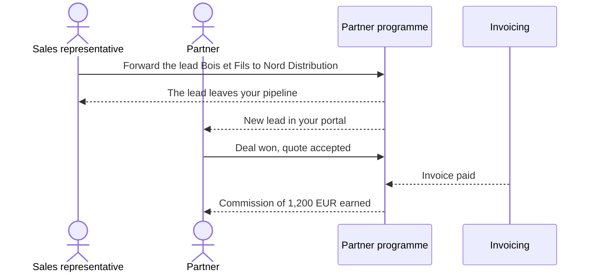

🏠 [Specs](../../../../README.md) › 🧩 [Functional capabilities](../../../README.md) ›
🛒 [F6 Customers and sales](../../README.md) › 📝 [Use cases](../README.md) › 📝 UC-F6-27 Run a partner programme

# 📝 UC-F6-27 Run a partner programme

**Status:** ✅ specified

## Summary

Sales runs a partner programme: resellers, referrers and integrators join as partners with a tier and a commission plan,
receive leads forwarded by the company, register their own deals in a partner portal, and are paid commissions on the
invoices their deals produce once those are paid.

## Personas

- [U03 Sales](../../../../01-users/personas/u03-sales.md)
- [U51 Reseller partner](../../../../01-users/personas/u51-reseller-partner.md)

## Goal

Partners sell and recommend the company's products without double handling: each lead has one owner, each deal one
partner, and each commission is traceable to a paid invoice.

## Trigger

A company decides to sell through partners, a partner applies, or a sales representative forwards a lead to a partner.

## Frequency

A handful of new partners a quarter; leads forwarded and deals registered weekly.

## Preconditions

- Commission plans exist ([E-F6-18 Commission plan and target](../../data/e-f06-18-commission-plan-and-target.md),
  [UC-F6-25](../09-sell-on-the-road-and-steer-sales/uc-f06-25-set-sales-targets-and-pay-commissions.md)).
- The lead or the opportunity to forward exists ([E-F6-20 Lead](../../data/e-f06-20-lead.md),
  [E-F6-02 Opportunity](../../data/e-f06-02-opportunity.md)).
- The partner has a portal user with an external role
  ([UC-F1-01](../../../f01-administration/use-cases/01-guided-setup/uc-f01-01-set-up-a-new-company.md)).

## Postconditions

- **Succeeded:** the partner is recorded ([E-F6-23 Partner](../../data/e-f06-23-partner.md)) with its tier, territory
  and commission plan; each forwarded lead has its partner as owner and has left the previous owner's pipeline; each
  commission is a line of [E-F6-19 Commission line](../../data/e-f06-19-commission-line.md) once the invoice is paid.
- **Failed:** the partner stays Applied or Suspended; a lead is not forwarded and stays with its owner.

## Main flow

1. A company applies as a partner, or sales creates it, on the partner screen
   ([S-F6-24](../../screens/10-partners-contracts-and-warranties/s-f06-24-partner-programme.md)) with its legal
   identifiers, territory and tier.
2. The administrator of sales approves the partner and gives it a commission plan; the partner's user is invited to the
   partner portal.
3. A sales representative forwards a lead to the partner; the lead leaves the representative's pipeline and forecast and
   appears in the partner's portal
   ([BR-F6-19](../../business-rules/br-f06-19-forwarded-leads-leave-their-owners-pipeline.md)).
4. The partner works the lead, logs its progress and can register a deal of its own for the company to accept.
5. When the deal is won and invoiced, the invoice carries the partner; when it is paid, the commission line is created
   ([BR-F6-18](../../business-rules/br-f06-18-commissions-follow-paid-invoices.md)).
6. Sales reads each partner's leads, deals, revenue and commissions, and changes its tier.

## Alternative flows

- 3a. The partner does not act on a forwarded lead within the time of its tier: the lead returns to its previous owner
  and the partner is told.
- 4a. Two partners register the same deal: the first registered keeps it for the protection period; sales decides when
  the period has ended.
- 6a. A partner is suspended: its open leads return to their owners and its commissions already earned are still paid.

## Error flows

- 2e. The partner's legal identifier fails its check
  ([BR-F6-20](../../business-rules/br-f06-20-identifiers-are-checked-per-scheme.md)): the partner stays Applied.
- 3e. The lead is already forwarded to another partner: the second forward is refused with the name of the current
  partner.
- 5e. The invoice is credited after the commission was created: the commission is reversed on the next payout
  ([UC-F6-09](../03-invoice-and-get-paid/uc-f06-09-credit-note-and-refund.md)).
- Any step: a service does not answer; the call is retried first
  ([BR-F3-32](../../../f03-assistant/business-rules/br-f03-32-retry-before-an-error.md)), then the message follows the
  error pattern ([D122](../../../../06-decisions/ux/d122-error-message-standard.md)) and what the user typed stays on
  the screen.

## Business rules

- [BR-F6-19](../../business-rules/br-f06-19-forwarded-leads-leave-their-owners-pipeline.md)
- [BR-F6-18](../../business-rules/br-f06-18-commissions-follow-paid-invoices.md)
- [BR-F6-03](../../business-rules/br-f06-03-portal-shows-only-the-customer-s-own.md)

## Entities

- [E-F6-23 Partner](../../data/e-f06-23-partner.md): created, changed
- [E-F6-20 Lead](../../data/e-f06-20-lead.md): changed, the lead's owner
- [E-F6-02 Opportunity](../../data/e-f06-02-opportunity.md): changed, the deal's owner
- [E-F6-18 Commission plan and target](../../data/e-f06-18-commission-plan-and-target.md): read, the commission plan
- [E-F6-19 Commission line](../../data/e-f06-19-commission-line.md): created, the commission lines
- [E-F6-05 Invoice](../../data/e-f06-05-invoice.md): read, the invoice that carries the partner

## Permissions

Sales manages partners and forwards leads. A partner user sees only its own leads, deals and commissions
([BR-F6-03](../../business-rules/br-f06-03-portal-shows-only-the-customer-s-own.md)); it never sees another partner's or
the company's other customers.

## Notifications

The partner, in the portal and by message: a lead forwarded, a lead about to return, a commission earned. Sales, in the
app: a deal registered, a partner application.

## Audit events

Each application, approval, tier change and suspension; each lead forwarded or returned, by whom and when; each deal
registered; each commission created or reversed.

## AI involvement

The AI assistant may suggest the partner that best fits a lead (territory, tier, product) and shows why; sales forwards
it. It never forwards a lead alone.

## API, MCP and A2A exposure

T5 operations of the capability for the personas above: create, read, update and list. The MCP tool of the
capability may read and propose, never confirm alone. No A2A skill.

## Screens

- [S-F6-24](../../screens/10-partners-contracts-and-warranties/s-f06-24-partner-programme.md)

## Flowchart

See
[FL-F6-10 Partners, frame contracts and warranties](../../flows/fl-f06-10-partners-contracts-and-warranties.md#flowchart).

## Sequence diagram

## Acceptance criteria

1. **Given** a lead owned by a sales representative **when** it is forwarded to a partner **then** it leaves the
   representative's pipeline and forecast and appears in the partner's portal.
2. **Given** a forwarded lead with no activity after the tier's time **when** the time is over **then** it returns to
   its previous owner and the partner is told.
3. **Given** a partner user **when** it opens the portal **then** it sees only its own leads, deals and commissions.
4. **Given** a commission on an invoice not yet paid **when** the partner reads its commissions **then** none is earned
   yet.

## Non-functional notes

The screen answers within 2 seconds for 10,000 records; every change is audited.

## Regulatory references

The partner's company identifiers are checked per scheme
([BR-F6-20](../../business-rules/br-f06-20-identifiers-are-checked-per-scheme.md)); a commission is an expense of the
company and an income of the partner, with VAT shown wherever it applies
([BR-F6-08](../../business-rules/br-f06-08-vat-is-shown-wherever-it-matters.md)).

## Related use cases

- [UC-F6-28](uc-f06-28-keep-several-identifiers-per-company.md)
- [UC-F6-25](../09-sell-on-the-road-and-steer-sales/uc-f06-25-set-sales-targets-and-pay-commissions.md)
- [UC-F6-01](../01-lead-to-quote/uc-f06-01-capture-and-qualify-a-lead.md)
- [UC-F6-02](../01-lead-to-quote/uc-f06-02-manage-the-pipeline-and-forecast.md)

## Open questions

None.

---

⬅️ [UC-F6-26](../09-sell-on-the-road-and-steer-sales/uc-f06-26-read-sales-and-margin-reports.md) · ⬆️ [Up](README.md) ·
➡️ [UC-F6-28 Keep several identifiers per company](uc-f06-28-keep-several-identifiers-per-company.md)
