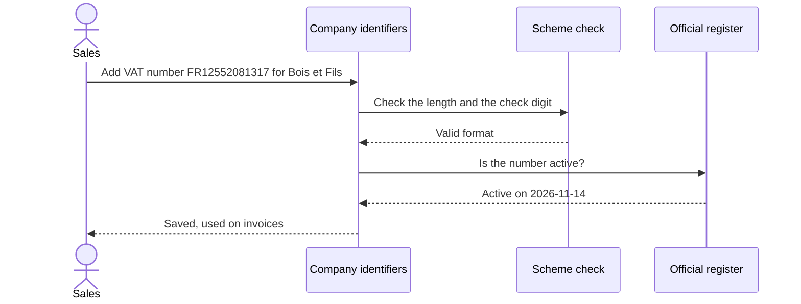

🏠 [Specs](../../../../README.md) › 🧩 [Functional capabilities](../../../README.md) ›
🛒 [F6 Customers and sales](../../README.md) › 📝 [Use cases](../README.md) ›
📝 UC-F6-28 Keep several identifiers per company

# 📝 UC-F6-28 Keep several identifiers per company

**Status:** ✅ specified

## Summary

Sales and accounting keep several identifiers for one company: its national registration number, its establishment
number, its VAT number, its e-invoicing address and others, each tied to its scheme and checked by the rules of that
scheme.

## Personas

- [U03 Sales](../../../../01-users/personas/u03-sales.md)
- [U05 Accounting](../../../../01-users/personas/u05-accounting.md)

## Goal

Every invoice, filing and exchange uses the identifier that the other side and the law expect, and a mistyped identifier
is caught when it is entered.

## Trigger

A customer, supplier or partner is created or changed, or an identifier is needed for a new use (a public buyer, an
export, an e-invoicing platform).

## Frequency

Each time a company record is created, and a few times a year per company when a new scheme is needed.

## Preconditions

- The company exists as a customer, supplier or partner
  ([E-F6-01 Customer record](../../data/e-f06-01-customer-record.md),
  [E-F6-23 Partner](../../data/e-f06-23-partner.md)).
- The identifier schemes of the company's countries are configured in the country pack
  ([CR-FR-001](../../../../10-country-packs/france/company/cr-fr-001-company-identifiers.md)).

## Postconditions

- **Succeeded:** each identifier is recorded ([E-F6-24 Company identifier](../../data/e-f06-24-company-identifier.md))
  with its scheme, its check result and its dates; documents pick the right one for their purpose.
- **Failed:** an identifier that fails its check is saved as Invalid and never used on a document; the user is told
  which scheme failed.

## Main flow

1. The user opens the company's identifiers
   ([S-F6-25](../../screens/10-partners-contracts-and-warranties/s-f06-25-company-identifiers.md)) from its record.
2. The user adds an identifier: picks the scheme (national number, establishment number, VAT number, e-invoicing
   address, customs number, other) and types the value.
3. simple-ERP checks the value by the scheme's rule
   ([BR-F6-20](../../business-rules/br-f06-20-identifiers-are-checked-per-scheme.md)): its length, its characters and
   its check digit.
4. For a VAT number, simple-ERP also asks the official register whether the number is active and keeps the answer with
   its date.
5. The user marks which identifier a use takes by default (the invoice, the e-invoice, the customs declaration).
6. A document that needs an identifier picks the one marked for its use and shows it.

## Alternative flows

- 2a. The user pastes a number with spaces or dots: they are removed before the check.
- 3a. The user types only a national number; simple-ERP proposes the other identifiers it can derive (an establishment
  number needs its own entry) and the user confirms.
- 4a. The register is unreachable: the VAT number is saved as Entered and checked again later.

## Error flows

- 3e. The check digit is wrong: the identifier is refused with the scheme's rule, and the user can correct it.
- 4e. The register says the number is not active: it is saved as Invalid with the date and the reason, and invoices that
  need it are held for accounting.
- 5e. Two companies carry the same identifier: the user is shown both and asked whether they are duplicates of one
  company.
- Any step: a service does not answer; the call is retried first
  ([BR-F3-32](../../../f03-assistant/business-rules/br-f03-32-retry-before-an-error.md)), then the message follows the
  error pattern ([D122](../../../../06-decisions/ux/d122-error-message-standard.md)) and what the user typed stays on
  the screen.

## Business rules

- [BR-F6-20](../../business-rules/br-f06-20-identifiers-are-checked-per-scheme.md)
- [BR-F6-08](../../business-rules/br-f06-08-vat-is-shown-wherever-it-matters.md)

## Entities

- [E-F6-24 Company identifier](../../data/e-f06-24-company-identifier.md): created, changed
- [E-F6-01 Customer record](../../data/e-f06-01-customer-record.md): read and changed, the company's record
- [E-F6-23 Partner](../../data/e-f06-23-partner.md): read, the partner's identifiers
- [E-F6-05 Invoice](../../data/e-f06-05-invoice.md): read, the identifier an invoice shows

## Permissions

Sales and accounting create and change identifiers; every user who reads a company sees them. Only accounting changes an
identifier already used on a posted invoice.

## Notifications

Accounting, in the app: an identifier became Invalid at its periodic check, with the invoices held.

## Audit events

Each identifier added, changed or retired, with who, when, the scheme and the check result and date.

## AI involvement

The AI assistant may read an identifier from a document the user uploads and prefill it; the user confirms and the check
still runs.

## API, MCP and A2A exposure

T5 operations of the capability for the personas above: create, read, update and list. The MCP tool of the
capability may read and propose, never confirm alone. No A2A skill.

## Screens

- [S-F6-25](../../screens/10-partners-contracts-and-warranties/s-f06-25-company-identifiers.md)

## Flowchart

See
[FL-F6-10 Partners, frame contracts and warranties](../../flows/fl-f06-10-partners-contracts-and-warranties.md#flowchart).

## Sequence diagram

## Acceptance criteria

1. **Given** a SIREN with a wrong check digit **when** the user saves it **then** it is refused with the scheme's rule.
2. **Given** a VAT number the register says is not active **when** the user saves it **then** it is Invalid and the
   invoices that need it are held.
3. **Given** a company with a national number and a VAT number **when** an invoice is issued **then** it shows the
   identifier marked for invoices.
4. **Given** an identifier already used by another company **when** the user saves it **then** both companies are shown
   and the user decides.

## Non-functional notes

The screen answers within 2 seconds for 10,000 records; every change is audited.

## Regulatory references

French company identifiers and their formats:
[CR-FR-001](../../../../10-country-packs/france/company/cr-fr-001-company-identifiers.md); VAT identification numbers on
invoices: [CR-FR-009](../../../../10-country-packs/france/tax-and-vat/cr-fr-009-vat-mentions.md).

## Related use cases

- [UC-F6-27 Run a partner programme](uc-f06-27-run-a-partner-programme.md)
- [UC-F6-29](uc-f06-29-agree-a-frame-contract-and-call-off-orders.md)
- [UC-F6-17](../06-accounts-and-credit/uc-f06-17-organise-accounts-with-their-timeline-and-emails.md)
- [UC-F6-19](../07-special-invoicing/uc-f06-19-invoice-a-public-buyer-through-chorus-pro.md)
- [UC-F6-27 Run a partner programme](uc-f06-27-run-a-partner-programme.md)

## Open questions

None.

---

⬅️ [UC-F6-27 Run a partner programme](uc-f06-27-run-a-partner-programme.md) · ⬆️ [Up](README.md) ·
➡️ [UC-F6-29 Agree a frame contract and call off orders](uc-f06-29-agree-a-frame-contract-and-call-off-orders.md)
