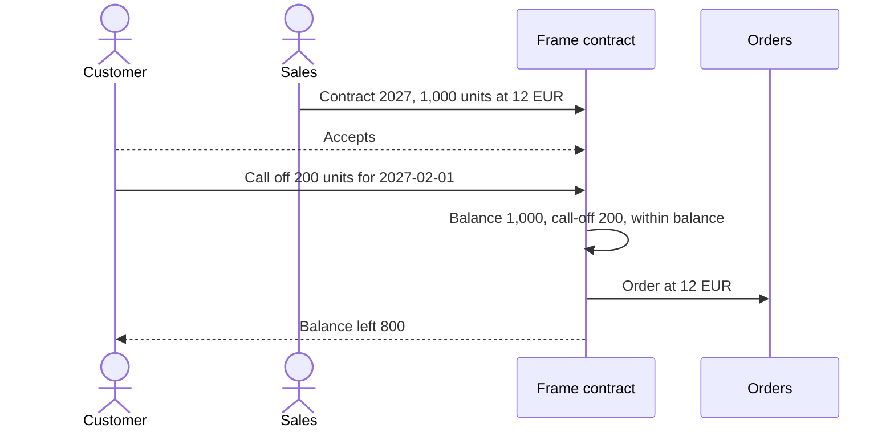

🏠 [Specs](../../../../README.md) › 🧩 [Functional capabilities](../../../README.md) ›
🛒 [F6 Customers and sales](../../README.md) › 📝 [Use cases](../README.md) ›
📝 UC-F6-29 Agree a frame contract and call off orders

# 📝 UC-F6-29 Agree a frame contract and call off orders

**Status:** ✅ specified

## Summary

Sales agrees a frame contract with a customer: prices and a committed quantity or amount over a period, then the
customer calls off orders against it, each one reducing the balance until the contract is used up or ends.

## Personas

- [U03 Sales](../../../../01-users/personas/u03-sales.md)
- [U09 Customer](../../../../01-users/personas/u09-customer.md)

## Goal

A long-term customer buys at agreed prices in several deliveries, and the company always knows what is left to deliver
and to bill.

## Trigger

A customer asks for a price commitment over a year, or sales proposes one to secure a volume.

## Frequency

A few contracts per customer and year; call-offs weekly or monthly.

## Preconditions

- The customer exists ([E-F6-01 Customer record](../../data/e-f06-01-customer-record.md)) and the items and prices are
  agreed ([E-F6-08 Sales price list](../../data/e-f06-08-sales-price-list.md)).
- The customer accepted the contract ([UC-F6-04](../02-quote-to-order/uc-f06-04-accept-or-sign-a-quote.md)).
- The customer's credit limit allows the commitment ([E-F6-12 Credit limit](../../data/e-f06-12-credit-limit.md)).

## Postconditions

- **Succeeded:** the contract is active ([E-F6-25 Frame contract](../../data/e-f06-25-frame-contract.md)) with its
  balance; each call-off is an order ([E-F6-04 Order](../../data/e-f06-04-order.md)) at the agreed price and reduces the
  balance.
- **Failed:** no call-off is accepted; the contract stays Draft or the call-off waits for approval.

## Main flow

1. Sales creates the frame contract on its screen
   ([S-F6-26](../../screens/10-partners-contracts-and-warranties/s-f06-26-frame-contracts.md)): customer, validity,
   items with agreed prices and the committed quantity or amount.
2. The customer accepts it ([UC-F6-04](../02-quote-to-order/uc-f06-04-accept-or-sign-a-quote.md)) and the contract
   becomes Active.
3. The customer, or sales for them, calls off an order from the contract: items, quantities and the delivery date.
4. SimpleERP applies the agreed prices, checks the call-off against the balance
   ([BR-F6-21](../../business-rules/br-f06-21-call-offs-never-exceed-the-balance-without-approval.md)) and creates the
   order.
5. The order follows the normal path
   ([UC-F6-05](../02-quote-to-order/uc-f06-05-turn-a-quote-into-an-order-and-follow-it.md)); the contract's balance and
   consumption update.
6. When the balance reaches zero or the validity ends, the contract closes; unused commitment is reported to sales.

## Alternative flows

- 3a. The customer calls off from the customer portal on a phone: a short form with the contract's items and the balance
  shown.
- 4a. A call-off above the balance: sales is asked to approve it, at the agreed or at the list price
  ([BR-F6-21](../../business-rules/br-f06-21-call-offs-never-exceed-the-balance-without-approval.md)).
- 6a. Sales extends the validity or tops up the commitment with the customer's agreement.

## Error flows

- 4e. The call-off uses an item that is not in the contract: it is refused and offered as a normal order.
- 4f. The call-off is after the validity: refused; the contract is Expired.
- 5e. A call-off order is cancelled: its quantity returns to the balance.
- Any step: a service does not answer; the call is retried first
  ([BR-F3-32](../../../f03-assistant/business-rules/br-f03-32-retry-before-an-error.md)), then the message follows the
  error pattern ([D122](../../../../06-decisions/ux/d122-error-message-standard.md)) and what the user typed stays on
  the screen.

## Business rules

- [BR-F6-21](../../business-rules/br-f06-21-call-offs-never-exceed-the-balance-without-approval.md)
- [BR-F6-11](../../business-rules/br-f06-11-over-the-credit-limit-orders-are-held.md)
- [BR-F6-04](../../business-rules/br-f06-04-large-discounts-need-approval.md)

## Entities

- [E-F6-25 Frame contract](../../data/e-f06-25-frame-contract.md): created, changed
- [E-F6-04 Order](../../data/e-f06-04-order.md): created, one order per call-off
- [E-F6-08 Sales price list](../../data/e-f06-08-sales-price-list.md): read, the agreed prices
- [E-F6-12 Credit limit](../../data/e-f06-12-credit-limit.md): read, the commitment against the limit
- [E-F6-01 Customer record](../../data/e-f06-01-customer-record.md): read, the customer

## Permissions

Sales creates contracts and approves call-offs above the balance. A customer calls off only its own contract
([BR-F6-03](../../business-rules/br-f06-03-portal-shows-only-the-customer-s-own.md)).

## Notifications

Sales, in the app: a call-off above the balance waits for approval; a contract's balance is under 10 percent; a contract
ends within 30 days. The customer: its call-off is confirmed.

## Audit events

Each contract created, accepted, extended and closed; each call-off with the balance before and after; each approval
above the balance and by whom.

## AI involvement

The AI assistant may draft a call-off from the customer's message and shows the balance; sales or the customer confirms.

## API, MCP and A2A exposure

T5 operations of the capability for the personas above: create, read, update and list. The MCP tool of the
capability may read and propose, never confirm alone. No A2A skill.

## Screens

- [S-F6-26](../../screens/10-partners-contracts-and-warranties/s-f06-26-frame-contracts.md)

## Flowchart

See
[FL-F6-10 Partners, frame contracts and warranties](../../flows/fl-f06-10-partners-contracts-and-warranties.md#flowchart).

## Sequence diagram

## Acceptance criteria

1. **Given** a contract with a balance of 800 units **when** the customer calls off 200 **then** an order is created at
   the agreed price and the balance is 600.
2. **Given** a balance of 100 units **when** a call-off of 150 is entered **then** it waits for sales' approval.
3. **Given** a call-off order cancelled **when** the cancellation is recorded **then** its quantity returns to the
   balance.
4. **Given** a contract past its validity **when** a call-off is entered **then** it is refused.

## Non-functional notes

The screen answers within 2 seconds for 10,000 records; every change is audited.

## Regulatory references

The agreed prices and terms are the customer's contract; VAT and payment terms follow the invoice rules
([CR-FR-018](../../../../10-country-packs/france/invoicing/cr-fr-018-payment-terms-cap.md)).

## Related use cases

- [UC-F6-28](uc-f06-28-keep-several-identifiers-per-company.md)
- [UC-F6-30 Check a customer's solvency](uc-f06-30-check-a-customers-solvency.md)
- [UC-F6-05](../02-quote-to-order/uc-f06-05-turn-a-quote-into-an-order-and-follow-it.md)
- [UC-F6-12](../01-lead-to-quote/uc-f06-12-manage-price-lists-and-discounts.md)
- [UC-F6-18](../06-accounts-and-credit/uc-f06-18-set-a-credit-limit-and-hold-orders.md)

## Open questions

None.

---

⬅️ [UC-F6-28 Keep several identifiers per company](uc-f06-28-keep-several-identifiers-per-company.md) ·
⬆️ [Up](README.md) · ➡️ [UC-F6-30 Check a customer's solvency](uc-f06-30-check-a-customers-solvency.md)
