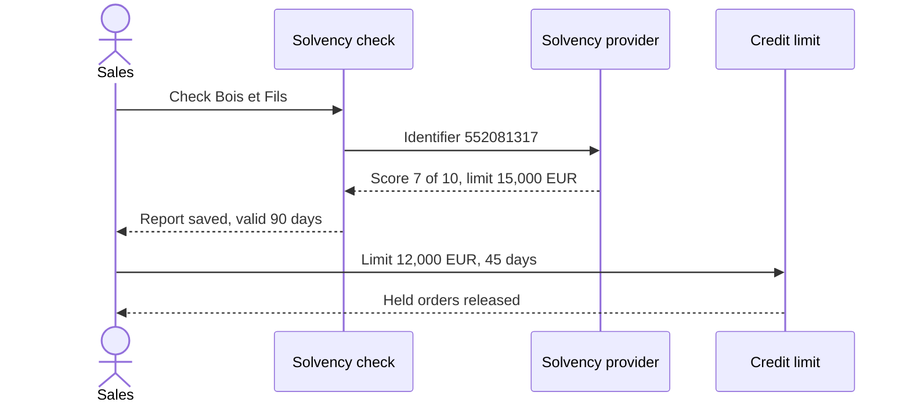

🏠 [Specs](../../../../README.md) › 🧩 [Functional capabilities](../../../README.md) ›
🛒 [F6 Customers and sales](../../README.md) › 📝 [Use cases](../README.md) › 📝 UC-F6-30 Check a customer's solvency

# 📝 UC-F6-30 Check a customer's solvency

**Status:** ✅ specified

## Summary

Sales and accounting ask a credit-information provider for a solvency report on a customer, read its score and
recommended limit, and use it to set the credit limit and the payment terms.

## Personas

- [U03 Sales](../../../../01-users/personas/u03-sales.md)
- [U05 Accounting](../../../../01-users/personas/u05-accounting.md)

## Goal

Payment terms and credit are given with a recent, documented view of the customer's ability to pay.

## Trigger

A new customer asks for payment terms, an order passes the credit limit, or a report expires.

## Frequency

At each new customer asking for terms, and each year per customer with credit.

## Preconditions

- A solvency provider is connected in the integrations hub
  [UC-F24-02](../../../f24-integrations-hub/use-cases/01-find-and-connect/uc-f24-02-connect-a-tool-in-the-fewest-steps.md).
- The customer's company identifier is valid ([E-F6-24 Company identifier](../../data/e-f06-24-company-identifier.md)).
- The customer exists with its credit limit ([E-F6-01 Customer record](../../data/e-f06-01-customer-record.md),
  [E-F6-12 Credit limit](../../data/e-f06-12-credit-limit.md)).

## Postconditions

- **Succeeded:** the report is saved ([E-F6-26 Solvency report](../../data/e-f06-26-solvency-report.md)) with its score,
  recommended limit and date; the credit limit and the terms can rely on it until it expires.
- **Failed:** no report is saved; the terms above the limit stay blocked until a report is obtained.

## Main flow

1. The user opens the solvency check
   ([S-F6-27](../../screens/10-partners-contracts-and-warranties/s-f06-27-solvency-check.md)) from the customer or from
   an order held for its limit.
2. The user asks for a report; SimpleERP sends the customer's identifier to the provider.
3. The provider answers with a score, a recommended limit and the main reasons; SimpleERP saves the report with its
   date.
4. The user reads the report and sets the credit limit
   ([UC-F6-18](../06-accounts-and-credit/uc-f06-18-set-a-credit-limit-and-hold-orders.md)) and the payment terms, at or
   below the recommendation, or records why they differ.
5. Orders held for the limit are released if the new limit allows them.
6. The report expires after its validity; a new one is asked before terms above the limit are given again
   ([BR-F6-22](../../business-rules/br-f06-22-terms-above-the-limit-need-a-recent-solvency-check.md)).

## Alternative flows

- 2a. The user asks the AI assistant: "is Bois et Fils safe for 60 days?"; it asks for or reads the latest report and
  answers with its date.
- 3a. The provider has no report on a small trader: the report says so and the user decides from the customer's payment
  history.
- 4a. The user sets a higher limit than recommended: a reason and an approval are required
  ([BR-F6-04](../../business-rules/br-f06-04-large-discounts-need-approval.md)).

## Error flows

- 2e. The provider does not answer: the call is retried, then the user is told and the order stays held.
- 3e. The identifier matches several companies at the provider: the user picks the right one from a list.
- 4e. The report is older than its validity: it cannot support terms above the limit.
- Any step: a service does not answer; the call is retried first
  ([BR-F3-32](../../../f03-assistant/business-rules/br-f03-32-retry-before-an-error.md)), then the message follows the
  error pattern ([D122](../../../../06-decisions/ux/d122-error-message-standard.md)) and what the user typed stays on
  the screen.

## Business rules

- [BR-F6-22](../../business-rules/br-f06-22-terms-above-the-limit-need-a-recent-solvency-check.md)
- [BR-F6-11](../../business-rules/br-f06-11-over-the-credit-limit-orders-are-held.md)
- [BR-F6-04](../../business-rules/br-f06-04-large-discounts-need-approval.md)

## Entities

- [E-F6-26 Solvency report](../../data/e-f06-26-solvency-report.md): created, changed
- [E-F6-12 Credit limit](../../data/e-f06-12-credit-limit.md): changed, the credit limit
- [E-F6-01 Customer record](../../data/e-f06-01-customer-record.md): read, the customer
- [E-F6-24 Company identifier](../../data/e-f06-24-company-identifier.md): read, the identifier sent to the provider

## Permissions

Sales and accounting ask and read reports; the owner reads them. A report on a sole trader is personal data and is
visible only to those roles.

## Notifications

Sales and accounting, in the app: a report has expired for a customer with open credit; a score fell.

## Audit events

Each report asked (provider, identifier, by whom, when) and received; each limit or term set from it.

## AI involvement

The AI assistant summarises the report's reasons and compares them with the customer's payment history; it never sets a
limit.

## API, MCP and A2A exposure

T5 operations of the capability for the personas above: create, read, update and list. The MCP tool of the
capability may read and propose, never confirm alone. No A2A skill.

## Screens

- [S-F6-27](../../screens/10-partners-contracts-and-warranties/s-f06-27-solvency-check.md)

## Flowchart

See
[FL-F6-10 Partners, frame contracts and warranties](../../flows/fl-f06-10-partners-contracts-and-warranties.md#flowchart).

## Sequence diagram

## Acceptance criteria

1. **Given** a customer asking for 60-day terms above its limit **when** no report is under 90 days old **then** the
   terms are refused until a report is obtained.
2. **Given** a report received with a recommended limit of 15,000 EUR **when** the user sets 12,000 EUR **then** the
   limit is saved with the report's reference.
3. **Given** a limit set above the recommendation **when** the user saves it **then** a reason and an approval are
   required.
4. **Given** a provider that does not answer **when** the user asks for a report **then** the call is retried and the
   user is told.

## Non-functional notes

The screen answers within 2 seconds for 10,000 records; every change is audited.

## Regulatory references

Credit scoring of a person is personal data used for a legitimate interest that must be balanced:
[CR-FR-196](../../../../10-country-packs/france/data-protection/cr-fr-196-legitimate-interest-balancing.md),
[CR-FR-050](../../../../10-country-packs/france/data-protection/cr-fr-050-privacy-by-design.md); payment terms are
capped by the invoice rules: [CR-FR-018](../../../../10-country-packs/france/invoicing/cr-fr-018-payment-terms-cap.md).

## Related use cases

- [UC-F6-29](uc-f06-29-agree-a-frame-contract-and-call-off-orders.md)
- [UC-F6-31 Handle a warranty claim](uc-f06-31-handle-a-warranty-claim.md)
- [UC-F6-18](../06-accounts-and-credit/uc-f06-18-set-a-credit-limit-and-hold-orders.md)
- [UC-F6-28](uc-f06-28-keep-several-identifiers-per-company.md)
- [UC-F6-08 Remind late payers](../03-invoice-and-get-paid/uc-f06-08-remind-late-payers.md)

## Open questions

None.

---

⬅️ [UC-F6-29 Agree a frame contract and call off orders](uc-f06-29-agree-a-frame-contract-and-call-off-orders.md) ·
⬆️ [Up](README.md) · ➡️ [UC-F6-31 Handle a warranty claim](uc-f06-31-handle-a-warranty-claim.md)
