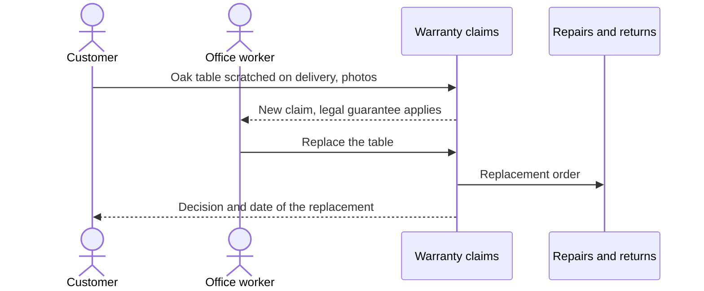

🏠 [Specs](../../../../README.md) › 🧩 [Functional capabilities](../../../README.md) ›
🛒 [F6 Customers and sales](../../README.md) › 📝 [Use cases](../README.md) › 📝 UC-F6-31 Handle a warranty claim

# 📝 UC-F6-31 Handle a warranty claim

**Status:** ✅ specified

## Summary

A customer reports a defect from the portal on a phone; the office checks the legal guarantee first and then the
commercial warranty, decides to repair, replace, reduce the price or refund, and follows the claim to the end.

## Personas

- [U09 Customer](../../../../01-users/personas/u09-customer.md)
- [U16 Office worker](../../../../01-users/personas/u16-office-worker.md)

## Goal

Every defect claim is answered under the right guarantee, within the time the customer is entitled to, and the customer
is never given less than the law gives.

## Trigger

A customer reports a defect on a delivered item, from the portal, by message or by phone.

## Frequency

A few claims a week for a retailer; fewer for a service or an industrial seller.

## Preconditions

- The item was delivered and its delivery date is recorded
  ([E-F7-22 Delivery note](../../../f07-purchasing-and-stock/data/e-f07-22-delivery-note.md),
  [E-F6-04 Order](../../data/e-f06-04-order.md)).
- The item's commercial warranty, if any, is on its price list
  ([E-F6-08 Sales price list](../../data/e-f06-08-sales-price-list.md)).
- Repairs are set up when the company repairs its products
  ([UC-F7-17](../../../f07-purchasing-and-stock/use-cases/06-benchmark-additions/uc-f07-17-repair-products.md)).

## Postconditions

- **Succeeded:** the warranty is recorded ([E-F6-27 Warranty](../../data/e-f06-27-warranty.md)) with the claim, the
  guarantee that applied, the decision and the outcome; a repair, a replacement, a price reduction or a refund is
  created.
- **Failed:** the claim is Refused with the reason and the customer is told how to dispute it.

## Main flow

1. The customer opens the portal on their phone, picks the delivered item and describes the defect with photos
   ([S-F6-28](../../screens/10-partners-contracts-and-warranties/s-f06-28-warranty-claims.md)).
2. SimpleERP creates the claim and links it to the order and the delivery date.
3. The office worker opens the claim and sees the guarantees: the legal guarantee of conformity first, then the
   commercial warranty ([BR-F6-23](../../business-rules/br-f06-23-the-legal-conformity-guarantee-applies-first.md)).
4. The office worker decides the remedy the customer is entitled to under the guarantee that applies: repair or
   replacement first, then price reduction or refund when those are not possible or fail.
5. The company acts: a repair order
   ([UC-F7-17](../../../f07-purchasing-and-stock/use-cases/06-benchmark-additions/uc-f07-17-repair-products.md)), a
   replacement order, a return
   [UC-F7-10](../../../f07-purchasing-and-stock/use-cases/04-pick-pack-and-ship/uc-f07-10-handle-returns-and-scrap.md)
   or a credit note ([UC-F6-09](../03-invoice-and-get-paid/uc-f06-09-credit-note-and-refund.md)).
6. The customer is told of the decision and follows the claim in the portal until it is Resolved.

## Alternative flows

- 1a. The customer reports by message or phone: the office worker creates the claim for them.
- 4a. The defect is caused by misuse and the commercial warranty excludes it: the claim is refused under the commercial
  warranty, but the legal guarantee is still examined first
  ([BR-F6-23](../../business-rules/br-f06-23-the-legal-conformity-guarantee-applies-first.md)).
- 5a. A supplier warranty covers the item: the company claims back from its supplier
  [UC-F7-10](../../../f07-purchasing-and-stock/use-cases/04-pick-pack-and-ship/uc-f07-10-handle-returns-and-scrap.md).

## Error flows

- 2e. The delivery date is unknown: the office worker sets it from the carrier's proof of delivery.
- 4e. The customer disputes a refusal: the claim reopens and the owner reviews it.
- 5e. The replacement is out of stock: the customer chooses a refund or waits, and the choice is recorded.
- Any step: a service does not answer; the call is retried first
  ([BR-F3-32](../../../f03-assistant/business-rules/br-f03-32-retry-before-an-error.md)), then the message follows the
  error pattern ([D122](../../../../06-decisions/ux/d122-error-message-standard.md)) and what the user typed stays on
  the screen.

## Business rules

- [BR-F6-23](../../business-rules/br-f06-23-the-legal-conformity-guarantee-applies-first.md)
- [BR-F6-23](../../business-rules/br-f06-23-the-legal-conformity-guarantee-applies-first.md)
- [BR-F6-03](../../business-rules/br-f06-03-portal-shows-only-the-customer-s-own.md)

## Entities

- [E-F6-27 Warranty](../../data/e-f06-27-warranty.md): created, changed
- [E-F6-04 Order](../../data/e-f06-04-order.md): read, the order and its delivery
- [E-F7-22 Delivery note](../../../f07-purchasing-and-stock/data/e-f07-22-delivery-note.md): read, the delivery date
- [E-F6-05 Invoice](../../data/e-f06-05-invoice.md): read, the invoice for a credit note
- [E-F7-14 Repair order](../../../f07-purchasing-and-stock/data/e-f07-14-repair-order.md): created, a repair order

## Permissions

Office workers handle claims; the owner reviews refusals. A customer sees only its own claims
([BR-F6-03](../../business-rules/br-f06-03-portal-shows-only-the-customer-s-own.md)).

## Notifications

The customer, on their phone: the claim received, the decision, the repair or refund done. The office, in the app: a new
claim, a claim waiting more than 5 days.

## Audit events

Each claim created, each guarantee applied and why, each decision, remedy and refusal, with who and when.

## AI involvement

The AI assistant reads the customer's description and photos and suggests the defect type and the guarantee to check;
the office worker decides. It never refuses a claim.

## API, MCP and A2A exposure

T5 operations of the capability for the personas above: create, read, update and list. The MCP tool of the
capability may read and propose, never confirm alone. No A2A skill.

## Screens

- [S-F6-28](../../screens/10-partners-contracts-and-warranties/s-f06-28-warranty-claims.md)

## Flowchart

See
[FL-F6-10 Partners, frame contracts and warranties](../../flows/fl-f06-10-partners-contracts-and-warranties.md#flowchart).

## Sequence diagram

## Acceptance criteria

1. **Given** an item delivered 4 months ago with a one-year commercial warranty **when** the customer claims **then**
   the legal guarantee is examined first and the commercial warranty second.
2. **Given** a defect the commercial warranty excludes **when** the office worker decides **then** the legal guarantee
   is still applied before any refusal.
3. **Given** a replacement that is not possible **when** the office worker records it **then** a price reduction or a
   refund is offered.
4. **Given** a claim by phone **when** the office worker creates it **then** the customer follows it in the portal.

## Non-functional notes

The screen answers within 2 seconds for 10,000 records; every change is audited.

## Regulatory references

The legal guarantee of conformity of the seller:
[CR-FR-067](../../../../10-country-packs/france/consumer/cr-fr-067-legal-guarantee-of-conformity.md). The
duties, periods and remedies of the legal conformity guarantee are those of the France-pack rule below: 2 years from
delivery, a defect within 24 months (12 for used goods) presumed to exist at delivery, repair or replacement within 30
days, then a price reduction or a refund within 14 days.

- France-pack rule:
  [CR-FR-223 Legal conformity guarantee](../../../../10-country-packs/france/consumer/cr-fr-223-legal-conformity-guarantee.md)

## Related use cases

- [UC-F6-30 Check a customer's solvency](uc-f06-30-check-a-customers-solvency.md)
- [UC-F7-17](../../../f07-purchasing-and-stock/use-cases/06-benchmark-additions/uc-f07-17-repair-products.md)
- [UC-F7-10](../../../f07-purchasing-and-stock/use-cases/04-pick-pack-and-ship/uc-f07-10-handle-returns-and-scrap.md)
- [UC-F6-09](../03-invoice-and-get-paid/uc-f06-09-credit-note-and-refund.md)
- [UC-F6-11 Use the customer portal](../02-quote-to-order/uc-f06-11-use-the-customer-portal.md)

## Open questions

None.

---

⬅️ [UC-F6-30 Check a customer's solvency](uc-f06-30-check-a-customers-solvency.md) · ⬆️ [Up](README.md)
