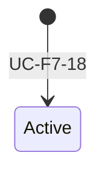

🏠 [Specs](../../../README.md) › 🧩 [Functional capabilities](../../README.md) ›
📦 [F7 Purchasing and stock](../README.md) › 🗃️ [Data](README.md) › 🗃️ E-F7-01 Supplier record

# 🗃️ E-F7-01 Supplier record

**Status:** ✅ specified

## Purpose

A supplier in purchasing and stock.

## Fields

| Name | Type | Required | Validation | Default | Example | Personal data | Custom fields |
|---|---|---|---|---|---|---|---|
| name | text | yes | - | - | Rexel | no | yes |
| price lists | list with lead times | no | - | - | cable 3G2.5: 0.82 EUR/m, 3 days | no | no |
| portal access | link or account | no | D17 | link | account | no | no |

## Relations

As its use cases.

## Lifecycle

## Indexes and search

By number, item, location, date.

## Retention

Accounting documents 10 years (Code de commerce L123-22); moves kept (BR-F7-05). See
[CR-FR-002 Accounting records kept 10 years](../../../10-country-packs/france/accounting/cr-fr-002-accounting-records-kept-ten-years.md).

## Audit

Every change.

## Import and export

CSV import and export.

## Used by

- [UC-F7-02](../use-cases/01-procure/uc-f07-02-order-from-a-supplier.md)
- [UC-F7-12](../use-cases/01-procure/uc-f07-12-use-the-supplier-portal.md)
- [UC-F7-18 Manage supplier contracts and price agreements](../use-cases/07-supplier-agreements-and-performance/uc-f07-18-manage-supplier-contracts-and-price-agreements.md)
- [UC-F7-19 Follow supplier performance](../use-cases/07-supplier-agreements-and-performance/uc-f07-19-follow-supplier-performance.md)

## Open questions

None.

---

⬆️ [Up](README.md) · ➡️ [E-F7-02 Purchase request](e-f07-02-purchase-request.md)
