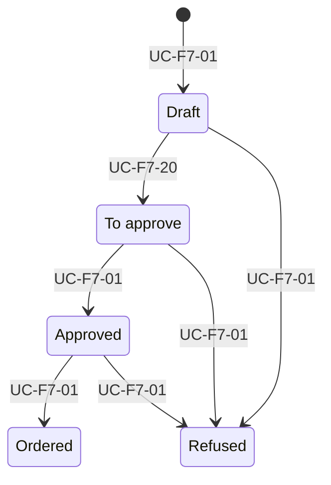

🏠 [Specs](../../../README.md) › 🧩 [Functional capabilities](../../README.md) ›
📦 [F7 Purchasing and stock](../README.md) › 🗃️ [Data](README.md) › 🗃️ E-F7-02 Purchase request

# 🗃️ E-F7-02 Purchase request

**Status:** ✅ specified

## Purpose

A purchase request in purchasing and stock.

## Fields

| Name | Type | Required | Validation | Default | Example | Personal data | Custom fields |
|---|---|---|---|---|---|---|---|
| items | list | yes | - | - | 200 m cable | no | yes |
| project or department | record | no | - | - | Villeurbanne site | no | no |
| amount | money | yes | - | - | 164 EUR excl. VAT | no | no |
| state | draft, to approve, approved, refused, ordered | yes | BR-F7-01 | draft | approved | no | no |

## Relations

As its use cases.

## Lifecycle

## Indexes and search

By number, item, location, date.

## Retention

Accounting documents 10 years (Code de commerce L123-22); moves kept (BR-F7-05). See
[CR-FR-002 Accounting records kept 10 years](../../../10-country-packs/france/accounting/cr-fr-002-accounting-records-kept-ten-years.md).

## Audit

Every change.

## Import and export

CSV import and export.

## Used by

- [UC-F7-01](../use-cases/01-procure/uc-f07-01-request-and-approve-a-purchase.md)
- [UC-F7-20 Order from an approved catalogue or punch-out](../use-cases/08-catalogues-and-stock-levels/uc-f07-20-order-from-an-approved-catalogue-or-punch-out.md)

## Open questions

None.

---

⬅️ [E-F7-01 Supplier record](e-f07-01-supplier-record.md) · ⬆️ [Up](README.md) ·
➡️ [E-F7-03 Purchase order](e-f07-03-purchase-order.md)
