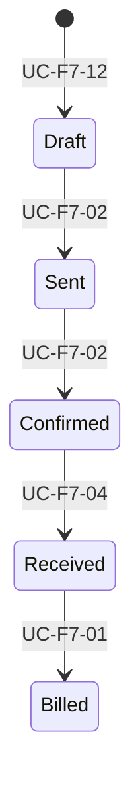

🏠 [Specs](../../../README.md) › 🧩 [Functional capabilities](../../README.md) ›
📦 [F7 Purchasing and stock](../README.md) › 🗃️ [Data](README.md) › 🗃️ E-F7-03 Purchase order

# 🗃️ E-F7-03 Purchase order

**Status:** ✅ specified

## Purpose

A purchase order in purchasing and stock.

## Fields

| Name | Type | Required | Validation | Default | Example | Personal data | Custom fields |
|---|---|---|---|---|---|---|---|
| number | text | yes | unique | sequence | PO-2026-077 | no | no |
| supplier | supplier | yes | - | - | Rexel | no | no |
| lines | list | yes | - | - | 200 m cable | no | yes |
| expected date | date | yes | lead time | - | 2026-11-12 | no | no |
| kind | standard, blanket, dropship | yes | - | standard | standard | no | no |
| state | draft, sent, confirmed, received, billed | yes | - | draft | confirmed | no | no |

## Relations

As its use cases.

## Lifecycle

## Indexes and search

By number, item, location, date.

## Retention

Accounting documents 10 years (Code de commerce L123-22); moves kept (BR-F7-05). See
[CR-FR-002 Accounting records kept 10 years](../../../10-country-packs/france/accounting/cr-fr-002-accounting-records-kept-ten-years.md).

## Audit

Every change.

## Import and export

CSV import and export.

## Used by

- [UC-F7-01](../use-cases/01-procure/uc-f07-01-request-and-approve-a-purchase.md)
- [UC-F7-02](../use-cases/01-procure/uc-f07-02-order-from-a-supplier.md)
- [UC-F7-04](../use-cases/01-procure/uc-f07-04-capture-and-match-supplier-invoices.md)
- [UC-F7-05](../use-cases/03-replenish/uc-f07-05-replenish-stock.md)
- [UC-F7-12](../use-cases/01-procure/uc-f07-12-use-the-supplier-portal.md)

## Open questions

None.

---

⬅️ [E-F7-02 Purchase request](e-f07-02-purchase-request.md) · ⬆️ [Up](README.md) ·
➡️ [E-F7-04 Transfer](e-f07-04-transfer.md)
