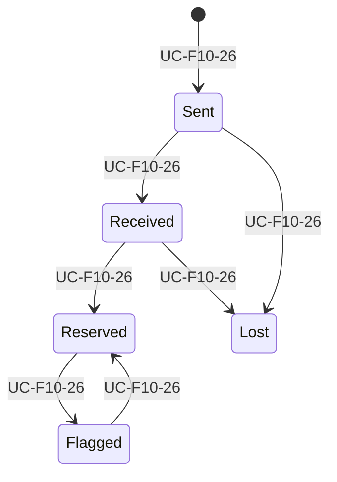

🏠 [Specs](../../../README.md) › 🧩 [Functional capabilities](../../README.md) ›
📦 [F7 Purchasing and stock](../README.md) › 🗃️ [Data](README.md) › 🗃️ E-F7-04 Transfer

# 🗃️ E-F7-04 Transfer

**Status:** ✅ specified

## Purpose

A transfer in purchasing and stock.

## Fields

| Name | Type | Required | Validation | Default | Example | Personal data | Custom fields |
|---|---|---|---|---|---|---|---|
| kind | receipt, internal, delivery, return | yes | - | - | receipt | no | no |
| step | input, quality, stock, pick, pack, output | yes | - | - | input | no | no |
| lines | list with lots and serials | yes | BR-F7-05 | - | cable, lot L2611 | no | no |
| batch or wave | text | no | - | - | Wave 46-3 | no | no |
| carrier | carrier | no | - | - | Colissimo | no | no |

## Relations

As its use cases.

## Lifecycle

## Indexes and search

By number, item, location, date.

## Retention

Accounting documents 10 years (Code de commerce L123-22); moves kept (BR-F7-05). See
[CR-FR-002 Accounting records kept 10 years](../../../10-country-packs/france/accounting/cr-fr-002-accounting-records-kept-ten-years.md).

## Audit

Every change.

## Import and export

CSV import and export.

## Used by

- [UC-F7-03](../use-cases/02-receive-and-store/uc-f07-03-receive-goods.md)
- [UC-F7-06](../use-cases/04-pick-pack-and-ship/uc-f07-06-pick-pack-and-ship.md)
- [UC-F7-08](../use-cases/05-count-trace-and-analyse/uc-f07-08-trace-lots-and-serials-recall.md)
- [UC-F7-10](../use-cases/04-pick-pack-and-ship/uc-f07-10-handle-returns-and-scrap.md)
- [UC-F10-26 Look up and transfer stock between stores](../../f10-point-of-sale/use-cases/10-clienteling-transfers-and-tax-free/uc-f10-26-look-up-and-transfer-stock-between-stores.md)
- [UC-F11-28 Fulfil online orders from a store](../../f11-online-shop/use-cases/10-fulfil-from-stores-and-report/uc-f11-28-fulfil-online-orders-from-a-store.md)

## Open questions

None.

---

⬅️ [E-F7-03 Purchase order](e-f07-03-purchase-order.md) · ⬆️ [Up](README.md) ·
➡️ [E-F7-05 Supplier invoice](e-f07-05-supplier-invoice.md)
