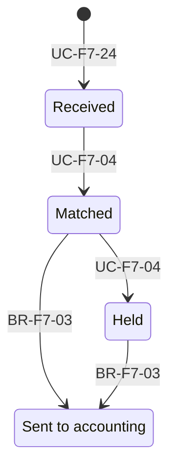

🏠 [Specs](../../../README.md) › 🧩 [Functional capabilities](../../README.md) ›
📦 [F7 Purchasing and stock](../README.md) › 🗃️ [Data](README.md) › 🗃️ E-F7-05 Supplier invoice

# 🗃️ E-F7-05 Supplier invoice

**Status:** ✅ specified

## Purpose

A supplier invoice in purchasing and stock.

## Fields

| Name | Type | Required | Validation | Default | Example | Personal data | Custom fields |
|---|---|---|---|---|---|---|---|
| source | e-invoice, PDF read by AI, typed | yes | - | - | e-invoice | no | no |
| match | order and receipt | yes | BR-F7-03 | - | PO-2026-077 | no | no |
| differences | list | no | - | - | price +2 % | no | no |
| state | received, matched, held, sent to accounting | yes | - | received | matched | no | no |

## Relations

As its use cases.

## Lifecycle

## Indexes and search

By number, item, location, date.

## Retention

Accounting documents 10 years (Code de commerce L123-22); moves kept (BR-F7-05). See
[CR-FR-002 Accounting records kept 10 years](../../../10-country-packs/france/accounting/cr-fr-002-accounting-records-kept-ten-years.md).

## Audit

Every change.

## Import and export

CSV import and export.

## Used by

- [UC-F7-04](../use-cases/01-procure/uc-f07-04-capture-and-match-supplier-invoices.md)
- [UC-F7-24 Measure the carbon of purchases](../use-cases/09-compliance-and-carbon/uc-f07-24-measure-the-carbon-of-purchases.md)

## Open questions

None.

---

⬅️ [E-F7-04 Transfer](e-f07-04-transfer.md) · ⬆️ [Up](README.md) · ➡️ [E-F7-06 Item](e-f07-06-item.md)
