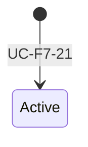

🏠 [Specs](../../../README.md) › 🧩 [Functional capabilities](../../README.md) ›
📦 [F7 Purchasing and stock](../README.md) › 🗃️ [Data](README.md) › 🗃️ E-F7-06 Item

# 🗃️ E-F7-06 Item

**Status:** ✅ specified

## Purpose

A item in purchasing and stock.

## Fields

| Name | Type | Required | Validation | Default | Example | Personal data | Custom fields |
|---|---|---|---|---|---|---|---|
| name | text | yes | - | - | Cable 3G2.5 | no | yes |
| kind | stocked, consumable, service, kit | yes | - | stocked | stocked | no | no |
| tracking | none, lot, serial | yes | - | none | lot | no | no |
| expiry times | best before, removal, alert | no | - | - | - | no | no |
| units | unit and purchase unit | yes | conversion | unit | m, 100 m reel | no | no |
| category | category | yes | costing method (BR-F7-07) | - | Electrical | no | no |

## Relations

As its use cases.

## Lifecycle

## Indexes and search

By number, item, location, date.

## Retention

Accounting documents 10 years (Code de commerce L123-22); moves kept (BR-F7-05). See
[CR-FR-002 Accounting records kept 10 years](../../../10-country-packs/france/accounting/cr-fr-002-accounting-records-kept-ten-years.md).

## Audit

Every change.

## Import and export

CSV import and export.

## Used by

- [UC-F7-03](../use-cases/02-receive-and-store/uc-f07-03-receive-goods.md)
- [UC-F7-05](../use-cases/03-replenish/uc-f07-05-replenish-stock.md)
- [UC-F7-06](../use-cases/04-pick-pack-and-ship/uc-f07-06-pick-pack-and-ship.md)
- [UC-F7-09](../use-cases/02-receive-and-store/uc-f07-09-value-stock-and-landed-costs.md)
- [UC-F7-11](../use-cases/05-count-trace-and-analyse/uc-f07-11-analyse-stock.md)
- [UC-F7-21 Set safety stock and min/max per item](../use-cases/03-replenish/uc-f07-21-set-safety-stock-and-min-max-per-item.md)
- [UC-F7-22 Charge and declare packaging eco-contributions](../use-cases/09-compliance-and-carbon/uc-f07-22-charge-and-declare-packaging-eco-contributions.md)

## Open questions

None.

---

⬅️ [E-F7-05 Supplier invoice](e-f07-05-supplier-invoice.md) · ⬆️ [Up](README.md) ·
➡️ [E-F7-07 Location](e-f07-07-location.md)
