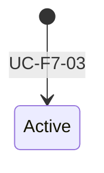

🏠 [Specs](../../../README.md) › 🧩 [Functional capabilities](../../README.md) ›
📦 [F7 Purchasing and stock](../README.md) › 🗃️ [Data](README.md) › 🗃️ E-F7-07 Location

# 🗃️ E-F7-07 Location

**Status:** ✅ specified

## Purpose

A location in purchasing and stock.

## Fields

| Name | Type | Required | Validation | Default | Example | Personal data | Custom fields |
|---|---|---|---|---|---|---|---|
| warehouse | warehouse | yes | - | - | Lyon | no | no |
| path | text | yes | unique | - | Lyon/A/03/2 | no | no |
| storage category | category | no | capacity | - | Heavy pallets, 1,000 kg | no | no |
| removal strategy | FIFO, LIFO, FEFO, closest, least packages | no | - | FIFO | FEFO | no | no |
| count frequency | days | no | - | 0 | 90 | no | no |

## Relations

As its use cases.

## Lifecycle

## Indexes and search

By number, item, location, date.

## Retention

Accounting documents 10 years (Code de commerce L123-22); moves kept (BR-F7-05). See
[CR-FR-002 Accounting records kept 10 years](../../../10-country-packs/france/accounting/cr-fr-002-accounting-records-kept-ten-years.md).

## Audit

Every change.

## Import and export

CSV import and export.

## Used by

- [UC-F7-03](../use-cases/02-receive-and-store/uc-f07-03-receive-goods.md)
- [UC-F7-06](../use-cases/04-pick-pack-and-ship/uc-f07-06-pick-pack-and-ship.md)
- [UC-F7-07](../use-cases/05-count-trace-and-analyse/uc-f07-07-count-stock.md)
- [UC-F7-13](../use-cases/03-replenish/uc-f07-13-set-up-warehouses-routes-and-rules.md)
- [UC-F7-23 Store dangerous goods with their safety data sheets](../use-cases/02-receive-and-store/uc-f07-23-store-dangerous-goods-with-their-safety-data-sheets.md)

## Open questions

None.

---

⬅️ [E-F7-06 Item](e-f07-06-item.md) · ⬆️ [Up](README.md) · ➡️ [E-F7-08 Route](e-f07-08-route.md)
