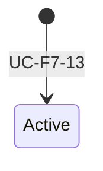

🏠 [Specs](../../../README.md) › 🧩 [Functional capabilities](../../README.md) ›
📦 [F7 Purchasing and stock](../README.md) › 🗃️ [Data](README.md) › 🗃️ E-F7-08 Route

# 🗃️ E-F7-08 Route

**Status:** ✅ specified

## Purpose

A route in purchasing and stock.

## Fields

| Name | Type | Required | Validation | Default | Example | Personal data | Custom fields |
|---|---|---|---|---|---|---|---|
| name | text | yes | - | - | Receive then store (2 steps) | no | no |
| rules | push and pull rules | yes | no loop | - | Input to Stock | no | no |
| applies to | item, category, warehouse, packaging | yes | - | warehouse | warehouse | no | no |

## Relations

As its use cases.

## Lifecycle

## Indexes and search

By number, item, location, date.

## Retention

Accounting documents 10 years (Code de commerce L123-22); moves kept (BR-F7-05). See
[CR-FR-002 Accounting records kept 10 years](../../../10-country-packs/france/accounting/cr-fr-002-accounting-records-kept-ten-years.md).

## Audit

Every change.

## Import and export

CSV import and export.

## Used by

- [UC-F7-13](../use-cases/03-replenish/uc-f07-13-set-up-warehouses-routes-and-rules.md)

## Open questions

None.

---

⬅️ [E-F7-07 Location](e-f07-07-location.md) · ⬆️ [Up](README.md) ·
➡️ [E-F7-09 Reordering rule](e-f07-09-reordering-rule.md)
