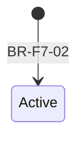

🏠 [Specs](../../../README.md) › 🧩 [Functional capabilities](../../README.md) ›
📦 [F7 Purchasing and stock](../README.md) › 🗃️ [Data](README.md) › 🗃️ E-F7-09 Reordering rule

# 🗃️ E-F7-09 Reordering rule

**Status:** ✅ specified

## Purpose

A reordering rule in purchasing and stock.

## Fields

| Name | Type | Required | Validation | Default | Example | Personal data | Custom fields |
|---|---|---|---|---|---|---|---|
| item | item | yes | - | - | Cable 3G2.5 | no | no |
| location | location | yes | - | - | Lyon/Stock | no | no |
| min, max, multiple | numbers | yes | min under max | - | 200, 1,000, 100 | no | no |
| trigger | automatic, manual | yes | BR-F7-02 | manual | manual | no | no |
| visibility days | number | no | - | 0 | 7 | no | no |

## Relations

As its use cases.

## Lifecycle

## Indexes and search

By number, item, location, date.

## Retention

Accounting documents 10 years (Code de commerce L123-22); moves kept (BR-F7-05). See
[CR-FR-002 Accounting records kept 10 years](../../../10-country-packs/france/accounting/cr-fr-002-accounting-records-kept-ten-years.md).

## Audit

Every change.

## Import and export

CSV import and export.

## Used by

- [UC-F7-05](../use-cases/03-replenish/uc-f07-05-replenish-stock.md)
- [UC-F7-13](../use-cases/03-replenish/uc-f07-13-set-up-warehouses-routes-and-rules.md)
- [UC-F7-21 Set safety stock and min/max per item](../use-cases/03-replenish/uc-f07-21-set-safety-stock-and-min-max-per-item.md)

## Open questions

None.

---

⬅️ [E-F7-08 Route](e-f07-08-route.md) · ⬆️ [Up](README.md) · ➡️ [E-F7-10 Lot or serial](e-f07-10-lot-or-serial.md)
