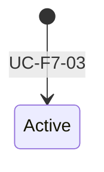

🏠 [Specs](../../../README.md) › 🧩 [Functional capabilities](../../README.md) ›
📦 [F7 Purchasing and stock](../README.md) › 🗃️ [Data](README.md) › 🗃️ E-F7-10 Lot or serial

# 🗃️ E-F7-10 Lot or serial

**Status:** ✅ specified

## Purpose

A lot or serial in purchasing and stock.

## Fields

| Name | Type | Required | Validation | Default | Example | Personal data | Custom fields |
|---|---|---|---|---|---|---|---|
| number | text | yes | unique per item | - | L2611 | no | no |
| item | item | yes | - | - | Cable 3G2.5 | no | no |
| expiry | dates | no | - | - | 2027-06-30 | no | no |
| moves | transfers | yes | traced | - | receipt, delivery to Durand SA | no | no |

## Relations

As its use cases.

## Lifecycle

## Indexes and search

By number, item, location, date.

## Retention

Accounting documents 10 years (Code de commerce L123-22); moves kept (BR-F7-05). See
[CR-FR-002 Accounting records kept 10 years](../../../10-country-packs/france/accounting/cr-fr-002-accounting-records-kept-ten-years.md).

## Audit

Every change.

## Import and export

CSV import and export.

## Used by

- [UC-F7-03](../use-cases/02-receive-and-store/uc-f07-03-receive-goods.md)
- [UC-F7-06](../use-cases/04-pick-pack-and-ship/uc-f07-06-pick-pack-and-ship.md)
- [UC-F7-08](../use-cases/05-count-trace-and-analyse/uc-f07-08-trace-lots-and-serials-recall.md)

## Open questions

None.

---

⬅️ [E-F7-09 Reordering rule](e-f07-09-reordering-rule.md) · ⬆️ [Up](README.md) ·
➡️ [E-F7-11 Stock count](e-f07-11-stock-count.md)
