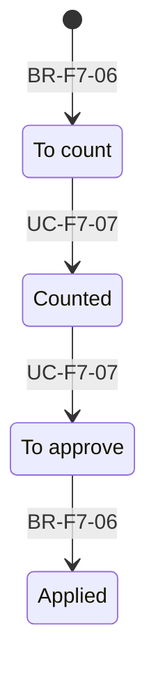

🏠 [Specs](../../../README.md) › 🧩 [Functional capabilities](../../README.md) ›
📦 [F7 Purchasing and stock](../README.md) › 🗃️ [Data](README.md) › 🗃️ E-F7-11 Stock count

# 🗃️ E-F7-11 Stock count

**Status:** ✅ specified

## Purpose

A stock count in purchasing and stock.

## Fields

| Name | Type | Required | Validation | Default | Example | Personal data | Custom fields |
|---|---|---|---|---|---|---|---|
| location | location | yes | - | - | Lyon/A/03 | no | no |
| lines | counted and expected | yes | - | - | 180 of 200 | no | no |
| state | to count, counted, to approve, applied | yes | BR-F7-06 | to count | applied | no | no |

## Relations

As its use cases.

## Lifecycle

## Indexes and search

By number, item, location, date.

## Retention

Accounting documents 10 years (Code de commerce L123-22); moves kept (BR-F7-05). See
[CR-FR-002 Accounting records kept 10 years](../../../10-country-packs/france/accounting/cr-fr-002-accounting-records-kept-ten-years.md).

## Audit

Every change.

## Import and export

CSV import and export.

## Used by

- [UC-F7-07](../use-cases/05-count-trace-and-analyse/uc-f07-07-count-stock.md)
- [UC-F7-11](../use-cases/05-count-trace-and-analyse/uc-f07-11-analyse-stock.md)

## Open questions

None.

---

⬅️ [E-F7-10 Lot or serial](e-f07-10-lot-or-serial.md) · ⬆️ [Up](README.md) ·
➡️ [E-F7-12 Landed cost](e-f07-12-landed-cost.md)
