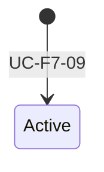

🏠 [Specs](../../../README.md) › 🧩 [Functional capabilities](../../README.md) ›
📦 [F7 Purchasing and stock](../README.md) › 🗃️ [Data](README.md) › 🗃️ E-F7-12 Landed cost

# 🗃️ E-F7-12 Landed cost

**Status:** ✅ specified

## Purpose

A landed cost in purchasing and stock.

## Fields

| Name | Type | Required | Validation | Default | Example | Personal data | Custom fields |
|---|---|---|---|---|---|---|---|
| invoice | supplier invoice | yes | - | - | Freight DHL | no | no |
| receipts | transfers | yes | - | - | 2 receipts | no | no |
| split | equal, quantity, value, weight, volume | yes | - | value | weight | no | no |

## Relations

As its use cases.

## Lifecycle

## Indexes and search

By number, item, location, date.

## Retention

Accounting documents 10 years (Code de commerce L123-22); moves kept (BR-F7-05). See
[CR-FR-002 Accounting records kept 10 years](../../../10-country-packs/france/accounting/cr-fr-002-accounting-records-kept-ten-years.md).

## Audit

Every change.

## Import and export

CSV import and export.

## Used by

- [UC-F7-09](../use-cases/02-receive-and-store/uc-f07-09-value-stock-and-landed-costs.md)

## Open questions

None.

---

⬅️ [E-F7-11 Stock count](e-f07-11-stock-count.md) · ⬆️ [Up](README.md) ·
➡️ [E-F7-13 Call for tenders](e-f07-13-call-for-tenders.md)
